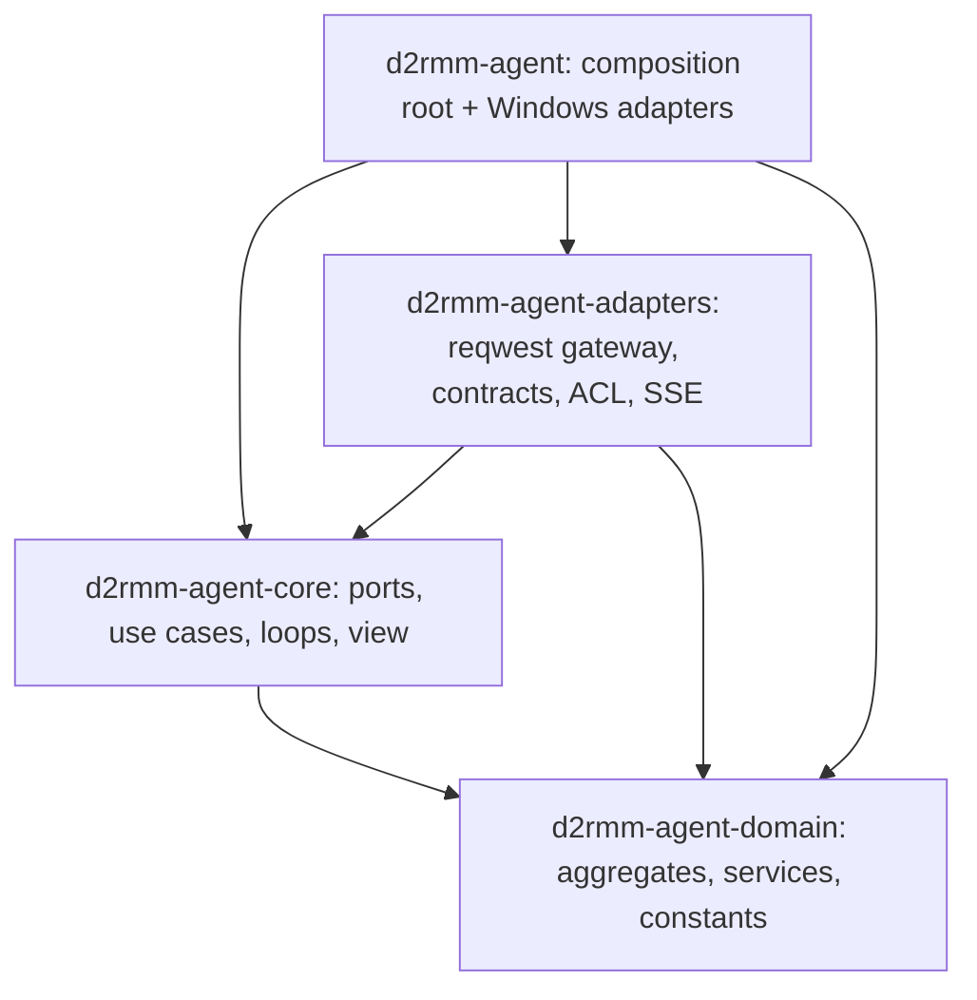

# Agent Hexagonal Migration Design

**Spec**: `.specs/features/agent-hexagonal-migration/spec.md`
**Status**: Approved (revision 3; architecture-reviewer PASS on the third review, security-reviewer PASS on revision 2)

---

## Architecture Overview

The agent becomes the three layers of ADR 027, with Cargo crate boundaries deciding the dependency direction:

| Layer       | Crate                         | Holds                                                                                                                                                                                                         |
| ----------- | ----------------------------- | ------------------------------------------------------------------------------------------------------------------------------------------------------------------------------------------------------------- |
| domain      | `d2rmm-agent-domain` (new)    | `Pairing`, `PairedDevice`, `RoomAssignment`, `ObservationRetry`, `Reconnect`, `fuse`, `Presence`, the vision region rule, their value objects, the timing constants, their errors                              |
| application | `d2rmm-agent-core` (existing) | ports, the use cases (pair, beat, follow the stream, post an observation, check for an update, read a frame), the loops that schedule them, `Runtime`, the view model, `Secret`, the loop spans                |
| adapters    | `d2rmm-agent-adapters` (new)  | the `reqwest` gateway and its `agent.http.*` spans, the generated contracts, the translation (ACL), the SSE parser and its limits, `ApiBase`, telemetry bootstrap, and the HTTP integration tests with their fake API |
| root        | `d2rmm-agent` (app, existing) | composition root, and the Windows and Tauri adapters: Credential Manager, toolhelp, Windows OCR, updater, window, system clock and ids                                                                        |

`adapters → application → domain`; nothing points the other way. `d2rmm-agent-adapters` and the app crate do not depend on each
other (ADR 027 table: adapters must not depend on each other); the app crate depends on both and wires them.

### Approaches considered (Large/Complex)

| Approach                                                                      | For                                                                                                                         | Against                                                                                                                                                         |
| ----------------------------------------------------------------------------- | --------------------------------------------------------------------------------------------------------------------------- | --------------------------------------------------------------------------------------------------------------------------------------------------------------- |
| A. HTTP adapter in the app crate (ADR 027 default)                            | One crate fewer                                                                                                             | Every HTTP integration test (`core/tests`, ~1 700 lines with the fake API) would need the Tauri crate to compile; each step rebuilds Tauri (brief risk a)      |
| **B. New `d2rmm-agent-adapters` crate for the portable adapters** (chosen)    | Gateway, contracts and fake-API tests compile without Tauri or Windows crates; steps stay cheap                              | One more workspace member; the app crate keeps only what needs Tauri, keyring or windows                                                                         |
| C. Modules inside `core` plus an import lint                                  | Cheapest move                                                                                                               | Rejected by ADR 027: the compiler would accept `use tokio::…` in `domain/`                                                                                       |

**Chosen: B** (ADR 027 open point 2 leaves the placement to this Design; AD-081). ADR 027's Enforcement paragraph says "Adapters stay
in the app crate" while its Consequences and open point 2 allow this crate; a one-line clarification of the ADR is queued for the
maintainer in `decisions.md` (changing an accepted ADR is an escalation, so it is not edited here).

---

## Where every current module goes

| Today (`core/src`)                                | After                                                                                                                                                                                                                       |
| ------------------------------------------------- | --------------------------------------------------------------------------------------------------------------------------------------------------------------------------------------------------------------------------- |
| `pairing.rs` rules                                | domain `pairing.rs` (`Pairing`); `Command` and the loop/`show_code` flow → core `pair.rs`                                                                                                                                   |
| `context.rs` (`Context`, `Hub`, `Adapters`)       | split: aggregate effects → domain `PairedDevice`; `Hub` → core `hub.rs`; watch channels + aggregate → core `DeviceState`; `Adapters` replaced by per-loop port groups (below)                                              |
| `stream.rs` delay rules                           | domain `Reconnect`; `SseParser`, `valid_game_name`, `valid_last_event_id`, `IDLE_TIMEOUT`, `MAX_EVENT_BYTES`, `handle` → adapters `http/sse.rs`; the loop → core `follow_stream.rs`                                         |
| `observations.rs` rules                           | domain `ObservationRetry`; `send` flow → core `post_observation.rs`                                                                                                                                                         |
| `fusion.rs`                                       | domain `fuse` (+ `GameNameObservation`)                                                                                                                                                                                     |
| `heartbeat.rs`                                    | `game_running`, `GAME_PROCESS` → domain `presence.rs`; `beat` loop → core `beat.rs`; `heartbeat_body` (a contract type) → adapters ACL                                                                                      |
| `updates.rs`                                      | `CHECK_EVERY` → domain constant; `view_after` (an `UpdateView` rule) and the loop → core `check_update.rs`; `Updater` (the object-safe wrapper around `UpdateChecker`) stays in core, explicit and documented               |
| `vision.rs`                                       | `AUTOMAP_NAME_1080P` and `region_for` (AD-047 rule) → domain `vision.rs` with `Region`; `read_game_name` (uses `TextReader` and a span) → core `read_frame.rs`. `xtask/src/fixture.rs` imports the constant from the domain  |
| `ports.rs`                                        | ports stay in core; `Region` and `ReadText` move to the domain (value objects); `Rgba` stays in core (an image buffer is not a rule); `PausedWallClock`, `SequentialIds` stay in core as the test fakes                    |
| `api_client.rs`                                   | adapters `http/api_client.rs` (`ApiClient`, unchanged: contract-typed, same requests, headers, `Retry-After` clamp) plus `http/gateway.rs` (`HttpGateway`, implements `ApiGateway` through the ACL); `ApiError` moves to core `ports.rs`                                                                                                                         |
| `contracts/`                                      | adapters `contracts/`; the typify output path and the `Secret` import change in `xtask`                                                                                                                                     |
| `config.rs`                                       | split: `Config { version }` stays in core; `ApiBase`, `AllowLoopbackHttp`, `ApiBaseError` → adapters                                                                                                                        |
| `secret.rs`                                       | stays in core (`Secret`, redacting `Debug`/`Display`, zeroize, and the `expose` serializer the generated types use)                                                                                                         |
| `telemetry.rs`                                    | `init`, `Mode`, `traceparent_for` → adapters (they need `opentelemetry` and `tracing-subscriber`)                                                                                                                           |
| `view.rs`, `runtime.rs`                           | stay in core; `Runtime::start` changes its parameters                                                                                                                                                                       |
| `src/adapters/http.rs` (client builder), `src/config.rs` | client builder → adapters `http/client.rs`; the app keeps the rule that only a debug build accepts loopback HTTP and its test (see Risks)                                                                              |

---

## Code Reuse Analysis

### Existing Components to Leverage

| Component                              | Location                                                               | How to Use                                                                                                                     |
| -------------------------------------- | ---------------------------------------------------------------------- | ------------------------------------------------------------------------------------------------------------------------------ |
| Pure rules already extracted (ADR 026) | `pairing.rs`, `stream.rs`, `observations.rs`, `heartbeat.rs`, `fusion.rs`, `vision.rs` | Move into the domain as methods and functions with their unit tests; loops keep I/O and scheduling                              |
| Ports and in-memory fakes              | `core/src/ports.rs`, `core/tests/support/fakes.rs`                      | Stay in core; add `ApiGateway`                                                                                                 |
| Fake API server and harness            | `core/tests/support/*.rs`, `core/tests/*.rs`                            | Move to `adapters/tests/` where the real gateway lives (AD-082)                                                                |
| Architecture-test pattern              | `scripts/test/agent-source-rules.test.mjs`, `arch-fixtures.test.mjs`    | Same pattern for `agent-architecture.test.mjs`                                                                                 |
| typify generator                       | `xtask/src/lib.rs`                                                      | Output path moves to `adapters/src/contracts/generated.rs`; the secret fields point at `d2rmm_agent_core::secret::{Secret, expose}` (one mechanism, kept) |
| Mutation scope                         | `.cargo/mutants.toml`, `nightly.yml`                                    | Extended below                                                                                                                  |

### Integration Points

| System                        | Integration Method                                                                                                                      |
| ----------------------------- | --------------------------------------------------------------------------------------------------------------------------------------- |
| API (HTTP, SSE)               | Unchanged wire. The gateway is the only code that builds requests; the JSON Schemas are untouched                                        |
| CI `agent` job, nightly       | Runs `--workspace`; the new crates join it; `nightly.yml` gains the domain and adapters packages with `-- --lib`                         |
| Harness (`pnpm test:harness`) | New `agent-architecture.test.mjs`; `agent-source-rules`, `agent-mutation-scope`, `mutation-scope` tests extended to all four crates      |

---

## Components

### Domain: `d2rmm-agent-domain`

Dependencies: `thiserror`, `chrono` (`default-features = false`), `uuid` (default features off). Nothing else: no `serde`, `tracing`, `zeroize`. `#![forbid(unsafe_code)]`.
Time and ids enter as arguments. The domain never holds a secret: the claim secret and the token are application values (`Secret`), so the domain needs no
zeroize or redaction (answers security finding 2).

**Constants** (`timings.rs`, AHM-13): `HEARTBEAT_INTERVAL` 15 s, `OFFLINE_AFTER` 45 s (AD-079), `CLAIM_INTERVAL` 2 s, `UNREACHABLE_RETRY` 15 s, `RATE_LIMIT_DEFAULT` 60 min,
`UNUSED_LIMIT` 2, `PAIRING_CODE_DIGITS` 6 (mirrors the contract's `^\d{6}$`, replaces nothing), `OBSERVATION_RETRY_DELAYS` [1, 2, 4, 8] s, `RECONNECT_MIN` 1 s,
`RECONNECT_MAX` 60 s, `RESET_AFTER_OPEN` 60 s, `CHECK_EVERY` 6 h, `GAME_PROCESS` `D2R.exe`. `IDLE_TIMEOUT` and `MAX_EVENT_BYTES` stay in the SSE adapter (protocol limits).

**`Pairing`** (AHM-07): holds the code's expiry, the consecutive unused count and the pause.
- `Pairing::new()`, `show(&mut self, code: PairingCode, expires_at: DateTime<Utc>)`
- `claim_result(&mut self, outcome: ClaimOutcome) -> ClaimNext`: `Pending` → claim again after `CLAIM_INTERVAL`; `Gone` counts as an expiry; `Unauthorized` resets the unused count to 0; `Unreachable` → wait `UNREACHABLE_RETRY`; `Claimed` → done
- `expired(&mut self) -> CodeNext` (`NewCode` or `Pause` at `UNUSED_LIMIT`), `rate_limited(retry_after: Option<Duration>) -> Duration` (`RATE_LIMIT_DEFAULT` when absent; the 1..3600 s clamp stays in the gateway), `minutes_left(remaining: Duration) -> u8`, `remaining_until(expires_at, now) -> Duration`
- `PairingCode`: six ASCII digits, validated on construction. The claim secret is not here: the pair use case keeps it as a core `Secret` next to the aggregate.

**`PairedDevice`** (AHM-08): the pairing state and the consequence of what the API says about the token and version.
- `unpaired()`, `paired()`; `on_unauthorized(&mut self) -> Vec<DeviceEffect>` = `[ForgetToken, ClearRoom, DropPendingRetries, AskNewCode]`;
  `on_upgrade_required(&mut self) -> Vec<DeviceEffect>` = `[RequireUpdate, DropPendingRetries, CheckForUpdateNow]`; `update_installed()`
- `api_allowed()`, `pairing_allowed()`, `retry_epoch() -> u64` (bumped by both effects lists above, the `epoch` of `Context` today)
- `DeviceEffect` is a domain enum; core applies each one to its ports, `Hub` and `watch` channels. A unit test pins the exact effect list and order for a 401 and a 426.

**`RoomAssignment`** (AHM-09): `empty()`, `receive(&mut self, Assignment) -> bool` (latest wins), `clear()`, `current() -> Option<&Assignment>`.
`Assignment { room: RoomId, run: NonZeroU64, expected_game_name: GameName, members: Vec<Member> }`; `RoomId` and `GameName` are opaque strings (no validation added): the stream path keeps the check it
has today (`valid_game_name`: 1..=32 of `[A-Za-z0-9-]`) in the SSE adapter, and the GET path keeps accepting what it accepts today. The ADR 017 room-name shape is not enforced (that would change behaviour).

**`ObservationRetry`** (AHM-10): `new(epoch)`, `after_failure(&mut self, error: PostFailure) -> Wait` (`For(Duration)` 1, 2, 4, 8 s, or `Drop`; `Drop` on a non-retryable failure or after the fifth failed attempt),
and `after_sleep(&self, current_epoch: u64) -> Retry` (`Again` or `Drop` when a 401 or 426 moved the epoch while it slept, AD-051). Two calls, because today the epoch is checked after the sleep.

**`Reconnect`** (AHM-11): `new()`, `delay(&self) -> Duration`, `slept(&mut self)` (doubles after a completed sleep, to at most 60 s; an interrupted sleep does not call it),
`opened_for(&mut self, open: Duration)` (reset to `RECONNECT_MIN` when the stream stayed open at least `RESET_AFTER_OPEN`). Pins today's `delay_after_open` / `next_delay` behaviour.

**`fuse`** (AHM-12): `fuse(read: &ReadText, assignment: &Assignment, now: DateTime<Utc>, key: impl FnOnce() -> Uuid) -> Option<GameNameObservation>`; the key is drawn only on a match (so
`SequentialIds` numbering is unchanged). Exact match after trim and lower-case; text normalised; confidence clamped to [0, 1], NaN as 0. `ReadText` and `Region` live in the domain.
"Room id not a UUID": `fuse` parses `assignment.room` into a `Uuid` and yields `None` when it is not one (today's behaviour, AHM-12), pinned by a domain unit test. `GameNameObservation.room` is a `Uuid`.

**`presence`** (AHM-12 neighbour): `game_running(names: &[String]) -> bool` (`D2R.exe`, ASCII case-insensitive, AD-077); `Presence { game_running, screen }`.

**`vision`**: `AUTOMAP_NAME_1080P: Region`, `region_for(width, height) -> Option<Region>` (AD-047).

### Application: `d2rmm-agent-core`

Dependencies: `d2rmm-agent-domain`, `chrono`, `uuid`, `tokio` (sync, time, rt, macros), `tracing`, `thiserror`, `zeroize`, `serde` (for `Secret` and the view only). No
`reqwest`, `serde_json`, `opentelemetry*`, `tracing-opentelemetry`, `tracing-subscriber`, `regress`, `url`, `tauri`, `keyring`, `windows`.

- **Ports** (`ports.rs`): `TokenStore`, `ProcessSource`, `TextReader`, `UpdateChecker`, `IdGenerator`, `WallClock`, `StateSink`, plus `ApiGateway`:
  - `request_code() -> Result<IssuedCode, ApiError>`; `IssuedCode { code: PairingCode, expires_at, claim_secret: Secret }` is a core type (`Debug` redacts, covered by a test)
  - `claim(&Secret) -> Result<Secret, ApiError>`; `heartbeat(&Secret, &Presence, version) -> Result<(), ApiError>`
  - `assignment(&Secret) -> Result<Option<Assignment>, ApiError>` (404 → `None`)
  - `post_observation(&Secret, &GameNameObservation) -> Result<(), ApiError>`
  - `open_stream(&Secret, last_event_id: Option<&str>) -> Result<Box<dyn EventStream>, ApiError>`
  - The port error keeps today's name and variants, **`ApiError`** (`Unauthorized`, `UpgradeRequired`, `RateLimited { retry_after }`, `Gone`, `Pending`, `Server`, `Network`, `Invalid`), defined in core `ports.rs` (no `reqwest`), so the ~14 `ApiError::…` assertions of `api_client.rs` keep their text. Its variants carry no
    response body, header, URL or token; a core test pins that `Debug` and `Display` of every variant contain none.
  - `EventStream`: `async fn next(&mut self) -> StreamItem` and `fn last_event_id(&self) -> Option<&str>`. `StreamItem` is `RoomAssigned(Assignment)` or `Ended(EndReason)` with `EndReason` = `Closed`, `Idle`, `Failed(ApiError)`. There is
    no "cleared" item: the contract has only `room.assigned`, and unknown or invalid events are skipped inside the adapter. `next` is cancel-safe (all parser state is in `self`, one cancel-safe chunk read per await), because the
    follow-stream use case races it against `wait_until_closed`. The loop reads `last_event_id()` and passes it back on reconnect.
- **State**: `DeviceState` holds the `PairedDevice`, `RoomAssignment`, the `watch` channels that wake loops, the dropped-observation counter and the `Hub`. The `Hub` owns the `StateSink` (the single owner; no group repeats it). `DeviceState` holds no other port.
  Each use case receives `DeviceState` plus only the ports it uses. `ForgetToken` needs `tokens`, which every group that can see a 401 has (pairing, heartbeat, stream, read).
- **Per-loop port groups** replace `Adapters` (AHM-17): `PairingPorts { gateway, tokens, clock }`, `HeartbeatPorts { gateway, tokens, processes }`, `StreamPorts { gateway, tokens }`, `UpdatePorts { updater }`,
  `ReadPorts { reader, ids, clock, gateway, tokens }` (exactly five; it is not widened). `Runtime::start(config, sink, pairing, heartbeat, stream, update, read) -> Handle`; none of the groups holds all ports. The app crate builds each group.
  `agent-architecture.test.mjs` fails when a struct in core has more than five port fields.
- **Test probe** (AD-082): `Runtime::start_with_probe(…) -> (Handle, Probe)` is a second entry point only the tests call; `Runtime::start` returns the `Handle` alone. `Probe` holds read-only fields that keep the text of the asserting lines
  (`update_required: watch::Receiver<bool>`, so `*h.ctx.update_required.borrow()` compiles; `dropped_observations()`) and the mutators the act lines use (`paired.send_replace` becomes `set_paired(bool)`, `set_assignment(…)`, `on_unauthorized()`, `on_upgrade_required()`).
  The shipped `Handle` has no mutator. `agent-architecture.test.mjs` fails when any source or manifest of the app crate mentions `Probe` or `start_with_probe`, so the production binary cannot forge `paired` or an assignment. No cargo feature is added (the AGS-01 rule that
  core has no `[features]` table stays).
- **In-memory fakes in core**: a `FakeApiGateway` (scripted responses, recorded calls, a scripted `EventStream`) beside `FakeClock`-style fakes. The use cases (`pair`, `beat`, `follow_stream`, `post_observation`, `check_update`, `read_frame`) get colocated `--lib` unit tests against
  it (paused tokio time). These are the proofs a mutant of a core flow module must fail (ADR 026, rule 12); the integration tests in the adapters crate are not mutation proofs. A use-case test pins that `ObservationRetry` also honours the `sleep_while_allowed` result
  (today: `!still_allowed || epoch != epoch`).
- **Starting one loop and outcome types**: the use-case `run` functions are public so a test can start a single loop (`heartbeat::run`, `stream::run`, `updates::run`, `pairing::run`) as the tests do today; `start_with_probe` starts all four. `SendOutcome` stays a core type with its
  variants (the `SendOutcome::Dropped` assertions depend on it). `Probe` also exposes the current assignment for the test helper that reads it, and the domain `GameName` offers `as_str()`.
- **Spans**: the loop and use-case spans (`agent.pairing.claim`, `agent.heartbeat`, `agent.stream.connect`, `agent.observation.post`, `agent.update.check`, `agent.vision.read`) stay in core, as today; the domain emits none. The HTTP-call spans
  `agent.http.*`, which record the response `status`, stay in the gateway adapter because they describe the HTTP call and core does not know HTTP statuses (AD-083).
- `Config { version }` only; the `api_base` field moves with `ApiBase`.

### Adapters: `d2rmm-agent-adapters`

Dependencies: `d2rmm-agent-core`, `d2rmm-agent-domain`, `reqwest`, `serde`, `serde_json`, `regress`, `url`, `tokio`, `tracing`, `chrono`, `uuid`, `thiserror`, `opentelemetry`, `opentelemetry_sdk`, `tracing-opentelemetry`,
`tracing-subscriber`. Dev: `axum`, `jsonschema`, `tokio-stream`, `tokio` test-util. No `tauri`, `keyring`, `windows`.

- `contracts/generated.rs` (typify output); `http/api_client.rs`: **`ApiClient` stays as it is today** (contract-typed, one method per route, same requests, headers, `Retry-After` clamp and `traceparent`, returning core's `ApiError`), so the `api_client.rs` tests keep every assertion,
  including `serde_json::to_value(&present)` on the contract `Assignment`; `http/gateway.rs`: `HttpGateway` wraps an `ApiClient` and implements `ApiGateway` by translating; `http/translate.rs` (the ACL); `http/sse.rs`; `http/client.rs`; `config.rs`; `telemetry.rs`.
- ACL: `contracts::Assignment` ⇄ domain `Assignment`, `PairingCodeResponse` → `IssuedCode`, `Presence` → `Heartbeat`, `GameNameObservation` → `Observation`. The ACL does not add a check the code lacks today: the GET path keeps accepting what it accepts (a room id the contract
  allows, even a non-UUID one, is carried as an opaque `RoomId`; `fuse` refuses it later, as today). A number the domain types narrower than the contract (`run` as `NonZeroU64`, as the contract has it) is carried unchanged. `translate.rs` is a pure rule module with colocated unit tests and is in the mutation scope.
- `tests/`: the files of `core/tests/` and `tests/support/`, with the stream tests that pin the idle timeout, the oversize event, reconnect on a timeout and `valid_last_event_id`, and one test per invalid-body path (GET assignment → `Invalid`; a stream event → skipped).

### Composition root: `d2rmm-agent` (app crate)

Builds `HttpGateway` (the client from the adapters crate) and the Windows adapters, hands them to `Runtime::start` as the five groups. Only it depends on `tauri`, `keyring`, `windows`. After M1b its manifest drops `reqwest`, so a
`danger_*` call cannot be written there (the clippy ban still applies workspace-wide). Its `src/config.rs` keeps the rule that only a debug build accepts loopback HTTP, with a test that names it.

---

## Data Models

Domain value types (no serde): `PairingCode`, `Assignment`, `GameName`, `Member`, `GameNameObservation { room, run, key, game_name, confidence, captured_at }`, `Presence`, `Screen { Unknown, AutomapOpen }`, `Region`, `ReadText`.
Core types: `Secret`, `IssuedCode`, `ApiError`, `StreamItem`, `EndReason`. Wire shapes stay in `contracts::generated` and never leave the adapters.

---

## Migration Steps (each ends green; one aggregate per step; each task is one commit)

| Step | Moves                                                                                                                                                                                                                                       | Closes                        |
| ---- | ------------------------------------------------------------------------------------------------------------------------------------------------------------------------------------------------------------------------------------------- | ----------------------------- |
| M0   | Domain crate with the constants and their pin tests; domain `clippy.toml`; `agent-architecture.test.mjs` with fixtures; `AGENTS.md`, `.cursor/rules/agent-rust.mdc`; workspace and CI wiring                                                | AHM-01, 04, 05, 06, 13        |
| M1a  | Inside core, still with `reqwest`: the message types (they live in core in this step and move to the domain in M2, M3 and M5, the port signatures following), the `ApiGateway` port and `ApiError` in `ports.rs`, `HttpGateway` wrapping the unchanged `ApiClient` with the ACL, `FakeApiGateway`; every loop switches to the port; `start_with_probe`/`Probe`; per-loop port groups replace `Adapters` (`Context` stays for now) | AHM-16 (port), 17 (groups)    |
| M1b  | Pure move: `HttpGateway`, `contracts`, `ApiBase`, telemetry, SSE parser, client builder, `core/tests` → adapters crate; `xtask` paths; `core` loses `reqwest`; app manifest drops `reqwest`; harness tests repointed and extended          | AHM-02, 03, 14, 16, 20        |
| M2   | `RoomAssignment`, `Assignment`, `GameName`, `vision` rule, `Region`, `ReadText` to the domain                                                                                                                                               | AHM-09                        |
| M3   | `Pairing` and `PairingCode`                                                                                                                                                                                                                 | AHM-07                        |
| M4   | `PairedDevice`; `Context` removed in favour of `DeviceState` + per-use-case ports                                                                                                                                                           | AHM-08, 17, 19                |
| M5   | `ObservationRetry`, `Reconnect`, `fuse`, `presence`                                                                                                                                                                                         | AHM-10, 11, 12                |
| M6   | `mutants.toml`, `nightly.yml`, mutation-scope tests, win-check paths, boundary-fixtures                                                                                                                                                      | AHM-22, 23, 24, 25            |
| M7   | Both sides of every boundary (AHM-15), core spans test (AHM-18), composition-root rule (AHM-19), the full gate                                                                                                                              | AHM-15, 18, 19, 21, 22        |

### Mutation scope (AHM-23, 24, 25; AD-080)

"Rule modules" are the modules of today's `.cargo/mutants.toml`, mapped to their new homes: `pairing` → `domain/pairing.rs`, `core/pair.rs`; `fusion` → `domain/fusion.rs`; `stream` → `domain/reconnect.rs`, `adapters/http/sse.rs`,
`core/follow_stream.rs`; `updates` → `core/check_update.rs`; `observations` → `domain/observation_retry.rs`, `core/post_observation.rs`; `api_client` → `adapters/http/api_client.rs`, `adapters/http/translate.rs`; `heartbeat` → `domain/presence.rs`, `core/beat.rs`; plus all of
`domain/src/`. A core flow module is in scope only because it has colocated `--lib` use-case tests against `FakeApiGateway` (see Components); the adapters' integration tests are never a mutation proof. The nightly job runs `cargo mutants` for `d2rmm-agent-domain`, `d2rmm-agent-core` and `d2rmm-agent-adapters`, each with `-- --lib` (the adapters' proofs are the unit tests colocated in `src/`, not `tests/`).
`agent-mutation-scope.test.mjs` and `scripts/test/agent-source-rules.test.mjs` get the new list.

### The moved integration tests (AD-082)

The assertion lines (`assert*` statements, including their multi-line forms) of the files under `core/tests/` stay byte-identical from M1a to the end; `use` lines, harness construction and act lines (`h.ctx.paired.send_replace(true)` becoming `h.ctx.set_paired(true)`,
`pairing::run(ctx, …)` becoming a call on the new use case) may change. The proof is a harness check that compares the multiset of assertion lines of those files (found by `git diff -M` against the commit that approved the spec, `b1519d6`) and fails on any added or removed line;
it runs on **every** task commit that touches these files, not only on the move. The assertions that read internals today are few and each has a stated landing: `h.ctx.dropped_observations()` (a `Probe` method), `*h.ctx.update_required.borrow()` in `observations.rs` and `updates.rs` (a read-only
`Probe` field of type `watch::Receiver<bool>`), `ApiError::…` in `api_client.rs` (the port error keeps the name `ApiError`), and `serde_json::to_value(&present)` (the test calls the unchanged contract-typed `ApiClient`, so `present` is still the contract `Assignment`). If a task finds an assertion that
cannot keep its text it stops and reports a blocker; it never edits the assertion, and the maintainer decides.

---

## Test Strategy

- Domain and application rules: colocated unit tests, `cargo nextest run -p <crate> --lib` (ADR 026). Domain tests cover both sides of every boundary (AHM-15). Secret hygiene: a core test that `Debug`/`Display` of `Secret` and `IssuedCode` never contain the value;
  the test that builds contract bodies and checks no secret leaks moves to the adapters crate.
- HTTP behaviour: the moved integration tests drive `Runtime` with `HttpGateway` against the fake API. Use-case behaviour (mutation proofs): `--lib` tests in core against `FakeApiGateway`.
- Architecture: `scripts/test/agent-architecture.test.mjs` reads each crate's `Cargo.toml` and `src/**/*.rs`. Dependency names match by family prefix, so `windows-sys` and `tauri-plugin-*` cannot slip in. It forbids `tokio*`, `reqwest*`, `tauri*`, `keyring*`, `windows*`, `serde*`, `tracing*`, `zeroize*` and `generated` in the domain; `reqwest*`, `tauri*`, `keyring*`, `windows*`, `serde_json`,
  `opentelemetry*` and `contracts::generated` in core; `tauri*`, `keyring*`, `windows*` in adapters; `reqwest*` in the app crate; a dependency of adapters on the app crate or the reverse; a struct in core with more than five port fields; any mention of `Probe` or `start_with_probe` in the app crate;
  and it requires `#![forbid(unsafe_code)]` in the domain, core and adapters, and no use of `std::process` or `tokio::process` there. One failing fixture per rule under `scripts/test/fixtures/agent-architecture/<rule>/`. The fixtures for the adapters-crate rules rely on the one-line ADR 027 clarification queued
  for the maintainer; until then they test the layout this Design chose (AD-081).
- Clippy: the domain crate has its own `clippy.toml`. Clippy reads only the nearest file, so it repeats every entry of the root `clippy.toml` and adds `Instant`, `SystemTime::now`, `Utc::now`, `Local::now`, `Uuid::new_v4`; the architecture test asserts it is a superset
  of the root list (so the ADR 010 bans cannot be lost in the domain), and `agent-source-rules.test.mjs` checks both files.
- Windows adapters: `node scripts/agent/win-check.mjs` (AD-071).

---

## Risks & Concerns

| Concern                                                                                                                                             | Mitigation                                                                                                                                                                                                                      |
| --------------------------------------------------------------------------------------------------------------------------------------------------- | ------------------------------------------------------------------------------------------------------------------------------------------------------------------------------------------------------------------------------- |
| AHM-20 names `core/tests/`; the tests move because `core` loses `reqwest`                                                                           | AD-082: assertion lines byte-identical on every commit that touches those files (harness check against `b1519d6`); `Probe`, the `ApiError` name and the unchanged contract-typed `ApiClient` keep the internals-reading lines unchanged; a task that cannot comply stops and reports                                                  |
| M1 was too large to stay green                                                                                                                      | Split: M1a keeps `reqwest` in core and converts the loops to the port; M1b is a pure move. No intermediate state needs a core → adapters edge                                                                                   |
| `.claude/hooks/test/mutation-gate.test.mjs` and `.claude/settings.json` mention the core path                                                       | Maintainer-owned: the gate asks. If an edit is needed the runner records an escalation and does not route around it                                                                                                              |
| `xtask` regenerates the contracts and its test compares to the committed file                                                                       | M1b changes the output path and the import in the same task; `contracts_are_current` stays the proof (AGS-03); `xtask/src/fixture.rs` imports the vision constant from the domain                                                |
| Tauri rebuild cost per step                                                                                                                         | M2…M6 run `-p d2rmm-agent-domain`, `-p d2rmm-agent-core`, `-p d2rmm-agent-adapters`; only M1b and M7 build the app crate                                                                                                         |
| Windows-only adapters cannot be built on a macOS worker                                                                                             | Unchanged from agent-skeleton: `win-check.mjs` (AD-071) and the `agent` CI job on `windows-latest`                                                                                                                               |
| Behaviour drift in effects and timings                                                                                                              | Pinned by unit tests: the effect list and order of a 401 and a 426; `Reconnect` doubling only after a completed sleep; `ObservationRetry` checking the epoch after the sleep; `fuse` drawing a key only on a match                |
| Silent loss of a limit when the stream moves behind `EventStream`                                                                                    | The idle timeout, oversize event, reconnect-on-timeout and last-event-id tests move to the adapters and are listed in the moved set                                                                                              |
| A per-crate `clippy.toml` replaces the root file                                                                                                    | The domain file repeats the root entries; the architecture test asserts the superset                                                                                                                                             |

## Conformity

- ADR 003/004 (layering): same direction and public-API rule as the backend modules. ADR 010 and `cargo deny`: the boundary applies to the new crates (workspace members). ADR 026: every proof is a unit test.
- ADR 027 open point 2 is settled here (AD-081). Rule 7 (spans in the application) holds for the agent's own spans; `agent.http.*` stay with the HTTP call (AD-083). No accepted ADR is changed.
