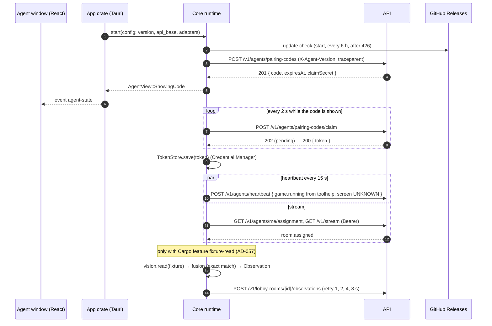

# Agent Skeleton Design

**Spec**: `.specs/features/agent-skeleton/spec.md`
**Status**: Draft

---

## Architecture Overview

A Tauri 2 app for Windows. All behaviour lives in a Rust **core** library crate with no Tauri dependency (AGS-01),
built around ports so every rule runs under `cargo nextest` with a paused Tokio clock and a contract-faithful fake
API. The **app** crate is a thin Tauri shell: it builds the real adapters (HTTP, Windows Credential Manager,
toolhelp, Windows OCR, Tauri updater), starts the core's runtime and forwards the core's state to the React window as
one typed event. The React UI only renders that state through translation keys and sends one command ("Get a new
code"). The server side is `api-web-skeleton`; this feature consumes its JSON Schemas (AD-035) and executes after it
is merged into `phase/F0`.



### Approaches considered (all deliver the same scope)

| Approach                                                                           | Trade-off                                                                                                                                                          | Verdict         |
| ---------------------------------------------------------------------------------- | ------------------------------------------------------------------------------------------------------------------------------------------------------------------ | --------------- |
| **A. Core library crate with ports + thin Tauri app crate + render-only React UI** | Every rule is testable on any OS with `cargo nextest`; only the Windows adapters need `windows-latest`. Matches the Design Doc's "núcleo Rust faz todo o trabalho" | **Recommended** |
| B. One Tauri crate holding logic and adapters                                      | Fewer crates, but tests need the Tauri runtime and Windows; AGS-01 asks for a core crate with no Tauri dependency                                                  | Rejected        |
| C. Logic in the TypeScript UI, Rust only for OS access                             | Contradicts the Design Doc and ADR 010's review story (the boundary is enforced by Rust lints and `cargo deny`)                                                    | Rejected        |

### Where the rules run

Every rule a user sees runs in the core crate and is tested with `cargo nextest` and mutated with `cargo-mutants`:
the pairing state machine (code shown, claim cadence, pause after two unused codes, 429 wait, 401 re-pair), the
"minutes left" rounding, heartbeat cadence and failure display, the update schedule and "Update required" gate,
stream event handling and reconnect backoff, fusion's exact match, observation retries, the request-header rules.
The core exposes one `AgentView` value; the UI maps it to translated strings with a pure function
(`apps/agent/src/shared/labels.ts`) tested by Vitest. The language rule (AD-054) is a pure function on
`navigator.language`, which WebView2 takes from the Windows display language.

---

## Code Reuse Analysis

### Existing Components to Leverage

| Component                | Location                                                     | How to Use                                                                                                                        |
| ------------------------ | ------------------------------------------------------------ | --------------------------------------------------------------------------------------------------------------------------------- |
| Agent JSON Schemas       | `packages/contracts/json-schema/*.json` (api-web-skeleton)   | Input of `typify`; this feature adds `claim-request.json` and emits draft-07 (AD-060), regenerating with `pnpm contracts:openapi` |
| `@d2rmm/agent` workspace | `apps/agent` (`package.json`, tsconfig, `src/index.ts`)      | Becomes the window's React UI (Vite); its `package.json` `version` is the single version source (AGS-04)                          |
| release-please config    | `release-please-config.json`, manifest (AD-028)              | Unchanged; this feature adds the workflow that runs it                                                                            |
| CI `agent` job           | `.github/workflows/ci.yml:132`                               | Switches on with `apps/agent/src-tauri/Cargo.toml`; this feature adds `cargo deny check` and the two fixture checks to it         |
| ESLint preset            | `packages/config/eslint.mjs` (T5 of api-web-skeleton)        | Extends `i18next/no-literal-string` to `apps/agent/src/**/*.tsx` (tightening)                                                     |
| Site layout and locales  | `apps/web/src/app/Layout.tsx`, `apps/web/src/shared/locales` | AGS-30 adds the SmartScreen note next to "Download the agent", in both locales                                                    |
| Acceptance site steps    | `tests/acceptance/steps/site.steps.ts` (api-web-skeleton)    | Reuses "the browser prefers", "a visitor opens the site"; adds "the site shows … next to …"                                       |
| Lefthook `rust-fmt`      | `lefthook.yml`                                               | Already formats staged Rust files                                                                                                 |

### Integration Points

| System                 | Integration Method                                                                                                                         |
| ---------------------- | ------------------------------------------------------------------------------------------------------------------------------------------ |
| API (api-web-skeleton) | HTTPS with `reqwest` (rustls): pairing code, claim, heartbeat, assignment, observations; SSE `GET /v1/stream` with `Authorization: Bearer` |
| GitHub Releases        | `tauri-plugin-updater` reading `releases/latest/download/latest.json`, verifying with the embedded minisign public key                     |
| Windows                | `windows` crate: toolhelp snapshot, `Windows.Media.Ocr`, `Windows.Graphics.Imaging`; `keyring` (Windows Credential Manager)                |
| Telemetry              | `tracing` spans + `opentelemetry` SDK without exporter (W3C `traceparent` injection only); export arrives with observability-e2e           |

---

## Components

All paths are under `apps/agent/src-tauri/` unless stated. Workspace: `Cargo.toml` (workspace + app package
`d2rmm-agent`), `core/` (library `d2rmm-agent-core`), `xtask/` (contract generator).

### Contracts (`core/src/contracts/`)

- **Purpose**: The only wire types (AGS-03, AGS-23).
- **Interfaces**: `generated.rs` (committed, produced by `cargo run -p xtask -- contracts` with the `typify` library from `packages/contracts/json-schema/*.json`); `mod.rs` re-exports `PairingCodeResponse`, `ClaimRequest`, `ClaimResponse`, `Heartbeat`, `Assignment`, `Observation`, `AgentStreamEvent`.
- **Test**: `contracts_are_current` regenerates in memory and compares with `generated.rs`.
- **Reuses**: api-web-skeleton's schemas.

### Ports (`core/src/ports.rs`)

- `TokenStore { load() -> Option<Secret>, save(&Secret) -> Result<(), StoreError>, delete() }` — `Secret` wraps the token, implements no `Display`/`Debug` content (prints `***`).
- `ProcessSource { names() -> Vec<String> }`.
- `TextReader { read(image: &Rgba, region: Region) -> Result<String, ReadError> }`.
- `UpdateChecker { check() -> UpdateOutcome }` with `UpdateOutcome = Installed | UpToDate | Failed(kind)`.
- `Clock { now_utc() }` (wall time for `capturedAt` and expiry); durations use `tokio::time` (paused in tests).
- `StateSink { publish(AgentView) }`.

### API client (`core/src/api_client.rs`)

- **Purpose**: Every request, with the header rules (AGS-12) and status mapping.
- **Interfaces**: `request_code()`, `claim(secret)`, `heartbeat(&Heartbeat)`, `assignment()`, `post_observation(room, &Observation)`, `open_stream(last_event_id)`; each returns `Result<T, ApiError>` with `ApiError = Unauthorized | UpgradeRequired | RateLimited { retry_after } | Gone | Pending | Server | Network | Invalid`.
- **Rules**: adds `X-Agent-Version` (from config) and `traceparent` of the current span to every request; never logs bodies or the `Authorization` header; bodies only of contract types.
- **Dependencies**: `reqwest` (rustls, json, stream), `opentelemetry` propagator.

### Pairing (`core/src/pairing.rs`)

- **Purpose**: The pairing state machine (AGS-05…AGS-09, AGS-34, AGS-35).
- **States**: `Requesting` → `ShowingCode { code, expires_at, unused_count }` → `Paired`; `Paused`; `RateLimited { until }`; `Unreachable` (retry every 15 s).
- **Rules**: claim every 2 s (`agent.pairing.claim` span); 202 keeps going; 200 → `TokenStore.save` → `Paired` (save error → "Could not save the pairing", new code); 410 or expiry → new code, `unused_count + 1`, `Paused` at 2; "Get a new code" → one request, count 0; success or 401 resets the count; 429 → `RateLimited { until: now + Retry-After or 60 min }`, no "Get a new code" until then; `minutes_left = ceil(remaining / 60 s)`.

### Heartbeat and process (`core/src/heartbeat.rs`, `core/src/process.rs`)

- **Purpose**: Presence every 15 s (AGS-10, AGS-11).
- **Rules**: `game.running` = `ProcessSource.names()` contains `D2R.exe` (case-insensitive); `screen: UNKNOWN`; network error or 5xx → `Connectivity::Unreachable`, next beat on schedule; success → `Connected`; 401 → back to pairing (AGS-08); 426 → update gate.
- **Windows adapter** (`app/src/adapters/toolhelp.rs`, `#[cfg(windows)]`): `CreateToolhelp32Snapshot(TH32CS_SNAPPROCESS)` + `Process32FirstW`/`Process32NextW`; no other process API (AD-055).

### Stream and assignment (`core/src/stream.rs`)

- **Purpose**: Know the room (AGS-13…AGS-15).
- **Rules**: on paired/start/reconnect fetch the assignment, then open the stream with `Last-Event-ID`; reconnect after 1 s doubling to 60 s, reset after 60 s open (AD-059); `handle(event) -> StreamEffect` where `StreamEffect = SetAssignment(Assignment) | Ignore` — the only effect type, so no event can do anything else (AGS-15 AC4); unknown or invalid events → `Ignore`; latest `room.assigned` wins.
- **SSE parsing**: `eventsource-stream` over the `reqwest` byte stream.

### Vision and fusion (`core/src/vision.rs`, `core/src/fusion.rs`)

- **Purpose**: Read the reference image and decide (AGS-16…AGS-20, AGS-33).
- **Vision**: `read_game_name(image, reader)` crops the built-in region for the image's resolution (1920×1080: the automap's top-right text block) and returns the first line. **Windows adapter** `app/src/adapters/windows_ocr.rs` (`#[cfg(windows)]`): `OcrEngine::TryCreateFromUserProfileLanguages`, `SoftwareBitmap` from the crop, in process (no file, no network).
- **Fusion**: `fuse(read, assignment, now, ids) -> Option<Observation>`: `read.trim().to_lowercase() == expected.to_lowercase()` → `GAME_NAME_SEEN` with the normalised read as value, room, run, confidence from the reader (clamped 0–1), new UUID idempotency key, `capturedAt = now`; otherwise `None` (AD-052).
- **Trigger**: module `fixture_read` compiled only with Cargo feature `fixture-read`; `--read-fixture <png>` is parsed only when the feature is on (a build without it rejects the flag); reads once when an assignment is held (AD-057).
- **Sender** (`core/src/observations.rs`): posts with retries after 1, 2, 4, 8 s on network error or 5xx, same idempotency key, then drops and counts (AD-051).

### Updates (`core/src/updates.rs`, `app/src/adapters/updater.rs`)

- **Purpose**: Self-update (AGS-24…AGS-27).
- **Rules**: check at start, every 6 h, and right after any 426; `Failed` → "Update failed — will retry", next check on schedule; 426 → `UpdateRequired`: all API loops stop (heartbeat, claim, stream, observations) until an update installs (AGS-27).
- **Adapter**: `tauri-plugin-updater` `check()` → `download_and_install()` → `app.restart()`. `tauri.conf.json`: `plugins.updater.endpoints = ["https://github.com/pedromoraisf/d2rmatchmaking/releases/latest/download/latest.json"]`, `plugins.updater.pubkey` (the maintainer's public key, committed), `bundle.createUpdaterArtifacts: true`, `version: "../package.json"` (AGS-04).

### Runtime and state (`core/src/runtime.rs`, `core/src/view.rs`)

- **Purpose**: Wire the loops and expose one view.
- **Interfaces**: `Runtime::start(config, adapters) -> Handle`; `Handle::get_new_code()`; `AgentView { pairing, connectivity, room, update }` serialised with serde for the UI.
- **Telemetry**: `tracing` spans `agent.heartbeat`, `agent.pairing.claim`, `agent.update.check`, `agent.stream.connect`, `agent.vision.read`, `agent.observation.post` (AGS-12); fields limited to ids, statuses and counts; an `opentelemetry_sdk` tracer provider without exporter makes the span context injectable.

### App crate (`src/main.rs`, `src/adapters/`)

- **Purpose**: Tauri shell: builds adapters (`KeyringTokenStore` with `keyring` `windows-native`, toolhelp, OCR, updater, `reqwest` client), starts the runtime, emits `agent-state` on every `AgentView` change, registers command `get_new_code`. `capabilities/default.json` grants the window only `core:event` and that command.

### UI (`apps/agent/src/`)

- `main.tsx`, `app/App.tsx`, `views/PairingView.tsx`, `views/StatusView.tsx`, `shared/labels.ts`, `shared/language.ts`, `shared/locales/{en,pt-BR}.json`; Vite build into `apps/agent/dist` (Tauri `frontendDist`). Strings per spec (AGS-31, AGS-32).

### Read-only boundary (`deny.toml`, `clippy.toml`)

- `deny.toml` `[bans] deny`: `sysinfo`, `process-memory`, `read-process-memory`, `dll-syringe`, `retour`, `detour`, `minhook`, `enigo`, `rdev`, `inputbot`, `pcap`, `pnet`, `windivert`, `winapi` (AGS-21); `[[bans.features]]` denies `windows` features `Win32_System_Diagnostics_Debug` and `Win32_UI_Input_KeyboardAndMouse` where no dependency needs them (checked by the task; see Risks).
- `clippy.toml` `disallowed-methods`: `std::process::Command::new`, `windows::Win32::System::Threading::OpenProcess`, `windows::Win32::System::Diagnostics::Debug::ReadProcessMemory`, `…::WriteProcessMemory`, `windows::Win32::UI::Input::KeyboardAndMouse::SendInput` (AGS-22).
- Fixtures: `apps/agent/src-tauri/boundary-fixtures/{banned-dep,command-new}/` (excluded from the workspace) and a harness test `scripts/test/agent-boundary.test.mjs` that runs `cargo deny` / `cargo clippy` on each and expects failure (Windows CI only).

### Release workflows (`.github/workflows/`)

- `release-please.yml` — on push to `main`, `googleapis/release-please-action` (SHA-pinned) with the existing config; `contents: write`, `pull-requests: write`.
- `release-agent.yml` — on push of tags `agent-v*`, `windows-latest`: install, build the UI, `tauri-apps/tauri-action` (SHA-pinned) with `tagName`, `releaseName`, `includeUpdaterJson: true`, env `TAURI_SIGNING_PRIVATE_KEY` and `TAURI_SIGNING_PRIVATE_KEY_PASSWORD`; never `--features fixture-read` (AGS-33). When `SIGNPATH_API_TOKEN` is set, `args: --config src-tauri/tauri.signpath.json`, whose `bundle.windows.signCommand` runs `scripts/agent/signpath-sign.ps1 %1` (submit and wait), so binaries are signed **before** the updater signature is made (AD-053). Then a step copies the NSIS installer to `D2RMatchMaking-setup.exe` and uploads it with `gh release upload` (env-passed tag, never `${{ }}` in `run:`).
- `scripts/test/release-workflows.test.mjs` — triggers, secrets only where used, no `fixture-read`, conditional SignPath config, fixed asset name, pinned actions, minimal permissions.

### Site note (`apps/web`)

- `Layout.tsx` renders the note next to "Download the agent"; keys in `en.json`/`pt-BR.json`; Vitest test; acceptance step "the site shows {string} next to {string}" in `site.steps.ts` (AGS-30).

---

## Data Models

```rust
pub enum PairingView { Requesting, ShowingCode { code: String, minutes_left: u8 }, Paused, RateLimited,
                       Unreachable, SaveFailed, Paired }
pub enum Connectivity { Connected, Unreachable }
pub enum UpdateView { Idle, Failed, Required }
pub struct AgentView { pub pairing: PairingView, pub connectivity: Connectivity,
                       pub room: Option<RoomView>, pub update: UpdateView }   // serde, camelCase
pub struct RoomView { pub game_name: String }
```

No local storage besides the Credential Manager entry (`service = "d2rmm-agent"`, `user = "agent-token"`).

---

## Error Handling Strategy

| Error Scenario                           | Handling                                                       | User Impact                                  |
| ---------------------------------------- | -------------------------------------------------------------- | -------------------------------------------- |
| API unreachable before pairing           | Retry the code request every 15 s                              | "Can't reach the server"                     |
| Claim 202 / 410 / code expired           | Keep claiming / new code, count it / new code, count it        | Code shown; "Pairing paused" after two       |
| Code request 429                         | Wait `Retry-After` or 60 min; no "Get a new code"              | "Too many codes requested. Try again later." |
| Credential store write fails             | New code                                                       | "Could not save the pairing. Try again."     |
| Any 401                                  | Delete token, back to pairing                                  | New code shown                               |
| Any 426                                  | Stop API loops, check for an update now                        | "Update required"                            |
| Heartbeat network error / 5xx            | Next beat on schedule                                          | "Can't reach the server", then "Connected"   |
| Stream drop                              | Reconnect 1 s → 60 s with `Last-Event-ID`, re-fetch assignment | none                                         |
| Unknown / invalid stream event           | `StreamEffect::Ignore`                                         | none                                         |
| Observation post network error / 5xx     | Retry 1, 2, 4, 8 s with the same key, then drop and count      | none                                         |
| Update check / download / signature fail | Keep the installed version, next check on schedule             | "Update failed — will retry"                 |

---

## Risks & Concerns

| Concern                                                                                               | Location (file:line)                           | Impact                                | Mitigation                                                                                                                                                                            |
| ----------------------------------------------------------------------------------------------------- | ---------------------------------------------- | ------------------------------------- | ------------------------------------------------------------------------------------------------------------------------------------------------------------------------------------- |
| `typify` (schemars) reads draft-07; the contracts emit draft 2020-12                                  | `packages/contracts/src/documents.ts:85`       | Generation fails or drops constraints | `z.toJSONSchema(schema, { target: 'draft-7' })` for the agent JSON Schemas, regenerated and committed with `pnpm contracts:check` green (AD-060); `claim-request.json` added          |
| No Rust toolchain on the maintainer's machine; Windows-only adapters cannot run on macOS              | environment                                    | Local gates for Rust tasks fail       | Execute is an escalation until `rustup` is installed; Windows adapters and OCR tests are `#[cfg(windows)]` and proved by the CI `agent` job on `windows-latest` (checks cite the job) |
| Windows OCR needs an installed OCR language on the runner                                             | `app/src/adapters/windows_ocr.rs`              | AGS-16 test fails on CI               | Use `TryCreateFromLanguage(en-US)`; the test fails with a clear message if `OcrEngine` is unavailable (never skips)                                                                   |
| `cargo deny` feature bans on `windows` may collide with features Tauri or tokio enable                | `deny.toml`                                    | False failure of the ban check        | The task enables a feature ban only when `cargo tree -e features` shows no other user; otherwise the clippy method ban carries the rule, recorded in tasks.md                         |
| `clippy` `disallowed-methods` paths that do not resolve produce a warning (fatal under `-D warnings`) | `clippy.toml`                                  | Clippy fails on a clean tree          | List only paths whose `windows` features are compiled in; the boundary fixture enables each one it calls                                                                              |
| SignPath through `signCommand` is untested until ADR 016 is accepted                                  | `release-agent.yml`, `tauri.signpath.json`     | First signed release may fail         | Static test of the conditional; unsigned path is the F0 path (AD-053); the phase review lists the first signed run as a follow-up                                                     |
| Updater key pair, `TAURI_SIGNING_*` secrets and the first tags are maintainer actions                 | escalation                                     | Release and self-update proofs wait   | The runner raises them as escalations with exact secret names when the release tasks run; the public key goes in `tauri.conf.json` once the maintainer provides it                    |
| The synthetic fixture differs from the real automap                                                   | `apps/agent/fixtures/automap-game-name.png`    | F2 needs new regions and thresholds   | Accepted for F0 (AD-047); fixture generator committed so F2 can regenerate                                                                                                            |
| `apps/web` and the acceptance steps are api-web-skeleton's files                                      | `apps/web/src/app/Layout.tsx`, `site.steps.ts` | Parallel edits would conflict         | This feature executes after api-web-skeleton merges (AD-035) and only adds keys, a line and a step                                                                                    |

---

## Tech Decisions (only non-obvious ones)

| Decision             | Choice                                                                                        | Rationale                                                                                 |
| -------------------- | --------------------------------------------------------------------------------------------- | ----------------------------------------------------------------------------------------- |
| Crates               | `d2rmm-agent` (app) + `d2rmm-agent-core` + `xtask`                                            | AGS-01: core without Tauri; generator out of the shipped binaries                         |
| Time in tests        | `#[tokio::test(start_paused = true)]` + `tokio::time::advance`; `Clock` port for wall time    | Cadences (2 s, 15 s, 6 h, backoffs) tested without sleeping                               |
| Fake API             | `axum` server in `core/tests/support/fake_api.rs`, validating bodies against the JSON Schemas | Contract-faithful; streams SSE; scripted answers (202, 410, 429, 401, 426, 5xx)           |
| State to UI          | One `agent-state` event with `AgentView`; one command `get_new_code`                          | The UI holds no rule; Tauri capabilities stay minimal                                     |
| Draft-07 JSON Schema | Agent schemas emitted as draft-07                                                             | `typify` support (AD-060)                                                                 |
| SignPath             | `bundle.windows.signCommand` override only when the secret exists                             | Signs before the updater signature, keeps tauri-action publishing `latest.json` (ADR 015) |
