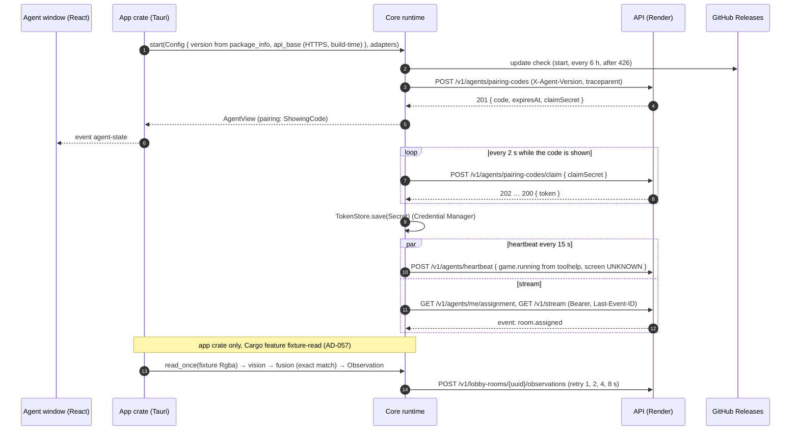

# Agent Skeleton Design

**Spec**: `.specs/features/agent-skeleton/spec.md`
**Status**: Draft (rev. 3 — closes the architecture-reviewer's retry-1 findings and the security-reviewer's minor items)

---

## Architecture Overview

A Tauri 2 app for Windows. All behaviour lives in a Rust **core** library crate with no Tauri dependency and no
Cargo features (AGS-01), built around ports so every rule runs under `cargo nextest` on any OS with a paused Tokio
clock and a contract-faithful fake API. The **app** crate (the Tauri package at `apps/agent/src-tauri/`) is a thin
shell: it builds the real adapters (HTTP, Windows Credential Manager, toolhelp, Windows OCR, Tauri updater), owns the
build-time configuration (API base URL, version), starts the core runtime and forwards one typed state to the React
window. The React UI renders that state through translation keys and sends one command ("Get a new code"). The server
side is `api-web-skeleton`; this feature consumes its JSON Schemas (AD-035) and executes after it is merged into
`phase/F0` — its changes to `packages/contracts`, `packages/config/eslint.mjs`, `apps/web` and `tests/acceptance` all
extend files that feature creates.



### Approaches considered (all deliver the same scope)

| Approach                                                                           | Trade-off                                                                                                                                                          | Verdict         |
| ---------------------------------------------------------------------------------- | ------------------------------------------------------------------------------------------------------------------------------------------------------------------ | --------------- |
| **A. Core library crate with ports + thin Tauri app crate + render-only React UI** | Every rule is testable on any OS with `cargo nextest`; only the Windows adapters need `windows-latest`. Matches the Design Doc's "núcleo Rust faz todo o trabalho" | **Recommended** |
| B. One Tauri crate holding logic and adapters                                      | Fewer crates, but tests need the Tauri runtime and Windows; AGS-01 asks for a core crate with no Tauri dependency                                                  | Rejected        |
| C. Logic in the TypeScript UI, Rust only for OS access                             | Contradicts the Design Doc and ADR 010's review story (the boundary is enforced by Rust lints and `cargo deny`)                                                    | Rejected        |

### Where the rules run

Every rule a user sees runs in the core crate and is tested with `cargo nextest` and mutated with `cargo-mutants`:
the pairing state machine (code shown, claim cadence, pause after two unused codes, 429 wait, 401 re-pair), "minutes
left" rounding, heartbeat cadence and failure display, the update schedule and the "Update required" gate, stream
event handling, validation of server-supplied values and reconnect backoff, fusion's exact match, observation retries,
request-header rules and the API base URL rule. The core exposes one `AgentView`; the UI maps it to translated strings
with a pure function (`apps/agent/src/shared/labels.ts`, Vitest). The language rule (AD-054) is a pure function on
`navigator.language`, which WebView2 takes from the Windows display language.

---

## Code Reuse Analysis

### Existing Components to Leverage

| Component                    | Location                                                                                | How to Use                                                                                                                               |
| ---------------------------- | --------------------------------------------------------------------------------------- | ---------------------------------------------------------------------------------------------------------------------------------------- |
| Agent JSON Schemas           | `packages/contracts/json-schema/*.json`, `src/documents.ts` (api-web-skeleton)          | Input of `typify`; this feature changes the emitted dialect and file set (§ Contracts changes, AD-060)                                   |
| `@d2rmm/agent` workspace     | `apps/agent` (`package.json`, tsconfig, `src/index.ts`)                                 | Becomes the window's React UI (Vite, `dist/` = Tauri `frontendDist`); its `package.json` `version` is the single version source (AGS-04) |
| release-please config        | `release-please-config.json`, manifest (AD-028)                                         | Kept; this feature adds the workflow that runs it                                                                                        |
| CI `agent` job               | `.github/workflows/ci.yml:132-155`                                                      | Extended (§ CI `agent` job)                                                                                                              |
| Nightly `agent-mutation` job | `.github/workflows/nightly.yml:70`                                                      | Runs `cargo mutants` with the new `.cargo/mutants.toml` scope                                                                            |
| ESLint preset                | `packages/config/eslint.mjs` — `i18next/no-literal-string` added by api-web-skeleton T5 | Its `files` glob extended to `apps/agent/src/**/*.tsx` (tightening; depends on that merge)                                               |
| Site layout and locales      | `apps/web/src/app/Layout.tsx`, `apps/web/src/shared/locales`                            | AGS-30 adds the SmartScreen note next to "Download the agent", both locales                                                              |
| Acceptance site steps        | `tests/acceptance/steps/site.steps.ts` (api-web-skeleton T47)                           | Reuses "the browser prefers", "a visitor opens the site"; adds "the site shows {string} next to {string}"                                |
| Lefthook `rust-fmt`          | `lefthook.yml`                                                                          | Already formats staged Rust files                                                                                                        |

### Integration Points

| System                 | Integration Method                                                                                                                                   |
| ---------------------- | ---------------------------------------------------------------------------------------------------------------------------------------------------- |
| API (api-web-skeleton) | HTTPS with `reqwest` (rustls, `https_only` in release, no redirects, timeouts); SSE `GET /v1/stream` with `Authorization: Bearer` (sensitive header) |
| GitHub Releases        | `tauri-plugin-updater` reading `releases/latest/download/latest.json`, minisign public key embedded in `tauri.conf.json`                             |
| Windows                | `windows` crate (fixed feature allow-list): toolhelp snapshot, `Media.Ocr` (en-US engine), `Graphics.Imaging`; `keyring` (`windows-native`)          |
| Telemetry              | `tracing` + `tracing-opentelemetry` + `opentelemetry_sdk` without exporter (W3C `traceparent` only); export arrives with observability-e2e           |

---

## Components

Layout (all under `apps/agent/src-tauri/`):

```text
Cargo.toml          workspace (members: ".", "core", "xtask"; exclude: "boundary-fixtures/*") + package d2rmm-agent (app)
Cargo.lock          committed; every build uses --locked
build.rs            tauri_build with AppManifest::commands(&["get_new_code"])
tauri.conf.json     version "../package.json", CSP, updater endpoint + pubkey, beforeBuildCommand ""
capabilities/main.json
permissions/        allow-get-new-code
src/main.rs         app entry: config, adapters, runtime, Tauri builder
src/config.rs       API base URL (build-time), version (package_info)
src/adapters/       token_store.rs (keyring), toolhelp.rs, windows_ocr.rs, updater.rs, http.rs (reqwest client)
src/fixture_read.rs #[cfg(feature = "fixture-read")] — flag parsing, PNG decode (`image`), one read
core/               d2rmm-agent-core (no Tauri, no features, #![forbid(unsafe_code)])
xtask/              contract generator (lib + bin) and the contracts_are_current test; typify lives only here
boundary-fixtures/  standalone crates (own [workspace]) that must fail the read-only checks
deny.toml, clippy.toml, .cargo/mutants.toml
```

### Config (`src/config.rs`)

- **API base URL**: compile-time `option_env!("D2RMM_API_BASE")`. Release builds (`not(debug_assertions)`) refuse to start without it or when it is not `https://`; debug builds also accept `http://127.0.0.1` / `http://localhost` (observability-e2e and local runs set it the same way). The release workflow sets it from the repository variable `API_BASE_URL` (the Render URL `deploy-api.yml` already uses). The provider URL lives only here, never in core.
- **Version**: `app.package_info().version` (from `tauri.conf.json` `version: "../package.json"`), passed into `core::Config`; never `CARGO_PKG_VERSION`.
- Core receives a validated `ApiBase` (`ApiBase::parse(url, AllowLoopbackHttp)`), unit-tested.

### Contracts (`core/src/contracts/`, `xtask/`)

- `core/src/contracts/generated.rs` — committed output of `cargo run -p xtask -- contracts` (typify library over `packages/contracts/json-schema/*.json`, formatted with `prettyplease`, file header `#![allow(clippy::all, clippy::pedantic)]`). The generator post-processes the secret fields: `ClaimRequest.claim_secret`, `PairingCodeResponse.claim_secret` and `ClaimResponse.token` become `core::secret::Secret` with `#[serde(serialize_with = "secret::expose")]` where they are sent.
- `xtask/tests/contracts_are_current.rs` regenerates in memory and compares with `generated.rs` (AGS-03). `typify`, `schemars` and `prettyplease` are dependencies of `xtask` only; core depends on `serde`, `serde_json`, `chrono` (`date-time`), `regress` (`pattern`), `uuid`.
- File → type map: `pairing-code.json` → `PairingCodeResponse`, `claim-request.json` → `ClaimRequest` (new), `claim.json` → `ClaimResponse`, `heartbeat.json` → `Heartbeat`, `assignment.json` → `Assignment`, `observation.json` → `Observation`, `agent-event-room-assigned.json` → `RoomAssignedEvent` (one schema per agent stream event, replacing the `agent-stream-event.json` union, which typify does not map well).
- `Observation.type` in draft-07 is an `enum` of the six glossary types; the agent constructs only `GAME_NAME_SEEN`. The server's `.catch('UNKNOWN')` stays a server rule.

### Contracts changes (`packages/contracts`, after the api-web-skeleton merge)

- `documents.ts`: agent JSON Schemas emitted with `z.toJSONSchema(schema, { target: 'draft-7' })` (AD-060); `JSON_SCHEMA_SOURCES` gains `claim-request` and `agent-event-room-assigned`, drops `agent-stream-event`; `documents.test.ts` expectations updated to the new file set.
- `@d2rmm/contracts` version `0.0.0` → `0.1.0` (ADR 009: a generated-schema change carries a version bump); `pnpm contracts:openapi` regenerates `openapi.json`, `asyncapi.json` and `json-schema/`, all committed; `pnpm contracts:check` green.

### Secret (`core/src/secret.rs`)

- `Secret(String)`: `Debug`/`Display` print `***`; `Zeroize` on drop; no blanket `Serialize` (only `serialize_with = expose` on contract fields); `expose(&self) -> &str` used by the API client and the token store only.

### Ports (`core/src/ports.rs`)

- `TokenStore { load() -> Option<Secret>, save(&Secret) -> Result<(), StoreError>, delete() }`
- `ProcessSource { names() -> Vec<String> }`
- `TextReader { read(image: &Rgba, region: Region) -> Result<ReadText, ReadError> }` with `ReadText { text, confidence }`, `ReadError = EngineUnavailable | Failed`; `Rgba { width, height, pixels }` is a core type.
- `UpdateChecker { check() -> UpdateOutcome }`, `UpdateOutcome = Installed | UpToDate | Failed(kind)`
- `IdGenerator { idempotency_key() -> Uuid }` with `SequentialIds` fake
- `WallClock { now_utc() }` — production: system time; tests: `PausedWallClock` anchored to `tokio::time::Instant`, so `tokio::time::advance` moves wall time too. All deadlines (code expiry, 429 `until`, 6 h) are `tokio::time::Instant`, converted once on receipt (`deadline = now + (expiresAt − now_utc)`); `minutes_left = ceil((deadline − now) / 60 s)`.
- `StateSink { publish(AgentView) }`

### API client (`core/src/api_client.rs`, `src/adapters/http.rs`)

- **Interfaces**: `request_code()`, `claim(&Secret)`, `heartbeat(&Heartbeat)`, `assignment()`, `post_observation(RoomId, &Observation)`, `open_stream(last_event_id)`; `Result<T, ApiError>` with `ApiError = Unauthorized | UpgradeRequired | RateLimited { retry_after } | Gone | Pending | Server | Network | Invalid`.
- **Rules**: every request opens a child span `agent.http.<operation>` (`request_code`, `claim`, `heartbeat`, `assignment`, `observation`, `stream`) inside its loop span and sends that span's `traceparent` plus `X-Agent-Version`; `Authorization` built with `HeaderValue::set_sensitive(true)`; bodies only of contract types; no body or header is logged.
- **Client** (app adapter, built in `src/adapters/http.rs` and handed to core already configured): `reqwest::Client` with `https_only(true)` unless the base is an allowed loopback in a debug build, `redirect(Policy::none())`, connect timeout 10 s, request timeout 30 s; the stream uses no request timeout and an idle timeout of 60 s (the API sends `: ka` every 25 s).
- **Server-supplied values**: `Retry-After` clamped to [1 s, 60 min]; room ids parsed as UUID before building paths; `game_name` accepted only if ≤ 32 chars of `[A-Za-z0-9-]`, else the event is ignored; error bodies are never shown.

### Pairing (`core/src/pairing.rs`)

- States: `Requesting` → `ShowingCode { code, deadline, unused_count }` → `Paired`; `Paused`; `RateLimited { until }`; `Unreachable` (retry every 15 s; these attempts never reach the API); `SaveFailed`.
- Rules: claim every 2 s (span `agent.pairing.claim`); 202 keeps going; 200 → `TokenStore.save` → `Paired` (save error → `SaveFailed`, new code); 410 or deadline → new code, `unused_count + 1`, `Paused` at 2; "Get a new code" → one request, count 0, offered only in `Paused`; pairing success and a 401 reset the count; 429 → `RateLimited { until: now + clamp(Retry-After or 60 min) }`; 426 → update gate.

### Heartbeat and process (`core/src/heartbeat.rs`, `src/adapters/toolhelp.rs`)

- Every 15 s (span `agent.heartbeat`): `game.running` = `ProcessSource.names()` contains `D2R.exe` (ASCII case-insensitive); `screen: UNKNOWN`; body ≈ 200 bytes; network error or 5xx → `Unreachable`, next beat on schedule; success → `Connected`; 401 → delete token, back to pairing; 426 → update gate.
- `toolhelp.rs` (`#[cfg(windows)]`, the only file besides `windows_ocr.rs` with `#[allow(unsafe_code)]`): `CreateToolhelp32Snapshot(TH32CS_SNAPPROCESS, 0)`, `Process32FirstW`/`Process32NextW`, `CloseHandle` on the snapshot handle; no other process API (AD-055).

### Stream and assignment (`core/src/stream.rs`)

- On paired, start and reconnect: fetch the assignment, then open the stream with `Last-Event-ID` (only if ≤ 32 chars of `[0-9.]`); reconnect after 1 s doubling to 60 s, reset after 60 s open (AD-059); the SSE `retry:` field is ignored; events and lines above 64 KiB close the connection (then reconnect).
- `handle(event_name, data) -> StreamEffect`, `StreamEffect = SetAssignment(Assignment) | Ignore` — the only effect type (AGS-15 AC4). Dispatch by the SSE `event:` name: `room.assigned` → parse `data` as `RoomAssignedEvent`; any other name, or a payload that fails to parse or validate → `Ignore`. Latest `room.assigned` wins. Parsing: `eventsource-stream` over the `reqwest` byte stream.

### Vision and fusion (`core/src/vision.rs`, `core/src/fusion.rs`, `src/adapters/windows_ocr.rs`)

- **Vision**: `read_game_name(image: &Rgba, reader) -> Result<ReadText, ReadError>` crops the built-in region for the image's resolution (1920×1080: the automap's top-right text block) and returns the first line (span `agent.vision.read`).
- **OCR adapter** (`#[cfg(windows)]`): fixed engine `OcrEngine::TryCreateFromLanguage(&Language::CreateLanguage("en-US"))`; `None` → `ReadError::EngineUnavailable`; `SoftwareBitmap` from the crop, in process (no file, no network).
- **Fusion**: `fuse(read, assignment, now_utc, ids) -> Option<Observation>`: `read.text.trim().to_lowercase() == expected.to_lowercase()` → `GAME_NAME_SEEN`, value = normalised read, room, run, confidence clamped to [0, 1], `ids.idempotency_key()`, `capturedAt = now_utc`; otherwise `None` (AD-052).
- **Trigger** (`src/fixture_read.rs`, app crate only — core has no feature, so feature unification cannot turn it on): with feature `fixture-read`, `--read-fixture <png>` decodes the PNG with `image` and calls `core::Runtime::read_once` when an assignment is held; without the feature `main` rejects the flag with exit code 2 before Tauri starts (AGS-33).
- **Sender** (`core/src/observations.rs`, span `agent.observation.post`): retries after 1, 2, 4, 8 s on network error or 5xx with the same key, then drops and counts (AD-051); pending retries are dropped on 401 and 426, kept on an assignment change (the observation names its own room and is idempotent).

### Updates (`core/src/updates.rs`, `src/adapters/updater.rs`)

- Check at start, every 6 h and right after any 426 (span `agent.update.check`); `Failed` → "Update failed — will retry", next scheduled check; 426 → `UpdateRequired`: heartbeat, claim, stream and observation loops stop until an update installs (AGS-27).
- Adapter: `tauri-plugin-updater` `check()` → `download_and_install()` → `app.restart()`, called from Rust only; default version comparator kept (a `latest.json` with an equal or lower version installs nothing); no `dangerousInsecureTransportProtocol`.
- `tauri.conf.json`: `plugins.updater.endpoints = ["https://github.com/pedromoraisf/d2rmatchmaking/releases/latest/download/latest.json"]`, `plugins.updater.pubkey` (maintainer-provided), `bundle.createUpdaterArtifacts: true`.

### Runtime, state and telemetry (`core/src/runtime.rs`, `core/src/view.rs`, `core/src/telemetry.rs`)

- `Runtime::start(config, adapters) -> Handle`; `Handle::get_new_code()`; `Handle::read_once(Rgba)` (called only by the app's fixture module); `AgentView { pairing, connectivity, room, update }` (serde, camelCase).
- `telemetry::init(Mode)` installs one `tracing` subscriber with the OpenTelemetry layer (W3C propagator, no exporter) and, in release, filter `info,hyper=warn,reqwest=warn`; used by the app and by tests. Loop spans: `agent.heartbeat`, `agent.pairing.claim`, `agent.update.check`, `agent.stream.connect`, `agent.vision.read`, `agent.observation.post`; fields only ids, statuses, counts. `#[instrument]` is used only with `skip_all`.
- The app installs a panic hook that logs location only, never the payload.

### App shell and window hardening (`src/main.rs`, `tauri.conf.json`, `capabilities/main.json`)

- One window labelled `main`. Capability `main` (windows: `["main"]`): `core:event:allow-listen`, `core:event:allow-unlisten`, `allow-get-new-code` — nothing else (no updater, shell, fs or http permission).
- `app.security.csp`: `default-src 'self'; script-src 'self'; style-src 'self'; img-src 'self'; connect-src ipc: http://ipc.localhost`; `app.withGlobalTauri: false`; no remote URLs, no `dangerousRemoteDomainIpcAccess`; devtools only in debug builds; `on_navigation` allows only the app's own URL.

### UI (`apps/agent/src/`)

- `main.tsx`, `app/App.tsx`, `views/PairingView.tsx`, `views/StatusView.tsx`, `shared/labels.ts`, `shared/language.ts`, `shared/locales/{en,pt-BR}.json`; Vite build into `apps/agent/dist`. Strings per spec (AGS-31, AGS-32).

### Read-only boundary (`deny.toml`, `clippy.toml`, unsafe policy) — AGS-21, AGS-22

| Mechanism                                                    | Rule                                                                                                                                                                                                                                                                                                                                                                                                                                             | Fixture (must fail)                                                              | Expected failure id           |
| ------------------------------------------------------------ | ------------------------------------------------------------------------------------------------------------------------------------------------------------------------------------------------------------------------------------------------------------------------------------------------------------------------------------------------------------------------------------------------------------------------------------------------ | -------------------------------------------------------------------------------- | ----------------------------- |
| `cargo deny check` `[bans]`                                  | `deny`: `sysinfo`, `process-memory`, `read-process-memory`, `proc-maps`, `memprocfs`, `ntapi`, `dll-syringe`, `retour`, `detour`, `minhook`, `enigo`, `rdev`, `inputbot`, `device_query`, `willhook`, `rustautogui`, `autopilot`, `mouse-rs`, `pcap`, `pnet`, `windivert`, `winapi`, `tauri-plugin-shell`, `tauri-plugin-fs`, `tauri-plugin-http`, `tauri-plugin-global-shortcut`; `wildcards = "deny"`                                          | `boundary-fixtures/banned-dep` (depends on `sysinfo`)                            | `banned`                      |
| `cargo deny check` `[sources]`, `[advisories]`, `[licenses]` | `unknown-registry = "deny"`, `unknown-git = "deny"`; RustSec advisories deny; licence allow-list MIT, Apache-2.0, Apache-2.0 WITH LLVM-exception, BSD-2-Clause, BSD-3-Clause, ISC, Zlib, Unicode-3.0, MPL-2.0, CC0-1.0                                                                                                                                                                                                                           | —                                                                                | —                             |
| Unsafe policy                                                | `core`: `#![forbid(unsafe_code)]`; app: `#![deny(unsafe_code)]` with `#[allow(unsafe_code)]` only in `src/adapters/toolhelp.rs` and `src/adapters/windows_ocr.rs` — every raw FFI call or `extern` block elsewhere fails                                                                                                                                                                                                                         | `boundary-fixtures/unsafe-ffi` (an `extern "system"` call)                       | `unsafe_code`                 |
| `clippy.toml` `disallowed-types`                             | `std::process::Command`, `tokio::process::Command`                                                                                                                                                                                                                                                                                                                                                                                               | `boundary-fixtures/command-new` (`Command::new("cmd")`)                          | `clippy::disallowed_types`    |
| `clippy.toml` `disallowed-methods`                           | `windows::Win32::System::Diagnostics::ToolHelp::Toolhelp32ReadProcessMemory` (same feature as AGS-10), `reqwest::ClientBuilder::danger_accept_invalid_certs`, `reqwest::ClientBuilder::danger_accept_invalid_hostnames` — only paths compiled in the app                                                                                                                                                                                         | `boundary-fixtures/toolhelp-read` (calls it)                                     | `clippy::disallowed_methods`  |
| `windows` feature allow-list                                 | The app's `windows` features are exactly `Win32_Foundation`, `Win32_System_Diagnostics_ToolHelp`, `Media_Ocr`, `Graphics_Imaging`, `Globalization`, `Foundation`, `Storage_Streams`; memory, debug, threading, hook and input APIs (`ReadProcessMemory`, `OpenProcess`, `CreateRemoteThread`, `VirtualAllocEx`, `SetWindowsHookExW`, `SendInput`, `keybd_event`, `mouse_event`) need features outside it, and any FFI needs `unsafe` (row above) | harness test with a fixture `Cargo.toml` adding `Win32_System_Diagnostics_Debug` | test fails naming the feature |
| Source rules                                                 | `allow(unsafe_code)` only in the two adapter files; `#[instrument]` only with `skip_all`; no `fixture-read` in any `default` feature                                                                                                                                                                                                                                                                                                             | harness test fixtures                                                            | test fails naming the rule    |

- Each boundary fixture is a standalone crate with its own `[workspace]`, copies nothing: it runs with the real files (`cargo deny --manifest-path … check bans --config ../../deny.toml`, `cargo clippy --manifest-path … -- -D warnings` with `CLIPPY_CONF_DIR` pointing at `apps/agent/src-tauri`).
- `scripts/agent/expect-failure.mjs <id> -- <command>` runs a command and passes only when it fails **and** its output contains `<id>` (a build error does not pass). It has its own `node:test` tests (unconditional, in `pnpm test:harness`). The fixture runs are explicit steps of the CI `agent` job, not a skipped test.
- `scripts/test/agent-source-rules.test.mjs` (unconditional, `pnpm test:harness`): the `windows` feature allow-list, the unsafe-allow locations, `#[instrument]` with `skip_all`, no `fixture-read` in `default`, `tauri.conf.json` (version path, CSP, `withGlobalTauri: false`, updater endpoint and no insecure transport, empty `beforeBuildCommand`, no `build.features`), the `windows::` paths referenced by the two unsafe-allowed files (allow-list: `toolhelp.rs` — `CreateToolhelp32Snapshot`, `Process32FirstW`, `Process32NextW`, `CloseHandle`, `PROCESSENTRY32W`, `TH32CS_SNAPPROCESS`, `HANDLE`; `windows_ocr.rs` — `Media::Ocr`, `Graphics::Imaging`, `Globalization::Language`, `Storage::Streams` types), since feature unification can expose more of the `windows` crate than the app enables, `capabilities/*.json` (window `main`, the three permissions only).

### CI `agent` job (`.github/workflows/ci.yml`, harness edit)

`windows-latest`; new steps SHA-pinned: checkout, `pnpm/action-setup`, `actions/setup-node`, `pnpm install --frozen-lockfile`, `pnpm --filter @d2rmm/agent build` (Tauri needs `frontendDist`); `dtolnay/rust-toolchain@stable` (rustfmt, clippy); `taiki-e/install-action` with `cargo-nextest@<pinned>`, `cargo-deny@<pinned>`; then in `apps/agent/src-tauri`:
`cargo fmt --all -- --check`; `cargo clippy --locked --all-targets -- -D warnings`; `cargo clippy --locked --all-targets --all-features -- -D warnings`; `cargo nextest run --locked` (includes the AGS-33 rejection test, `cfg(not(feature = "fixture-read"))`); `cargo nextest run --locked --all-features`; `cargo deny --locked check`; the four boundary fixtures through `expect-failure.mjs`.

### Release workflows (`.github/workflows/`)

- `release-please.yml` — on push to `main`: job `release-please` runs `googleapis/release-please-action` (SHA-pinned) with the existing config and the default `GITHUB_TOKEN` (`contents: write`, `pull-requests: write`); release-please creates the tag and the GitHub Release. Job `release-agent` (`needs: release-please`, `if: needs.release-please.outputs['apps/agent--release_created'] == 'true'` on the calling job, its own `permissions: contents: write`) calls the reusable `release-agent.yml` with the tag name — a `GITHUB_TOKEN` tag does not trigger a `push: tags` workflow, and no PAT is needed. Because a PR opened with `GITHUB_TOKEN` gets no `pull_request` CI either, when release-please opens or updates its release PR the job runs `gh workflow run ci.yml --ref <release PR branch>` (a `workflow_dispatch` run, which `GITHUB_TOKEN` may start) so the PR's head commit gets the required `verify` check; `ci.yml` gains a `workflow_dispatch` trigger. Fallback, written in the release runbook in `docs/engineering/releases.md`: the maintainer closes and reopens the release PR.
- `release-agent.yml` — triggers: `workflow_call` (input `tag`, from release-please), `push: tags: ['agent-v*']` (AGS-28 as written: a tag pushed by the maintainer; release-please's `GITHUB_TOKEN` tags never fire it, so there is no double run) and `workflow_dispatch` (input `tag`, to re-run a failed release). The tag resolves as `inputs.tag || github.ref_name`. Job `build`, `windows-latest`, `environment: release` (environment secrets with required reviewers — created by the maintainer), `permissions: contents: write`, checkout of `ref: <tag>` with `persist-credentials: false`:
  1. assert the tag's commit is an ancestor of `origin/main` (tag passed through `env:`);
  2. `pnpm install --frozen-lockfile --ignore-scripts`, `pnpm --filter @d2rmm/agent build` (so `beforeBuildCommand` stays empty);
  3. `cargo tree --locked -p d2rmm-agent -e features` must not contain `fixture-read` (AGS-33);
  4. `tauri-apps/tauri-action` (SHA-pinned) with `tagName: ${{ inputs.tag }}` (uploads to release-please's existing release), `includeUpdaterJson: true`, env `TAURI_SIGNING_PRIVATE_KEY`, `TAURI_SIGNING_PRIVATE_KEY_PASSWORD`, `D2RMM_API_BASE: ${{ vars.API_BASE_URL }}`, `args: --ci -- --locked`; never `--features`;
  5. smoke check: the built `d2rmm-agent.exe --read-fixture x` exits with code 2 (AGS-33, the release binary rejects the flag);
  6. copy the NSIS installer to `D2RMatchMaking-setup.exe`, write `SHA256SUMS` for both installers, `gh release upload "$TAG" …` (tag through `env:`, no `--clobber` in this job).
- **SignPath (AD-053)**: a second job `sign` in `release-agent.yml`, `needs: build`, runs only when the repository variable `SIGNPATH_ENABLED == 'true'` (secrets cannot be used in `if:`). It uses `signpath/github-action-submit-signing-request` (SHA-pinned, origin-verified artifact upload, one approval per release), runs in `environment: release`, re-signs the updater artifact with `tauri signer sign`, rewrites `latest.json`'s signature (`scripts/agent/latest-json.mjs`, `node:test`), regenerates `D2RMatchMaking-setup.exe` and `SHA256SUMS` from the signed installer, and replaces those assets (`--clobber` allowed only in this job). Unsigned is the F0 path; this job is proved only by the static test until ADR 016 is accepted.
- `scripts/test/release-workflows.test.mjs`: the three triggers and the tag resolution; the `release_created` guard on the calling job's `if:` and its `contents: write`; the CI dispatch for the release PR and `ci.yml`'s `workflow_dispatch`; checkout of the tag; environment `release` on `build` and `sign`; secrets only in `build`/`sign`; ancestor check; `--ignore-scripts`; the `fixture-read` check before tauri-action and no `--features`; `tagName` from the input; the exit-code-2 smoke check; fixed asset and `SHA256SUMS` without `--clobber` in `build`; SignPath gated by the variable; every `uses:` in both workflows and in the CI `agent` job pinned by a 40-char SHA; minimal permissions.

### Site note (`apps/web`)

`Layout.tsx` renders the note next to "Download the agent"; keys in `en.json`/`pt-BR.json`; Vitest test; acceptance step "the site shows {string} next to {string}" in `site.steps.ts` (AGS-30).

### Mutation (`.cargo/mutants.toml`)

`examine_globs = ["core/src/pairing.rs", "core/src/fusion.rs", "core/src/stream.rs", "core/src/updates.rs", "core/src/observations.rs", "core/src/api_client.rs", "core/src/heartbeat.rs"]`; run nightly by `agent-mutation` and by the Verifier on the named modules.

---

## Data Models

```rust
pub enum PairingView { Requesting, ShowingCode { code: String, minutes_left: u8 }, Paused, RateLimited,
                       Unreachable, SaveFailed, Paired }
pub enum Connectivity { Connected, Unreachable }
pub enum UpdateView { Idle, Failed, Required }
pub struct AgentView { pub pairing: PairingView, pub connectivity: Connectivity,
                       pub room: Option<RoomView>, pub update: UpdateView }   // serde, camelCase
pub struct RoomView { pub game_name: String }
```

No local storage besides the Credential Manager entry (`service = "d2rmm-agent"`, `user = "agent-token"`). `KeyringTokenStore` has a `#[cfg(windows)]` round-trip test (save, load, delete) under a unique service name that it removes, run by the CI `agent` job.

`CODEOWNERS` assigns the maintainer to `apps/agent/src-tauri/src/adapters/toolhelp.rs`, `windows_ocr.rs`, `boundary-fixtures/`, `deny.toml` and `clippy.toml`.

---

## Error Handling Strategy

| Error Scenario                           | Handling                                                       | User Impact                                  |
| ---------------------------------------- | -------------------------------------------------------------- | -------------------------------------------- |
| API unreachable before pairing           | Retry the code request every 15 s                              | "Can't reach the server"                     |
| Claim 202 / 410 / code expired           | Keep claiming / new code, count it / new code, count it        | Code shown; "Pairing paused" after two       |
| Code request 429                         | Wait clamp(`Retry-After` or 60 min); no "Get a new code"       | "Too many codes requested. Try again later." |
| Credential store write fails             | New code                                                       | "Could not save the pairing. Try again."     |
| Any 401                                  | Delete token, drop pending retries, back to pairing            | New code shown                               |
| Any 426                                  | Stop API loops, drop pending retries, check for an update now  | "Update required"                            |
| Heartbeat network error / 5xx            | Next beat on schedule                                          | "Can't reach the server", then "Connected"   |
| Stream drop, oversized event             | Reconnect 1 s → 60 s with `Last-Event-ID`, re-fetch assignment | none                                         |
| Unknown / invalid stream event           | `StreamEffect::Ignore`                                         | none                                         |
| Observation post network error / 5xx     | Retry 1, 2, 4, 8 s with the same key, then drop and count      | none                                         |
| OCR engine unavailable (fixture builds)  | `ReadError::EngineUnavailable`, logged, no observation         | none                                         |
| Update check / download / signature fail | Keep the installed version, next check on schedule             | "Update failed — will retry"                 |
| Release build without an HTTPS API base  | Refuse to start                                                | (build/config error, never shipped)          |

---

## Risks & Concerns

| Concern                                                                                                             | Location (file:line)                        | Impact                                          | Mitigation                                                                                                                                                                                                   |
| ------------------------------------------------------------------------------------------------------------------- | ------------------------------------------- | ----------------------------------------------- | ------------------------------------------------------------------------------------------------------------------------------------------------------------------------------------------------------------ |
| `typify` reads draft-07; unions and `.catch` do not map                                                             | `packages/contracts/src/documents.ts:85`    | Generation fails or drops constraints           | Draft-07 target, one schema per agent event, enum for observation types (AD-060); contract version bump and regeneration                                                                                     |
| No Rust toolchain on the maintainer's machine; Windows adapters cannot run on macOS                                 | environment                                 | Local gates for Rust tasks fail                 | Execute is an escalation until `rustup` is installed; Windows adapters and their tests are `#[cfg(windows)]` and proved by the CI `agent` job (checks cite the job)                                          |
| `tauri-action` with `tagName` of an existing release must upload rather than create; `--ci -- --locked` passthrough | `release-agent.yml`                         | Release step fails                              | Verified against tauri-action and Tauri CLI docs in the task; the static test pins the chosen form; first run is in the phase review                                                                         |
| Updater key pair, `release` environment, `API_BASE_URL`/`SIGNPATH_ENABLED` variables, tag ruleset                   | escalation                                  | Release and self-update proofs wait             | Raised as escalations with exact names when the release tasks run; `.github/rulesets/agent-tags.json` (protect `agent-v*`) is written for the maintainer to import; key rotation plan queued in decisions.md |
| SignPath Foundation's flow is unverified until ADR 016 is accepted                                                  | `release-agent.yml` `sign`                  | First signed release may fail                   | Separate opt-in job using the official action; unsigned is the F0 path (AD-053); first signed run listed as a follow-up                                                                                      |
| `releases/latest` is repo-wide                                                                                      | ADR 015, `release-please-config.json`       | A future non-agent release breaks `latest.json` | Recorded as an ADR 015 constraint in decisions.md: any future package uses `make_latest: false`; `release-workflows.test.mjs` asserts the agent is the only package today                                    |
| Windows OCR needs the en-US OCR language                                                                            | `src/adapters/windows_ocr.rs`               | AGS-16 fails on a runner without it             | Fixed en-US engine; `EngineUnavailable` fails the test loudly (never skips); the fixture path never ships                                                                                                    |
| Same-user processes can read the Credential Manager entry                                                           | Windows                                     | A local malware could read the token            | Accepted residual risk, bounded by revocation and the token's scope (ADR 011); written in SECURITY.md                                                                                                        |
| First install integrity rests on GitHub while unsigned                                                              | release assets                              | Tampered download undetected                    | `SHA256SUMS` asset; signing with ADR 016                                                                                                                                                                     |
| Floating action tags in existing `ci.yml` jobs                                                                      | `.github/workflows/ci.yml:30-164`           | Supply-chain drift                              | The `agent` job's steps are pinned by SHA here; pinning the other jobs is queued as a harness follow-up in decisions.md                                                                                      |
| The synthetic fixture differs from the real automap                                                                 | `apps/agent/fixtures/automap-game-name.png` | F2 needs new regions                            | Accepted for F0 (AD-047); the generator is committed                                                                                                                                                         |
| `apps/web`, contracts, ESLint and acceptance files belong to api-web-skeleton                                       | several                                     | Parallel edits would conflict                   | Executes after api-web-skeleton merges (AD-035); only extends those files                                                                                                                                    |

---

## Tech Decisions (only non-obvious ones)

| Decision            | Choice                                                                                                                                                    | Rationale                                                                                                        |
| ------------------- | --------------------------------------------------------------------------------------------------------------------------------------------------------- | ---------------------------------------------------------------------------------------------------------------- |
| Crates              | app `d2rmm-agent` (Tauri package at `src-tauri/`) + `d2rmm-agent-core` + `xtask`                                                                          | AGS-01; generator and `typify` out of shipped binaries; `fixture-read` only in the leaf app                      |
| Time in tests       | `#[tokio::test(start_paused = true)]`; deadlines on `tokio::time::Instant`; `PausedWallClock`                                                             | One clock drives cadences and expiries                                                                           |
| Fake API            | `axum` server in `core/tests/support/fake_api.rs`, validating bodies against the JSON Schemas                                                             | Contract-faithful; SSE; scripted 202, 410, 429, 401, 426, 5xx                                                    |
| Secret capture test | `core/tests/support/capture.rs` (tracing capture layer + span recorder) used by the AGS-09 test over a pair → heartbeat → 401 cycle                       | Proves neither token nor claim secret reaches logs or spans                                                      |
| State to UI         | One `agent-state` event with `AgentView`; one command `get_new_code`                                                                                      | The UI holds no rule; minimal capability                                                                         |
| Release chain       | release-please calls `release-agent.yml` via `workflow_call` on `release_created`; `push: tags` kept for maintainer tags, `workflow_dispatch` for re-runs | `GITHUB_TOKEN` tags do not trigger workflows; no PAT; AGS-28 holds as written                                    |
| Signing key         | `release` environment; no install scripts; empty `beforeBuildCommand`; `--locked`                                                                         | Limits what runs next to `TAURI_SIGNING_PRIVATE_KEY` while tauri-action keeps publishing `latest.json` (ADR 015) |
| API base URL        | Build-time `D2RMM_API_BASE`, HTTPS-only in release                                                                                                        | No runtime override in shipped builds; provider URL only in the app crate                                        |
