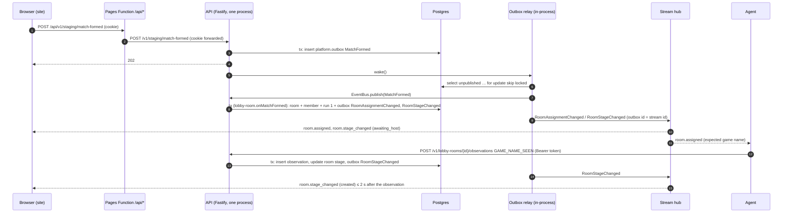

# API and Web Skeleton Design

**Spec**: `.specs/features/api-web-skeleton/spec.md`
**Status**: Draft

---

## Architecture Overview

One Fastify 5 process (ADR 002, 006) holds the five modules, an in-memory event bus, the outbox relay and the stream
hub. Postgres (Neon in production, a Testcontainers/Docker Postgres locally) stores accounts, sessions, agents,
pairing codes, rooms, observations and the outbox. Presence, rate-limit counters and open streams live in memory. The
site is a static React 19 SPA on Cloudflare Pages; it calls the API only through the same-origin Pages Function
`/api/*` (ADR 012). The agent (simulated over HTTP in this feature) calls the API directly.



### Approaches considered (all deliver the same scope)

| Approach                                                                    | Trade-off                                                                                                                                                                          | Verdict         |
| --------------------------------------------------------------------------- | ---------------------------------------------------------------------------------------------------------------------------------------------------------------------------------- | --------------- |
| **A. Relay woken in-process after each commit, plus one sweep at start-up** | Every write comes from this single process (ADR 006), so a wake signal after commit is enough; the start-up sweep publishes rows left by a crash. No idle query, so Neon can sleep | **Recommended** |
| B. Relay on Postgres `LISTEN/NOTIFY`                                        | A permanently open connection keeps Neon awake (NFR-07: 100 CU-hours, scale-to-zero after 5 min)                                                                                   | Rejected        |
| C. Relay polling the outbox every few hundred ms                            | Simplest, but the polling query also keeps Neon awake around the clock                                                                                                             | Rejected        |

The same reasoning applies to presence: heartbeats update an in-memory `PresenceStore` and never touch Postgres
(AWS-13); an offline sweep runs in memory every second.

### Where the rules run

Every rule a user sees runs in `domain` or `application` and is unit-tested and mutated (ADR 014): player-name
validation, session expiry, pairing-code expiry/single use/claim, rate limits, agent-version comparison, presence and
its 45 s offline rule, game-name format, room creation and the `awaiting_host → created` transition, observation
idempotency and membership. The site only maps contract values to translated labels; that mapping is a pure function
in `apps/web/src/shared/` with its own Vitest tests.

---

## Code Reuse Analysis

### Existing Components to Leverage

| Component                   | Location                                                     | How to Use                                                                                                                              |
| --------------------------- | ------------------------------------------------------------ | --------------------------------------------------------------------------------------------------------------------------------------- |
| `Result`, `ok`, `err`       | `apps/api/src/shared-kernel/result.ts`                       | Every expected failure in domain and application (invalid name, expired code, rate limited, not a member)                               |
| `Clock`, `FakeClock`        | `apps/api/src/shared-kernel/clock.ts`                        | Session and code expiry, rate-limit windows, presence offline rule, keep-alive; `FakeClock` in unit and integration tests               |
| `IdGenerator` + fake        | `apps/api/src/shared-kernel/id-generator.ts`                 | Room, member, agent, match, session ids                                                                                                 |
| Five modules × three layers | `apps/api/src/modules/*/{domain,application,adapters}`       | Fill the empty layers; each `index.ts` becomes the module's public port                                                                 |
| Mutation runner             | `apps/api/scripts/mutation.ts`, `mutation-plan.ts`           | Unchanged; domain and application code now gives both layers real mutants (`mutation.api.application` gets its first value)             |
| Contracts workspace         | `packages/contracts` (`scripts/generate.ts`, `documents.ts`) | `documents.ts` is replaced (its header says so): Zod schemas → AsyncAPI + JSON Schema; OpenAPI comes from the API's routes (below)      |
| Dependency rules            | `.dependency-cruiser.cjs`                                    | Unchanged; `acceptance-is-black-box`, `web-features-isolated`, `contracts-are-leaf` already describe this feature's boundaries          |
| ESLint preset               | `packages/config/eslint.mjs`                                 | Extended (tightened): `n/no-process-env` for `apps/api/src/**` outside `main/`, `i18next/no-literal-string` for `apps/web/src/**/*.tsx` |
| TypeScript presets          | `packages/config/tsconfig.base.json`, `tsconfig.dom.json`    | API extends base; web extends dom with `jsx: react-jsx`                                                                                 |
| Acceptance runner           | `tests/acceptance` (`fixtures.ts`, playwright-bdd)           | New worker-scoped `stack` fixture and steps per context (`identity`, `agents`, `lobby-room`); config gains a `globalSetup` (below)      |
| CI integration job          | `.github/workflows/ci.yml` (`integration`)                   | Already runs `test:integration`, `test:e2e`, `test:acceptance` on Ubuntu runners with Docker; no change                                 |
| Backup job                  | `.github/workflows/nightly.yml` (`backup`)                   | Untouched (out of scope)                                                                                                                |

### Integration Points

| System                        | Integration Method                                                                                                                                                           |
| ----------------------------- | ---------------------------------------------------------------------------------------------------------------------------------------------------------------------------- |
| Postgres                      | Kysely + `pg` in `modules/*/adapters/postgres/`; one schema per module (`identity`, `agents`, `lobby`, `platform`); migrations in `apps/api/migrations/` (Kysely `Migrator`) |
| Cloudflare Pages              | `apps/web/functions/api/[[path]].ts` (Pages Functions file routing); build output `apps/web/dist`; deployed by `deploy-web.yml` with `cloudflare/wrangler-action`            |
| Render                        | `render.yaml` blueprint: one free web service, `node apps/api/src/main/render.ts`, health check `/healthz`; deploys triggered by `deploy-api.yml` via the deploy hook        |
| Agent (agent-skeleton)        | Contract-only: JSON Schema files in `packages/contracts/json-schema/` consumed by `typify` (AD-035)                                                                          |
| Telemetry (observability-e2e) | Use cases open spans with `@opentelemetry/api` (no-op until observability-e2e registers an SDK in `main/`)                                                                   |

---

## Components

### Shared kernel additions (`apps/api/src/shared-kernel/`)

- **Purpose**: Cross-module primitives that stay pure.
- **Interfaces**:
  - `interface DomainEvent<T extends string, P> { type: T; payload: P }` and the event type union for this feature: `MatchFormed`, `RoomAssignmentChanged`, `RoomStageChanged` (payloads per `docs/domain/events.md`).
  - `interface Outbox { append(tx: Transaction, events: readonly DomainEvent[]): Promise<void> }` — written inside the caller's transaction (ADR 008).
  - `interface UnitOfWork { run<T>(work: (tx: Transaction) => Promise<T>): Promise<T> }`; `Transaction` is an opaque branded type, only adapters know it is a Kysely transaction.
  - `interface EventBus { publish(e: PublishedEvent): Promise<void>; subscribe(type, handler): void }` with `PublishedEvent = DomainEvent & { id: bigint }` (the outbox id).
  - `interface RandomSource { int(maxExclusive: number): number; bytes(n: number): Uint8Array }` — pairing codes and secrets; deterministic fake for tests.
  - `interface Scheduler { every(ms: number, fn: () => void): Cancel }` with a `FakeScheduler` driven by `FakeClock` (keep-alive, presence sweep).
  - `withSpan<T>(name: string, fn: () => Promise<T>): Promise<T>` in `tracing.ts`, built on `@opentelemetry/api` only (AWS-35).
- **Dependencies**: none beyond `@opentelemetry/api` (runtime dependency of `@d2rmm/api`).

### Identity module (`modules/identity/`)

- **Purpose**: Test sign-in and sessions (AWS-01…AWS-04).
- **Domain**: `player-name.ts` — `PlayerName.parse(raw): Result<PlayerName, 'invalid-player-name'>` (`^[A-Za-z0-9-]{2,16}$`, no trimming), `key` = lower-cased (AD-042); `account.ts` — `Account { id, battletag: '<display>#test', displayName, nameKey }`; `session.ts` — `Session.open(accountId, now)` with `expiresAt = now + 7 days`, `isValidAt(now)` (expired at exactly 7 days, AWS-04).
- **Application**: `signInTestAccount({ name })` → `{ account, sessionToken }`; `authenticateSession(token)` → `Result<AccountId, 'unauthenticated'>`; `getMe(accountId)`.
- **Ports**: `AccountRepository { findByNameKey, insert }`, `SessionRepository { insert(hash, accountId, expiresAt), findByHash }`, `TokenHasher { sha256(token): string }`.
- **Adapters**: Postgres repositories; HTTP routes `POST /v1/auth/test-login` (staging only), `GET /v1/me`; a Fastify `requireSession` preHandler that reads cookie `d2rmm_session` and sets `request.accountId`.
- **Public port (`index.ts`)**: `IdentityPort { authenticateSession(token): Promise<Result<AccountId, 'unauthenticated'>> }`.
- **Cookie**: `d2rmm_session=<32 random bytes, base64url>; HttpOnly; Secure; SameSite=Lax; Path=/; Max-Age=604800` (AD-036). Only the SHA-256 hash is stored.

### Agents module (`modules/agents/`)

- **Purpose**: Pairing, token, presence and version gate (AWS-05…AWS-18).
- **Domain**:
  - `pairing-code.ts` — `PairingCode.issue(agentId, random, now)` → 6 digits zero-padded, `expiresAt = now + 5 min`; `use(accountId, now)` → `Result<_, 'invalid-code'>` for unknown/expired/used; `claim(now)` → `'pending' | 'token' | 'gone'` (`gone` = expired unused or already claimed, AWS-07).
  - `agent.ts` — `Agent { id, accountId?, tokenHash?, claimSecretHash, pairedAt?, revokedAt? }`; `pair(accountId)`, `revoke(now)`.
  - `sliding-window.ts` — `SlidingWindowLimit { limit, windowMs }.check(timestamps, now)` → `allowed | limited(until)`: account code submissions 10 / 5 min (AD-032), IP code requests 10 / 1 h (AD-041). Every submission counts, valid or not (AWS-09 "submitted 10 codes").
  - `agent-version.ts` — `AgentVersion.parse(header): Result<AgentVersion, 'not-semver'>` (`MAJOR.MINOR.PATCH`, digits only), `isBelow(min)` (AWS-12).
  - `presence.ts` — `Presence { online, gameRunning, screen: 'UNKNOWN' | 'AUTOMAP_OPEN', lastSeenAt }`; `fromHeartbeat(hb, now)`; `isOfflineAt(now)` when `now - lastSeenAt ≥ 45 s` (AD-031); `differs(a, b)`.
- **Application**: `requestPairingCode({ ip })`, `pairAgent({ accountId, code })` (revokes the account's previous agent in the same transaction, AD-037), `claimToken({ claimSecret })`, `authenticateAgent({ token })`, `recordHeartbeat({ agentId, heartbeat })`, `sweepPresence()` (scheduled every 1 s), `getMyAgent({ accountId })` (paired agent + presence for the site). Presence changes publish an in-memory `AgentPresenceChanged` on the event bus (not the outbox: presence is not in Postgres, AWS-13).
- **Ports**: `AgentRepository`, `PairingCodeRepository` (Postgres); `PresenceStore`, `RateLimitStore` (memory, ADR 006); `RandomSource`, `TokenHasher`, `Clock`.
- **Adapters**: Postgres repositories; memory stores; HTTP routes `POST /v1/agents/pairing-codes` (201), `POST /v1/agents/pairing-codes/claim` (200 token / 202 pending / 410 gone), `POST /v1/agents/pair` (site; 200 / 400 / 429), `POST /v1/agents/heartbeat` (204 / 400), `GET /v1/agents/me` (site); preHandlers `requireAgentVersion` (every agent route, 426 before anything else) and `requireAgent` (Bearer token → `request.agentId`; a session cookie is ignored, so a cookie-only call gets 401, AWS-11).
- **Public port**: `AgentsPort { accountOfAgent(agentId), currentAgentOf(accountId) }` — used by Lobby Room (membership) and the stream hub (addressing).

### Matchmaking module (`modules/matchmaking/`)

- **Purpose**: The staging-only test match (AWS-19, AD-033).
- **Application**: `formTestMatch({ accountId })` → in one transaction appends `MatchFormed { matchId, mode: 'leveling', activity: 'baal', difficulty: 'hell', region: 'americas', ladder: 'sc-ladder', era: 'rotw', members: [{ accountId, characterId: null, joinOrder: 1, role: 'host' }] }` to the outbox. No `matchmaking` schema in F0 (AWS-32's list).
- **Adapters**: route `POST /v1/staging/match-formed` (staging only, 202).

### Lobby Room module (`modules/lobby-room/`)

- **Purpose**: The room aggregate and observations (AWS-20…AWS-25).
- **Domain**:
  - `game-name.ts` — `GameName.of(activity, difficulty, n)`; F0 supports `difficulty: 'hell' → 'h'` only and returns `err('unsupported-difficulty')` otherwise (the full table is FR-14, F1); `matches(value)` = case-insensitive equality after no trimming (AD-034).
  - `lobby-room.ts` — `LobbyRoom.fromMatch(match, n, ids)` → room in `awaiting_host`, run 1, host = lowest `joinOrder`, password `''`, events `[RoomAssignmentChanged, RoomStageChanged]` (AD-039); `observe(obs)` → `{ room, events, effect: 'created' | 'ignored' }`; only `GAME_NAME_SEEN` from the host's account for the current run with a matching value moves `awaiting_host → created`; in `created` it is ignored (AWS-24 criterion 8).
  - `observation.ts` — `Observation { idempotencyKey, roomId, agentId, accountId, type, run, value, confidence, capturedAt }`.
- **Application**: `onMatchFormed(event)` (idempotent by `matchId`, AWS-20), `recordObservation({ agentId, roomId, body })` — 403 when the agent's account is not a member (store nothing), 202 + no-op when the idempotency key exists (INV-09) or the type is unknown (store nothing), otherwise insert the observation and apply `observe` in one transaction; `getCurrentRoom({ accountId })` (newest room, AWS-21 criterion 13); `getAssignment({ agentId })`.
- **Ports**: `LobbyRoomRepository`, `ObservationRepository`, `GameNameSequence { next(tx): Promise<number> }` (Postgres sequence `lobby.game_name_seq`).
- **Adapters**: routes `POST /v1/lobby-rooms/:id/observations` (agent), `GET /v1/agents/me/assignment` (agent), `GET /v1/me/room` (site).

### Platform: outbox relay, event bus, stream hub (`apps/api/src/platform/`)

`platform/` is a new folder of adapters shared by the modules (it imports module public ports, never internals; modules
never import it — the dependency rules already forbid modules importing anything but other modules' `index.ts`, and
a new depcruise rule `platform-is-adapter` adds: nothing under `modules/` imports `platform/`).

- **OutboxRelay** — `wake()`; `sweep()` at start-up; loop: `select … where published_at is null order by id for update skip locked limit 100`, `EventBus.publish` each in order, set `published_at`, repeat until empty. Publishing happens before marking, so delivery is at-least-once and consumers dedupe (Lobby Room by `matchId`, stream clients by event id).
- **InMemoryEventBus** — typed subscribers, awaited in order.
- **StreamHub** — `GET /v1/stream`: a Bearer token (with `X-Agent-Version`) opens an **agent** stream, otherwise the session cookie opens a **site** stream; neither credential opens the other kind (AWS-11). On open with `Last-Event-ID`, replays the client's projected events from the outbox with `id > outboxId` in order, then goes live. Keep-alive comment `: ka` every 25 s through `Scheduler` (AWS-40).
- **Projection** (`stream-projection.ts`, pure) — outbox event → client events with recipients: `RoomAssignmentChanged` → `room.assigned` for each member account (site) and each member's current agent (agent); `RoomStageChanged` → `room.stage_changed` for each member account. `AgentPresenceChanged` (bus only) → `agent.presence_changed` for the owner account.
- **Event ids** (AWS-39): durable events carry `id: "<outboxId>"`; in-memory presence events carry `id: "<lastOutboxIdSentToThisStream>.<k>"` with `k` increasing per stream. Ids compare as `(outboxId, k)` tuples, so every id increases; resume parses the part before the dot. The site re-reads presence with `GET /v1/agents/me` on every (re)connect, so a presence event lost in a reconnect is never stale.

### Composition roots (`apps/api/src/main/`)

- `app.ts` — `buildApp(deps): FastifyInstance` (Zod type provider, `@fastify/cookie`, `@fastify/swagger`, routes of every module, `/healthz`, `/v1/config` → `{ stagingEndpoints, minAgentVersion }`). Staging routes are registered only when `deps.config.stagingEndpoints` is true, so they 404 otherwise (AWS-03).
- `config.ts` — the only reader of `process.env`: `DATABASE_URL`, `PORT`, `ENABLE_STAGING_ENDPOINTS`, `AGENT_MIN_VERSION` (default `0.0.0`), `TRUST_PROXY_HOPS`, `D2RMM_ACCEPTANCE`.
- `local.ts` — Postgres from `DATABASE_URL` (Docker), runs migrations on start, `trustProxy: 1`; **only here**, when `D2RMM_ACCEPTANCE=true`, mounts `POST /__test/reset` (truncate, clear memory stores) and `POST /__test/clock` (advance a `ControllableClock`) for acceptance isolation (AD-045). `render.ts` never imports them.
- `render.ts` — Neon `DATABASE_URL` with TLS, `trustProxy: 1` (Render adds one hop, so the client IP is the right-most `X-Forwarded-For` entry and cannot be spoofed), listens on `PORT`.
- `migrate.ts` — `pnpm --filter @d2rmm/api db:migrate` (Kysely `Migrator` + `FileMigrationProvider` over `apps/api/migrations`).
- `openapi.ts` (script) — builds the app with in-memory ports and writes `app.swagger()` to `packages/contracts/openapi.json`; wired as the API's `contracts:openapi` task.

### Contracts (`packages/contracts/src/`)

- `http/*.ts` — Zod schemas per route (request, params, responses), e.g. `PairingCodeResponse { code: /^\d{6}$/, expiresAt: datetime, claimSecret }`, `ClaimResponse { token }`, `Heartbeat` (Design Doc shape, `screen: 'UNKNOWN' | 'AUTOMAP_OPEN'`), `Observation` (`type` = the six glossary types; unknown types parse to `{ type: 'UNKNOWN' }` via a catch so the API can answer 202, AWS-25), `Assignment`, `RoomView`, `MeResponse`, `AgentView`, `ConfigResponse`, `TestLoginRequest`, `ErrorResponse { error: string }`.
- `events/*.ts` — stream events `room.assigned`, `room.stage_changed`, `agent.presence_changed` (union `SiteStreamEvent`, `AgentStreamEvent`).
- `documents.ts` — builds `asyncapi.json` (AsyncAPI 3.0, one channel `stream` with the events) and the JSON Schemas (`z.toJSONSchema`, Zod 4 native) written to `json-schema/{pairing-code,claim,heartbeat,assignment,observation,agent-stream-event}.json` (AWS-36).
- Root `contracts:check` also diffs `packages/contracts/json-schema/`.

### Web (`apps/web/`)

- **Stack**: React 19, Vite 8, `react-i18next`, native `fetch` and `EventSource` (Design Doc § stack). TanStack Router and Query are left for F1: F0 has one page and three requests (AD-046).
- **Structure** (rule `web-features-isolated`): `app/` (App, i18n bootstrap, layout with notice and download link), `features/identity/` (SignInPanel), `features/agents/` (PairingForm, PresencePanel), `features/lobby-room/` (RoomPanel, StartTestMatchButton), `shared/` (`api-client.ts` → `/api/v1/...`, `stream.ts` → `EventSource('/api/v1/stream')` with reconnect, `labels.ts` pure label mapping, `locales/en.json`, `locales/pt-BR.json`, `language.ts` → `pickLanguage(navigator.languages)`).
- **States**: signed out (sign-in form on staging; nothing else but the notice and download link otherwise), loading (each panel shows "Loading…"), error (a request that fails shows "Something went wrong. Try again." and keeps the previous content), unauthorised (401 → signed-out view).
- **Pages Function** `functions/api/[[path]].ts` — `onRequest({ request, env })`: strips `/api`, forwards method, headers (cookie included), body to `env.API_ORIGIN`, returns `new Response(upstream.body, upstream)` so `Set-Cookie` passes through and stream bodies are piped chunk by chunk (AWS-29).

### Workflows and hosting files

- `deploy-web.yml` — `push` to `main` (paths `apps/web/**`, `packages/**`) → build, `wrangler pages deploy apps/web/dist --project-name d2rmatchmaking --branch main`; `pull_request` (same paths) → preview deploy and a PR comment with the URL. Secrets `CLOUDFLARE_API_TOKEN`, `CLOUDFLARE_ACCOUNT_ID`; Pages variable `API_ORIGIN` set by the maintainer in Cloudflare.
- `deploy-api.yml` — `workflow_run` of `ci` on `main`, `conclusion == success`, and a diff touching `apps/api/**` or `packages/**` → `pnpm --filter @d2rmm/api db:migrate` with `NEON_DATABASE_URL`, `curl -fsS -X POST "$RENDER_DEPLOY_HOOK"`, then poll `${{ vars.API_BASE_URL }}/healthz` every 10 s for up to 5 min; fail otherwise (AWS-34). Environment `production` (approval required, Design Doc § secrets).
- `render.yaml` — one `web` service, `plan: free`, `healthCheckPath: /healthz`, `autoDeploy: false` (deploys come only from the hook, after migrations).
- A static test (`scripts/test/deploy-workflows.test.mjs`, harness self-test) parses both workflows and asserts triggers, secrets used, the migrate-before-deploy order and the 5-minute health loop.

### Acceptance stack (`tests/acceptance/`)

- `playwright.config.ts` gains `globalSetup: './support/global-setup.ts'`: starts one Postgres container (`@testcontainers/postgresql`) and exposes its URL. Nothing else changes (retries stay 0, `forbidOnly`, timeout 60 s).
- `support/stack.ts` — worker-scoped fixture, started lazily by the first step that needs it: creates database `acc_w<workerIndex>`, spawns two API processes (`node apps/api/src/main/local.ts`: one with `ENABLE_STAGING_ENDPOINTS=true`, one with it off; both `AGENT_MIN_VERSION=0.0.1`, `D2RMM_ACCEPTANCE=true`) and two `wrangler pages dev apps/web/dist` servers pointing at them, on worker-specific ports. Before each scenario: `POST /__test/reset`. Child processes only — black box (rule `acceptance-is-black-box`).
- `support/agent-client.ts` — the simulated agent: pairing, claim, heartbeat, observation and stream over HTTP, typed with `@d2rmm/contracts`; every request sends `X-Agent-Version` and a per-scenario `X-Forwarded-For` so the IP limit is per scenario.
- Steps: `steps/identity.steps.ts`, `steps/agents.steps.ts`, `steps/lobby-room.steps.ts` (README rule: one file per context), locating by role and accessible name.

---

## Data Models

```sql
-- apps/api/migrations/0001_skeleton.ts (Kysely)
create schema identity; create schema agents; create schema lobby; create schema platform;

create table identity.accounts (id uuid primary key, battletag text not null unique, display_name text not null,
  name_key text not null unique, created_at timestamptz not null);
create table identity.sessions (token_hash text primary key, account_id uuid not null references identity.accounts,
  expires_at timestamptz not null);

create table agents.agents (id uuid primary key, account_id uuid references identity.accounts,
  claim_secret_hash text not null unique, token_hash text unique, token_claimed_at timestamptz,
  paired_at timestamptz, revoked_at timestamptz, created_at timestamptz not null);
create table agents.pairing_codes (code char(6) not null, agent_id uuid not null references agents.agents,
  expires_at timestamptz not null, used_at timestamptz, primary key (agent_id));
create unique index pairing_codes_live on agents.pairing_codes (code) where used_at is null;
  -- issuing a code first deletes expired unused rows with the same code, then retries on conflict

create sequence lobby.game_name_seq;
create table lobby.rooms (id uuid primary key, match_id uuid not null unique, mode text not null,
  activity text not null, difficulty text not null, host_account_id uuid not null, stage text not null,
  current_run int not null, created_at timestamptz not null);
create table lobby.members (room_id uuid references lobby.rooms, account_id uuid not null, character_id uuid,
  role text not null, join_order int not null, primary key (room_id, account_id));
create table lobby.runs (room_id uuid references lobby.rooms, number int not null, game_name text not null unique,
  opened_at timestamptz not null, primary key (room_id, number));
create table lobby.observations (idempotency_key text primary key, room_id uuid not null, agent_id uuid not null,
  type text not null, run int not null, value text not null, confidence real not null,
  captured_at timestamptz not null, received_at timestamptz not null);

create table platform.outbox (id bigserial primary key, event_type text not null, payload jsonb not null,
  created_at timestamptz not null, published_at timestamptz);
create index outbox_unpublished on platform.outbox (id) where published_at is null;
```

**Relationships**: an account has at most one agent with a live token (enforced in `pairAgent`); rooms reference
accounts by id only (no cross-schema foreign key from `lobby` to `identity`, ADR 002 schema ownership).

---

## Error Handling Strategy

| Error Scenario                               | Handling                                                                       | User Impact                                           |
| -------------------------------------------- | ------------------------------------------------------------------------------ | ----------------------------------------------------- |
| Invalid player name                          | `Result.err('invalid-player-name')` → 400 `{ error: 'invalid-player-name' }`   | "Use 2 to 16 letters, digits or hyphens."             |
| Unknown / expired / used code                | 400 `{ error: 'invalid-code' }`                                                | "This code is invalid or has expired."                |
| Rate limited                                 | 429 `{ error: 'rate-limited' }` + `Retry-After`                                | "Too many attempts. Try again in a few minutes."      |
| Missing/invalid session or token             | 401                                                                            | Signed-out view; agent re-pairs                       |
| Agent version too old / missing / not semver | 426 before auth                                                                | Agent updates (agent-skeleton)                        |
| Observation for a room the account is not in | 403, nothing stored                                                            | none                                                  |
| Body breaks the contract                     | 400 from the Zod validator; presence untouched                                 | none                                                  |
| Postgres down during a request               | 503 `{ error: 'unavailable' }`; transaction rolled back, nothing published     | "Something went wrong. Try again."                    |
| Crash between commit and relay               | Start-up `sweep()` publishes unpublished rows                                  | Event arrives after the restart; stream resumes by id |
| Stream drops                                 | `EventSource` reconnects with `Last-Event-ID`; site re-reads room and presence | none beyond the reconnect delay                       |
| Health check during Neon cold start          | `/healthz` never queries Postgres                                              | Render keeps the instance healthy                     |

---

## Risks & Concerns

| Concern                                                                                           | Location (file:line)                                          | Impact                                                                                   | Mitigation                                                                                                                                                                                                                                                 |
| ------------------------------------------------------------------------------------------------- | ------------------------------------------------------------- | ---------------------------------------------------------------------------------------- | ---------------------------------------------------------------------------------------------------------------------------------------------------------------------------------------------------------------------------------------------------------- |
| HF-04's scenario asserts "OpenAPI … with no paths" and "AsyncAPI … with no channels"              | `.specs/features/harness-foundation/acceptance.feature:50-55` | Becomes false the moment this feature adds routes; harness-foundation's acceptance fails | The documents were declared placeholders (`packages/contracts/src/documents.ts:1-2`). A task rewrites the two Then lines to "declares version 3.1/3.0 and matches the committed file"; the gate asks the maintainer to confirm that scenario edit (AD-044) |
| Unauthenticated `POST /v1/agents/pairing-codes` and `/claim`                                      | new routes                                                    | Row creation and brute force from the internet                                           | IP limit 10/h (AD-041); claim secrets are 32 random bytes, stored hashed; codes are useless without a signed-in account and that account's 10/5 min limit (AD-032)                                                                                         |
| `X-Forwarded-For` spoofing                                                                        | `main/render.ts`                                              | A spoofed header would dodge the IP limit                                                | `trustProxy: 1` takes the hop Render adds, not the client-supplied value; the integration test sends a forged left-most entry and expects it ignored                                                                                                       |
| Test-control endpoints reachable in production                                                    | `main/local.ts`                                               | Reset or clock control on Render would be destructive                                    | Mounted only in `local.ts` under `D2RMM_ACCEPTANCE=true`; `render.ts` cannot import them (a depcruise rule `render-no-test-controls` forbids `main/render.ts → main/test-controls.ts`)                                                                     |
| Docker not running on the maintainer's machine                                                    | environment                                                   | Integration and acceptance gates fail locally                                            | Tasks that need Docker say so in their gate; the runner checks `docker info` before dispatching those batches and escalates if Docker is down                                                                                                              |
| Acceptance now starts a Postgres container for every run, harness-foundation's scenarios included | `tests/acceptance/playwright.config.ts`                       | Slower acceptance runs; Docker needed even for `@HF-*`                                   | Only the container starts globally; API and wrangler start lazily per worker on the first step that needs them                                                                                                                                             |
| Secure cookie on `http://localhost`                                                               | acceptance                                                    | A browser could drop it                                                                  | Chromium treats `localhost` as a secure context and keeps `Secure` cookies; acceptance runs only Chromium                                                                                                                                                  |
| `wrangler pages dev` downloads nothing but runs `workerd` from npm                                | `tests/acceptance/support/stack.ts`                           | A missing platform binary breaks acceptance                                              | `wrangler` is a devDependency of `@d2rmm/web` (lockfile pins `workerd`); CI already runs on Ubuntu x64                                                                                                                                                     |
| Outbox and observations grow without clean-up                                                     | `platform.outbox`, `lobby.observations`                       | Neon 1 GB                                                                                | Out of scope in F0 (volume is a handful of rows); F1 adds the 30-day retention job with real observations                                                                                                                                                  |

---

## Tech Decisions (only non-obvious ones)

| Decision                  | Choice                                                                                            | Rationale                                                                                                         |
| ------------------------- | ------------------------------------------------------------------------------------------------- | ----------------------------------------------------------------------------------------------------------------- |
| Relay trigger             | In-process wake after commit + start-up sweep                                                     | Single writer process; Neon can sleep (Approach A)                                                                |
| Presence events           | Event bus only, not the outbox; ids `<outboxId>.<k>`                                              | AWS-13 forbids Postgres writes per heartbeat; AWS-39 needs increasing ids                                         |
| One stream route          | `GET /v1/stream`; the credential type picks site or agent content                                 | ADR 007 names one route; AWS-11 is met because neither credential opens the other's stream                        |
| OpenAPI source            | Generated from Fastify routes by `apps/api/scripts/openapi.ts`, written into `packages/contracts` | ADR 020: Zod + Fastify routes; `contracts-are-leaf` forbids contracts importing the API                           |
| Unknown observation types | Zod catch → `UNKNOWN`, 202, not stored                                                            | AWS-25 and Design Doc "o servidor descarta o que não reconhece"                                                   |
| `matchmaking` schema      | None in F0; the test match exists only as its `MatchFormed` outbox row                            | AWS-32 lists four schemas; `matchmaking.matches` comes with the real queue (F1)                                   |
| Acceptance isolation      | Per-worker database + stack, reset per scenario, controllable clock in `local.ts` only            | Personas ("PlayerOne") repeat across scenarios; expiry and rate windows need time travel without waiting (AD-045) |
| Web data layer            | `fetch` + `EventSource`, no TanStack in F0                                                        | One page; F1 adds the router and query cache with real navigation (AD-046)                                        |
