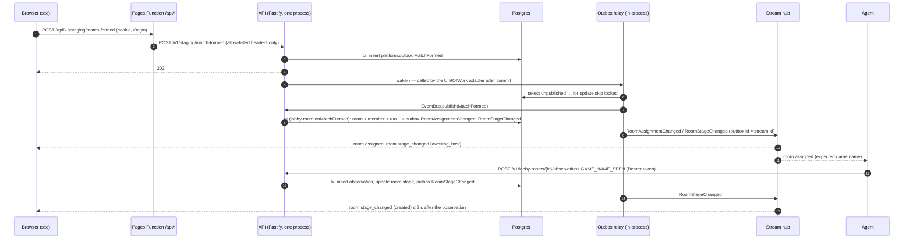

# API and Web Skeleton Design

**Spec**: `.specs/features/api-web-skeleton/spec.md`
**Status**: Draft (revision 2: closes the first architecture and security reviews)

---

## Architecture Overview

One Fastify 5 process (ADR 002, 006) holds the five modules, an in-memory event bus, the outbox relay and the stream
hub. Postgres (Neon in production, a Testcontainers/Docker Postgres locally) stores accounts, sessions, agents,
pairing codes, rooms, observations and the outbox. Presence, the agent-token cache, rate-limit counters and open
streams live in memory. The site is a static React 19 SPA on Cloudflare Pages; it calls the API only through the
same-origin Pages Function `/api/*` (ADR 012). The agent (simulated over HTTP in this feature) calls the API directly.



### Approaches considered (all deliver the same scope)

| Approach                                                               | Trade-off                                                                                                                                                                          | Verdict         |
| ---------------------------------------------------------------------- | ---------------------------------------------------------------------------------------------------------------------------------------------------------------------------------- | --------------- |
| **A. Relay woken in-process after each commit, plus a start-up sweep** | Every write comes from this single process (ADR 006), so a wake signal after commit is enough; the start-up sweep publishes rows left by a crash. No idle query, so Neon can sleep | **Recommended** |
| B. Relay on Postgres `LISTEN/NOTIFY`                                   | A permanently open connection keeps Neon awake (NFR-07: 100 CU-hours, scale-to-zero after 5 min)                                                                                   | Rejected        |
| C. Relay polling the outbox every few hundred ms                       | Simplest, but the polling query also keeps Neon awake around the clock                                                                                                             | Rejected        |

The same reasoning applies to presence and agent authentication: heartbeats update an in-memory `PresenceStore` and
are authenticated from an in-memory `AgentTokenCache`, so a heartbeat issues no SQL (AWS-13, AWS-33); an offline
sweep runs in memory every second.

### Where the rules run

Every rule a user sees runs in `domain` or `application` and is unit-tested and mutated (ADR 014): player-name
validation, session expiry, pairing-code expiry, single use and claim, rate limits, agent-version comparison,
presence and its 45 s offline rule, game-name format, room creation and the `awaiting_host → created` transition,
observation idempotency and membership. The site only maps contract values to translated labels; that mapping is a
pure function in `apps/web/src/shared/labels.ts` with its own Vitest tests. Matchmaking has no domain code in F0: the
staging test match is a fixed payload built in `application` (AD-033) and is mutated with the application layer.

---

## Code Reuse Analysis

### Existing Components to Leverage

| Component                   | Location                                                     | How to Use                                                                                                                                                                                       |
| --------------------------- | ------------------------------------------------------------ | ------------------------------------------------------------------------------------------------------------------------------------------------------------------------------------------------ |
| `Result`, `ok`, `err`       | `apps/api/src/shared-kernel/result.ts`                       | Every expected failure in domain and application                                                                                                                                                 |
| `Clock`, `FakeClock`        | `apps/api/src/shared-kernel/clock.ts`                        | Session and code expiry, rate-limit windows, presence offline rule, keep-alive                                                                                                                   |
| `IdGenerator` + fake        | `apps/api/src/shared-kernel/id-generator.ts`                 | Room, member, agent, match ids                                                                                                                                                                   |
| Five modules × three layers | `apps/api/src/modules/*/{domain,application,adapters}`       | Fill the empty layers; each `index.ts` becomes the module's public port                                                                                                                          |
| Mutation runner             | `apps/api/scripts/mutation.ts`, `mutation-plan.ts`           | Unchanged; both layers now have mutants (`mutation.api.application` gets its first value)                                                                                                        |
| Contracts workspace         | `packages/contracts` (`scripts/generate.ts`, `documents.ts`) | `documents.ts` is replaced (its header says so): Zod schemas → AsyncAPI + JSON Schema; OpenAPI comes from the API's routes                                                                       |
| Dependency rules            | `.dependency-cruiser.cjs`                                    | Every existing rule kept unchanged; **three rules added** (tightening, ADR 004), each with a violation fixture under `scripts/test/fixtures/arch/`: see § Dependency rules added                 |
| ESLint preset               | `packages/config/eslint.mjs`                                 | Tightened: `n/no-process-env` for `apps/api/src/**` outside `main/`; `i18next/no-literal-string` for `apps/web/src/**/*.tsx`; `no-restricted-properties` bans `Math.random` in `apps/api/src/**` |
| TypeScript presets          | `packages/config/tsconfig.base.json`, `tsconfig.dom.json`    | API extends base; web extends dom with `jsx: react-jsx`                                                                                                                                          |
| Acceptance runner           | `tests/acceptance` (`fixtures.ts`, playwright-bdd)           | New worker-scoped `stack` fixture and steps per context; config gains a `globalSetup` (below)                                                                                                    |
| CI integration job          | `.github/workflows/ci.yml` (`integration`)                   | Already runs `test:integration`, `test:e2e`, `test:acceptance` on Ubuntu runners with Docker; unchanged                                                                                          |
| Backup job                  | `.github/workflows/nightly.yml` (`backup`)                   | Untouched (out of scope)                                                                                                                                                                         |

### Integration Points

| System                        | Integration Method                                                                                                                                                                   |
| ----------------------------- | ------------------------------------------------------------------------------------------------------------------------------------------------------------------------------------ |
| Postgres                      | Kysely + `pg`; module repositories in `modules/*/adapters/postgres/`; `Outbox` and `UnitOfWork` in `platform/postgres/`; one schema per module; migrations in `apps/api/migrations/` |
| Cloudflare Pages              | `apps/web/functions/api/[[path]].ts`; build output `apps/web/dist`; deployed by `deploy-web.yml`                                                                                     |
| Render                        | `render.yaml`: one free web service, `node apps/api/src/main/render.ts`, health check `/healthz`, `autoDeploy: false`                                                                |
| Agent (agent-skeleton)        | Contract-only: JSON Schema files in `packages/contracts/json-schema/` consumed by `typify` (AD-035)                                                                                  |
| Telemetry (observability-e2e) | Use cases open spans with `@opentelemetry/api` (no-op until observability-e2e registers an SDK in `main/`)                                                                           |

---

## Components

### Shared kernel additions (`apps/api/src/shared-kernel/`)

- **Purpose**: Cross-module primitives that stay pure (no Fastify, no Kysely).
- **Interfaces**:
  - `DomainEvent<T, P> { type: T; payload: P }`; durable events of this feature: `MatchFormed`, `RoomAssignmentChanged`, `RoomStageChanged` (payloads per `docs/domain/events.md`); transient events: `AgentPresenceChanged`, `AgentRevoked`.
  - `BusEvent = { kind: 'durable'; id: bigint; event: DomainEvent } | { kind: 'transient'; event: DomainEvent }` — durable ones carry their outbox id, transient ones none.
  - `Outbox { append(tx, events): Promise<void> }` and `UnitOfWork { run<T>(work: (tx) => Promise<T>): Promise<T> }`; `Transaction` is an opaque branded type.
  - `EventBus { publish(e: BusEvent): Promise<void>; subscribe(type, handler): void }`.
  - `RandomSource { int(maxExclusive): number; bytes(n): Uint8Array }`; production implementation in `main/` uses `node:crypto` (`randomInt`, `randomBytes`); deterministic fake for tests.
  - `Scheduler { every(ms, fn): Cancel; at(time, fn): Cancel }` with `FakeScheduler` driven by `FakeClock`.
  - `withSpan<T>(name, attributes, fn)` in `tracing.ts` on `@opentelemetry/api` only (AWS-35). Attributes are ids and bounded enums only — never codes, secrets, tokens, IPs or names.

### Identity module (`modules/identity/`)

- **Purpose**: Test sign-in and sessions (AWS-01…AWS-04).
- **Domain**: `player-name.ts` — `PlayerName.parse(raw)` (`^[A-Za-z0-9-]{2,16}$`, no trimming) with `testKey` = lower-cased name (AD-042); `account.ts` — `Account { id, battletag, displayName, testKey? }`, test accounts have `battletag = '<display>#test'`; `session.ts` — `Session.open(accountId, now)`, `expiresAt = now + 7 days`, `isValidAt(now)` false from exactly 7 days.
- **Application**: `signInTestAccount({ name })` looks up or creates **only** by `testKey` among test accounts, so it can never return a non-test account; `authenticateSession(token)`; `getMe(accountId)`.
- **Ports**: `AccountRepository { findTestAccount(testKey), insertTestAccount }`, `SessionRepository { insert, findByHash }`, `SecretHasher { hash(domain: 'session' | 'agent' | 'claim', value): string }` (SHA-256 of `domain + ':' + value`, so a value from one table never matches another).
- **Adapters**: Postgres repositories; route plugin `identityRoutes(app, { useCases, guards })` with `POST /v1/auth/test-login` (staging only) and `GET /v1/me`.
- **Public port (`index.ts`)**: `IdentityPort { authenticateSession(token): Promise<Result<{ accountId, expiresAt }, 'unauthenticated'>> }`.
- **Cookie**: `__Host-d2rmm_session=d2rmm_s_<32 random bytes, base64url>; HttpOnly; Secure; SameSite=Lax; Path=/; Max-Age=604800`; never a `Domain` attribute (host-only, so preview deployments never share a session). Only the hash is stored.

### Agents module (`modules/agents/`)

- **Purpose**: Pairing, token, presence and version gate (AWS-05…AWS-18).
- **Domain**:
  - `pairing-code.ts` — `PairingCode.issue(agentId, random, now)`: 6 digits zero-padded, `expiresAt = now + 5 min`; `use(accountId, now)` → `Result<_, 'invalid-code'>`; `claimState(now)` → `'pending' | 'claimable' | 'gone'`.
  - `agent.ts` — `Agent { id, accountId?, tokenHash?, claimSecretHash, tokenClaimedAt?, pairedAt?, revokedAt? }`; `pair(accountId)`, `revoke(now)`; `isActive()` = token hash present and not revoked.
  - `sliding-window.ts` — `SlidingWindowLimit { limit, windowMs }.check(timestamps, now)` → `allowed | limited(retryAt)`: account code submissions 10 / 5 min (AD-032), IP code requests 10 / 1 h (AD-041). Every submission counts. IPv6 addresses are keyed by their /64 prefix.
  - `agent-version.ts` — `AgentVersion.parse(header)` (`^\d+\.\d+\.\d+$`), `isBelow(min)`.
  - `presence.ts` — `Presence { online, gameRunning, screen, lastSeenAt }`; `fromHeartbeat`; `isOfflineAt(now)` from `now - lastSeenAt ≥ 45 s`; `differs(a, b)`.
- **Application**: `requestPairingCode({ ip })`; `pairAgent({ accountId, code })` — revokes the account's previous agent in the same transaction (AD-037) and publishes transient `AgentRevoked`; `claimToken({ claimSecret })` — generates `d2rmm_a_<32 random bytes>` and stores its hash with one atomic statement (below), returns the token only when that statement updated a row, otherwise 410/202; `authenticateAgent({ token })` — empty token → `unauthenticated` before any lookup; `AgentTokenCache.get(hash)` hit → done; miss → one Postgres read, rejects a null hash or a non-null `revoked_at`, then caches; `recordHeartbeat`; `sweep()` every 1 s (presence offline rule and rate-limit pruning of timestamps older than the widest window); `getMyAgent({ accountId })`.
- **Ports**: `AgentRepository`, `PairingCodeRepository` (Postgres); `PresenceStore`, `RateLimitStore`, `AgentTokenCache` (memory, ADR 006; the cache is filled on claim, invalidated on revoke, bounded to 10 000 entries LRU); `RandomSource`, `SecretHasher`, `Clock`.
- **Adapters**: Postgres repositories, memory stores, route plugin `agentsRoutes(app, { useCases, guards })`: `POST /v1/agents/pairing-codes` (201), `POST /v1/agents/pairing-codes/claim` (secret in the JSON body; 200 / 202 / 410), `POST /v1/agents/pair` (site; 200 / 400 / 429), `POST /v1/agents/heartbeat` (204 / 400), `GET /v1/agents/me` (site). Claim and pairing-code responses send `Cache-Control: no-store`.
- **Public port**: `AgentsPort { authenticateAgent(token), accountOfAgent(agentId), currentAgentOf(accountId) }`.

Atomic claim (one round trip, no race between two claims with the same secret):

```sql
update agents.agents set token_hash = $tokenHash, token_claimed_at = $now
where claim_secret_hash = $secretHash and token_claimed_at is null and account_id is not null and revoked_at is null
returning id, account_id
```

### Matchmaking module (`modules/matchmaking/`)

- **Purpose**: The staging-only test match (AWS-19, AD-033).
- **Application**: `formTestMatch({ accountId })` appends `MatchFormed { matchId, mode: 'leveling', activity: 'baal', difficulty: 'hell', region: 'americas', ladder: 'sc-ladder', era: 'rotw', members: [{ accountId, characterId: null, joinOrder: 1, role: 'host' }] }` to the outbox in one transaction. No `matchmaking` schema in F0.
- **Adapters**: route plugin with `POST /v1/staging/match-formed` (staging only, 202).

### Lobby Room module (`modules/lobby-room/`)

- **Purpose**: The room aggregate and observations (AWS-20…AWS-25).
- **Domain**:
  - `game-name.ts` — `GameName.of(activity, difficulty, n)`; F0 supports `hell → 'h'` only and returns `err('unsupported-difficulty')` otherwise (FR-14 is F1); `matches(value)` = case-insensitive equality, no trimming (AD-034).
  - `lobby-room.ts` — `LobbyRoom.fromMatch(match, n, ids)` → `awaiting_host`, run 1, host = lowest `joinOrder`, empty password, events `[RoomAssignmentChanged, RoomStageChanged]` (AD-039); `observe(obs)` → only `GAME_NAME_SEEN` from the host's account, current run, matching value moves `awaiting_host → created`; anything else, and anything once `created`, is `ignored`.
  - `observation.ts` — `Observation { agentId, idempotencyKey, roomId, accountId, type, run, value (≤ 64 chars), confidence (0–1), capturedAt }`.
- **Application**: `onMatchFormed(event)` (idempotent by `matchId`); `recordObservation({ agentId, roomId, body })` in this order: membership (403, store nothing) → unknown type (202, store nothing) → idempotency key already stored **for this agent** (202, no change, INV-09) → insert + `observe` in one transaction; `getCurrentRoom({ accountId })` (newest room); `getAssignment({ agentId })`.
- **Ports**: `LobbyRoomRepository`, `ObservationRepository`, `GameNameSequence` (Postgres sequence `lobby.game_name_seq`).
- **Adapters**: route plugin with `POST /v1/lobby-rooms/:id/observations` (agent; body limit 4 KB), `GET /v1/agents/me/assignment` (agent), `GET /v1/me/room` (site).

### Platform (`apps/api/src/platform/`)

Adapters shared by the modules. Platform imports only modules' public `index.ts` and the shared kernel; modules never
import platform (rules below). Module route plugins receive the guards as a parameter typed structurally in each
module's adapters, so no module imports platform's code.

- **`http/guards.ts`** — Fastify preHandlers built from `IdentityPort` and `AgentsPort`, passed into every route plugin by `main/app.ts`:
  - `requireAgentVersion` — every agent route (pairing code, claim, heartbeat, assignment, observations, agent stream): no header, non-semver or below `AGENT_MIN_VERSION` → 426 before anything else (AWS-12).
  - `requireAgent` — `Authorization: Bearer d2rmm_a_…` → `request.agentId`; missing or invalid → 401; a cookie is ignored (AWS-11).
  - `requireSession` — cookie `__Host-d2rmm_session` → `request.accountId`; an `Authorization` header on a site route → 401 (AWS-11).
  - `requireSameOrigin` — on every cookie-authenticated non-GET route (test sign-in included): `Origin` must equal `SITE_ORIGIN` and `Content-Type` must be `application/json`, else 403 (CSRF, ADR 012). No CORS plugin: the API never sends `Access-Control-Allow-*`. No GET changes state.
- **`postgres/unit-of-work.ts`, `postgres/outbox.ts`** — Kysely transaction; `append` inserts into `platform.outbox`; after a commit that appended rows, the unit of work calls `relay.wake()`.
- **`outbox-relay.ts`** — `wake()`; `sweep()` at start-up; loop: `select … where published_at is null and failed_at is null order by id for update skip locked limit 100`; publish each in order; mark `published_at`. When a handler throws: increment `attempts`, keep the row, retry after 1, 2, 4, 8 s (scheduler); after the 5th failure set `failed_at` (dead letter, logged with the event id) and move on, so one poison event never stalls the rest. At-least-once; consumers dedupe (Lobby Room by `matchId`, clients by event id).
- **`event-bus.ts`** — `InMemoryEventBus`, subscribers awaited in order.
- **`stream-hub.ts`** — `GET /v1/stream`:
  - Credential precedence: an `Authorization` header selects an **agent** stream (`requireAgentVersion` + `requireAgent`; invalid → 401, no fallback to the cookie); otherwise the session cookie selects a **site** stream; a credential in the query string → 400. Neither credential opens the other kind (AWS-11).
  - Resume: on open, subscribe to live events and buffer them; then replay the client's projected events from the outbox with `id > Last-Event-ID` in order; then flush the buffer skipping ids already sent; then stream live. Recipients are resolved at replay time (the member's current agent).
  - Keep-alive comment `: ka` every 25 s (AWS-40). Headers `Content-Type: text/event-stream`, `Cache-Control: no-store, no-transform`, `X-Accel-Buffering: no`.
  - Closing: `AgentRevoked` closes that agent's streams; a site stream closes at its session's `expiresAt`; a 6th stream for the same account or agent closes the oldest (free single instance).
- **`stream-projection.ts`** (pure) — `RoomAssignmentChanged` → `room.assigned` for each member account and each member's current agent; `RoomStageChanged` → `room.stage_changed` for each member account; transient `AgentPresenceChanged` → `agent.presence_changed` for the owner account.
- **Event ids** (AWS-39): durable events carry `id: "<outboxId>"`; transient presence events carry `id: "<lastOutboxIdSentToThisStream>.<k>"` with `k` increasing per stream. Ids compare as `(outboxId, k)`, so every id increases; resume uses the part before the dot. The site re-reads presence with `GET /v1/agents/me` on every (re)connect, so a presence event lost in a reconnect is never stale (AD-056).

### Composition roots (`apps/api/src/main/`)

- `app.ts` — `buildApp(deps)`: Zod type provider, `@fastify/cookie`, `@fastify/swagger`, guards from `platform/http/guards.ts`, every module's route plugin, `/healthz` (no SQL), `/v1/config` → `{ stagingEndpoints, minAgentVersion }`. Staging routes are registered only when `deps.config.stagingEndpoints` is true, so they 404 otherwise (AWS-03). Logger `redact: ['req.headers.authorization', 'req.headers.cookie', 'res.headers["set-cookie"]']`; request bodies are never logged; the validation error handler answers `{ error: 'invalid-request', fields: [<paths>] }` without echoing values.
- `config.ts` — the only reader of `process.env`: `DATABASE_URL`, `PORT`, `HOST`, `SITE_ORIGIN`, `ENABLE_STAGING_ENDPOINTS` (default false), `D2RMM_ENV` (`local` | `staging` | `production`), `AGENT_MIN_VERSION` (default `0.0.0`), `TRUST_PROXY_HOPS` (default 1), `D2RMM_ACCEPTANCE`, `TEST_CONTROL_SECRET`.
- `local.ts` — Docker/Testcontainers Postgres, migrations on start, binds `127.0.0.1` only, `trustProxy` from `TRUST_PROXY_HOPS`; when `D2RMM_ACCEPTANCE=true` registers `main/test-controls.ts`.
- `test-controls.ts` — `POST /__test/reset` (truncate every table, restart `lobby.game_name_seq` and the outbox id sequence, clear presence, token cache and rate-limit stores, close open streams, reset the relay) and `POST /__test/clock` (advance the `ControllableClock`). Both require header `X-Test-Control: <TEST_CONTROL_SECRET>` (a random value `stack.ts` generates per run), and reset refuses unless the database name matches `^acc_w\d+$` and the host is `localhost`/`127.0.0.1` (AD-045).
- `render.ts` — Neon with TLS, binds `0.0.0.0:$PORT`, `trustProxy: TRUST_PROXY_HOPS`. **Fail-closed**: refuses to start when `ENABLE_STAGING_ENDPOINTS=true` unless `D2RMM_ENV=staging`, and when `D2RMM_ACCEPTANCE` is set at all. Never imports `test-controls.ts` (rule below).
- `migrate.ts` — `pnpm --filter @d2rmm/api db:migrate` (Kysely `Migrator` over `apps/api/migrations`).
- `openapi.ts` — script: builds the app with in-memory ports and writes `app.swagger()` to `packages/contracts/openapi.json`; the API's `contracts:openapi` task (Turbo `dependsOn: ["^build"]` builds `@d2rmm/contracts` first).
- Integration tests that build the whole app live under `apps/api/src/main/__tests__/` (inside `main/`, so `nobody-imports-main` holds without an exception); module-level integration tests (repositories against Testcontainers) live next to their adapters.

### Dependency rules added (`.dependency-cruiser.cjs`, tightening only)

| Rule                         | From                             | To (forbidden)                          | Fixture                                                    |
| ---------------------------- | -------------------------------- | --------------------------------------- | ---------------------------------------------------------- |
| `platform-is-adapter`        | `^apps/api/src/modules/`         | `^apps/api/src/platform/`               | `scripts/test/fixtures/arch/module-imports-platform/`      |
| `platform-uses-public-ports` | `^apps/api/src/platform/`        | `^apps/api/src/modules/[^/]+/(domain    | application                                                | adapters)/` | `scripts/test/fixtures/arch/platform-imports-internal/` |
| `render-no-test-controls`    | `^apps/api/src/main/render\.ts$` | `^apps/api/src/main/test-controls\.ts$` | `scripts/test/fixtures/arch/render-imports-test-controls/` |

`platform → main` is already forbidden by `nobody-imports-main`. The existing fixture test gains the three cases.

### Contracts (`packages/contracts/src/`)

- `http/*.ts` — Zod schemas per route: `PairingCodeResponse { code: /^\d{6}$/, expiresAt, claimSecret }`, `ClaimRequest { claimSecret }`, `ClaimResponse { token }`, `Heartbeat` (Design Doc shape, `screen: 'UNKNOWN' | 'AUTOMAP_OPEN'`), `Observation` (`type`: the six glossary types, unknown types caught to `UNKNOWN`; `value` ≤ 64 chars; `idempotencyKey` ≤ 64 chars), `Assignment`, `RoomView`, `MeResponse`, `AgentView`, `ConfigResponse`, `TestLoginRequest`, `ErrorResponse`.
- `events/*.ts` — `room.assigned`, `room.stage_changed`, `agent.presence_changed` (`SiteStreamEvent`, `AgentStreamEvent`).
- `documents.ts` — writes `asyncapi.json` (AsyncAPI 3.0, channel `stream`) and the JSON Schemas (`z.toJSONSchema`) to `json-schema/{pairing-code,claim,heartbeat,assignment,observation,agent-stream-event}.json` (AWS-36).
- Root `package.json` `contracts:check` diffs `packages/contracts/json-schema/` too.

### Web (`apps/web/`)

- **Stack**: React 19, Vite 8, `react-i18next`, native `fetch` and `EventSource`; TanStack Router and Query come in F1 (AD-046).
- **Structure** (rule `web-features-isolated`): `app/` (App, i18n bootstrap, layout with notice and download link), `features/identity/` (SignInPanel), `features/agents/` (PairingForm, PresencePanel), `features/lobby-room/` (RoomPanel, StartTestMatchButton), `shared/` (`api-client.ts` → `/api/v1/...` with `Content-Type: application/json` on every POST, `stream.ts` → `EventSource('/api/v1/stream')`, `labels.ts`, `locales/en.json`, `locales/pt-BR.json`, `language.ts`).
- **States**: signed out (sign-in form on staging), loading ("Loading…"), error ("Something went wrong. Try again.", previous content kept), unauthorised (401 → signed-out view).
- **Pages Function** `functions/api/[[path]].ts` (AWS-29):
  - Path: strip `/api`; allow only `/healthz` and `^/v1(/[A-Za-z0-9_-]+)*$` after decoding, and reject anything containing `..`, `//`, `%2f`, `%5c` or `\` (404). `/__test/*` is therefore unreachable through the site.
  - Target: `const target = new URL(env.API_ORIGIN); target.pathname = path; target.search = url.search` — never string concatenation.
  - Request headers: an allow-list only — `cookie`, `content-type`, `accept`, `accept-language`, `last-event-id`, `origin`, `traceparent`. `Authorization`, `X-Agent-Version`, `Host`, `X-Forwarded-*` and `CF-*` from the browser are dropped, so a browser can never act as an agent through the site.
  - Response: `new Response(upstream.body, upstream)` so `Set-Cookie` passes through and stream bodies are piped chunk by chunk; `Cache-Control: no-store` added on `/api/*`.

### Workflows and hosting files

- `deploy-web.yml` — job `build` (no secrets): install with `--frozen-lockfile`, build `apps/web`, upload `dist` as an artifact; job `deploy` (needs `build`; secrets `CLOUDFLARE_API_TOKEN` scoped to Pages:Edit, `CLOUDFLARE_ACCOUNT_ID`): `push` to `main` (paths `apps/web/**`, `packages/**`) → `wrangler pages deploy … --branch main`; `pull_request` → preview only when `github.event.pull_request.head.repo.full_name == github.repository`, the branch name passed through `env:` and quoted (never `${{ }}` inside `run:`), and the preview URL commented on the PR. Pages variable `API_ORIGIN` points at the single (staging-enabled) Render service in F0.
- `deploy-api.yml` — `workflow_run` of `ci`, `types: [completed]`, guarded by `conclusion == 'success' && event == 'push' && head_branch == 'main' && head_repository.full_name == github.repository`; checks out `workflow_run.head_sha`; continues only if the diff touches `apps/api/**` or `packages/**`; `pnpm install --frozen-lockfile --ignore-scripts`; `pnpm --filter @d2rmm/api db:migrate` with `NEON_DATABASE_URL`; `curl -fsS -X POST "$RENDER_DEPLOY_HOOK"`; poll `${{ vars.API_BASE_URL }}/healthz` every 10 s for up to 5 min, else fail (AWS-34). Environment `production` (secrets are environment secrets, required reviewer, `main` only).
- Both: `permissions:` minimal (`contents: read`; `pull-requests: write` only on the preview-comment job), a `concurrency` group, third-party actions pinned by commit SHA.
- `render.yaml` — one `web` service, `plan: free`, `healthCheckPath: /healthz`, `autoDeploy: false`, env `D2RMM_ENV=staging` and `ENABLE_STAGING_ENDPOINTS=true` for F0 (brief Q3: off in production after F0).
- `scripts/test/deploy-workflows.test.mjs` (harness self-test) parses both workflows and asserts: triggers and guards above, no `${{ github.head_ref }}` or `${{ github.event.* }}` inside `run:`, secrets only in the deploy jobs, migrate before deploy hook, the 5-minute health loop, pinned actions, minimal permissions.

### Acceptance stack (`tests/acceptance/`)

- `playwright.config.ts` gains `globalSetup: './support/global-setup.ts'`: starts one Postgres container and exposes its URL. Nothing else changes (retries 0, `forbidOnly`, timeout 60 s).
- `support/stack.ts` — worker-scoped fixture, started lazily by the first step that needs it: creates database `acc_w<workerIndex>`, generates `TEST_CONTROL_SECRET`, spawns two API processes (`node apps/api/src/main/local.ts`, one with `ENABLE_STAGING_ENDPOINTS=true`, one without; both `AGENT_MIN_VERSION=0.0.1`, `D2RMM_ACCEPTANCE=true`, `SITE_ORIGIN` = their site) and two `wrangler pages dev apps/web/dist` servers pointing at them, on worker-specific ports. Before each scenario: `POST /__test/reset`. Child processes only (rule `acceptance-is-black-box`).
- `support/agent-client.ts` — the simulated agent over HTTP, typed with `@d2rmm/contracts`; every request sends `X-Agent-Version` and a per-scenario `X-Forwarded-For` (the local API trusts one hop and listens on loopback only).
- Steps: `steps/identity.steps.ts`, `steps/agents.steps.ts`, `steps/lobby-room.steps.ts`.

---

## Data Models

```sql
-- apps/api/migrations/0001_skeleton.ts (Kysely)
create schema identity; create schema agents; create schema lobby; create schema platform;

create table identity.accounts (id uuid primary key, battletag text not null unique, display_name text not null,
  test_key text unique, created_at timestamptz not null);            -- test_key only on '#test' accounts
create table identity.sessions (token_hash text primary key, account_id uuid not null references identity.accounts,
  expires_at timestamptz not null);

create table agents.agents (id uuid primary key, account_id uuid references identity.accounts,
  claim_secret_hash text not null unique, token_hash text unique, token_claimed_at timestamptz,
  paired_at timestamptz, revoked_at timestamptz, created_at timestamptz not null);
create table agents.pairing_codes (agent_id uuid primary key references agents.agents, code char(6) not null,
  expires_at timestamptz not null, used_at timestamptz);
create unique index pairing_codes_live on agents.pairing_codes (code) where used_at is null;
  -- issuing a code first deletes expired unused rows with the same code, then retries on conflict

create sequence lobby.game_name_seq;
create table lobby.rooms (id uuid primary key, match_id uuid not null unique, mode text not null,
  activity text not null, difficulty text not null, host_account_id uuid not null, stage text not null,
  current_run int not null, created_at timestamptz not null);
create table lobby.members (room_id uuid references lobby.rooms, account_id uuid not null, character_id uuid,
  role text not null, join_order int not null, primary key (room_id, account_id));
create table lobby.runs (room_id uuid references lobby.rooms, number int not null, game_name text not null unique,
  opened_at timestamptz not null, primary key (room_id, number));
create table lobby.observations (agent_id uuid not null, idempotency_key text not null, room_id uuid not null,
  type text not null, run int not null, value text not null, confidence real not null,
  captured_at timestamptz not null, received_at timestamptz not null, primary key (agent_id, idempotency_key));

create table platform.outbox (id bigserial primary key, event_type text not null, payload jsonb not null,
  created_at timestamptz not null, published_at timestamptz, attempts int not null default 0, failed_at timestamptz);
create index outbox_pending on platform.outbox (id) where published_at is null and failed_at is null;
```

**Relationships**: an account has at most one active agent (enforced in `pairAgent`); `lobby` references accounts by
id only (no cross-schema foreign key, ADR 002 schema ownership). The idempotency key is scoped to the agent, so one
agent can never shadow another agent's observation.

---

## Security controls (summary)

| Threat                                      | Control                                                                                                                                                              |
| ------------------------------------------- | -------------------------------------------------------------------------------------------------------------------------------------------------------------------- |
| SSRF / open proxy through the Function      | Path allow-list, `URL`-based target, header allow-list, `/__test` unreachable (unit-tested with hostile paths)                                                       |
| CSRF on cookie routes                       | `SameSite=Lax` + `requireSameOrigin` (Origin = `SITE_ORIGIN`, JSON content type) on every non-GET cookie route; no CORS; no state change on GET                      |
| Agent token used as a session or vice versa | Separate guards; `Authorization` on a site route → 401; the Function strips `Authorization`; prefixes `d2rmm_s_` / `d2rmm_a_` and domain-separated hashes            |
| Token race / replay on claim                | One atomic `update … returning`; plaintext token returned once, never stored; `Cache-Control: no-store`; secrets only in bodies                                      |
| Weak randomness                             | `RandomSource` backed by `node:crypto` in `main/`; ESLint bans `Math.random` in `apps/api/src/**`                                                                    |
| Revoked agent keeps streaming               | `AgentRevoked` closes its streams and invalidates the token cache; expired sessions close their stream at `expiresAt`                                                |
| Staging login in production                 | Flag defaults off; `render.ts` refuses `ENABLE_STAGING_ENDPOINTS=true` without `D2RMM_ENV=staging`; test sign-in only finds `#test` accounts; 404 test with flag off |
| Test controls reachable remotely            | Only `local.ts` (loopback bind), secret header, DB-name and host guard, depcruise rule, test that `render.ts` registers no `/__test` route                           |
| IP spoofing of the pairing-code limit       | `TRUST_PROXY_HOPS` (default 1 for Render); IPv6 by /64; integration test sends a forged left-most `X-Forwarded-For` and expects it ignored                           |
| Secrets in logs and spans                   | Logger redaction, no body logging, span attributes limited to ids and enums, validation errors without values; a test scans captured logs of the pairing flow        |
| Workflow injection and fork secrets         | Guards on `workflow_run` and previews, `env:`-passed refs, secret-free build jobs, environment secrets, SHA-pinned actions, static workflow test                     |

---

## Error Handling Strategy

| Error Scenario                               | Handling                                                                          | User Impact                                           |
| -------------------------------------------- | --------------------------------------------------------------------------------- | ----------------------------------------------------- |
| Invalid player name                          | 400 `{ error: 'invalid-player-name' }`                                            | "Use 2 to 16 letters, digits or hyphens."             |
| Unknown / expired / used code                | 400 `{ error: 'invalid-code' }`                                                   | "This code is invalid or has expired."                |
| Rate limited                                 | 429 `{ error: 'rate-limited' }` + `Retry-After`                                   | "Too many attempts. Try again in a few minutes."      |
| Missing/invalid session or token             | 401                                                                               | Signed-out view; agent re-pairs                       |
| Cross-origin or non-JSON cookie POST         | 403 `{ error: 'forbidden' }`                                                      | none (an attack)                                      |
| Agent version too old / missing / not semver | 426 before auth                                                                   | Agent updates (agent-skeleton)                        |
| Observation for a room the account is not in | 403, nothing stored                                                               | none                                                  |
| Body breaks the contract                     | 400 `{ error: 'invalid-request', fields }`, values not echoed; presence untouched | none                                                  |
| Postgres down during a request               | 503 `{ error: 'unavailable' }`; transaction rolled back, nothing published        | "Something went wrong. Try again."                    |
| Crash between commit and relay               | Start-up `sweep()` publishes unpublished rows                                     | Event arrives after the restart; stream resumes by id |
| Consumer throws on an event                  | Backoff 1–8 s, dead letter after 5 attempts, relay continues                      | Logged; later events unaffected                       |
| Stream drops                                 | `EventSource` reconnects with `Last-Event-ID`; site re-reads room and presence    | none beyond the reconnect delay                       |
| Health check during Neon cold start          | `/healthz` never queries Postgres                                                 | Render keeps the instance healthy                     |

---

## Risks & Concerns

| Concern                                                                                       | Location (file:line)                                          | Impact                                                                                  | Mitigation                                                                                                                                                                                                                                                                                                       |
| --------------------------------------------------------------------------------------------- | ------------------------------------------------------------- | --------------------------------------------------------------------------------------- | ---------------------------------------------------------------------------------------------------------------------------------------------------------------------------------------------------------------------------------------------------------------------------------------------------------------- |
| HF-04's scenario asserts "OpenAPI … with no paths" and "AsyncAPI … with no channels"          | `.specs/features/harness-foundation/acceptance.feature:53-55` | False once this feature adds routes; harness-foundation's acceptance fails              | The documents were declared placeholders (`packages/contracts/src/documents.ts:1-2`). A task rewrites the two Then lines to structural assertions — "declares version 3.1 and the path /healthz", "declares version 3.0 and the channel stream" — and the gate asks the maintainer to confirm that edit (AD-044) |
| Render's real proxy chain is not verified                                                     | `main/render.ts`                                              | A wrong hop count shares one IP bucket among all players, or lets the limit be bypassed | `TRUST_PROXY_HOPS` is config; the phase review checklist asks the maintainer to send a forged `X-Forwarded-For` to the deployed API and confirm the resolved IP in the logs before F1                                                                                                                            |
| Pairing-code brute force across many accounts                                                 | `pairAgent`                                                   | N accounts × 10 guesses / 5 min against a 1 M space                                     | F0 limits are the spec's (AD-032, AD-041); test sign-in is staging-only, so accounts are not free in production. A global failed-submission ceiling and a claim limit are queued for F1 with real login (decisions.md)                                                                                           |
| No sign-out or revoke-agent route                                                             | spec Out of Scope                                             | A session lives 7 days; the only revoke is re-pairing                                   | FR-04 and real login are F1; streams close on revoke and at session expiry                                                                                                                                                                                                                                       |
| Room stage moved by one agent's claim                                                         | `LobbyRoom.observe`                                           | A host can mark their own room Created                                                  | No ranking impact in F0; INV-14 keeps ELO to double-confirmed results in F3                                                                                                                                                                                                                                      |
| In-memory counters reset on restart                                                           | `RateLimitStore`                                              | A restart clears limits                                                                 | Accepted for F0 (ADR 006); recorded in decisions.md                                                                                                                                                                                                                                                              |
| Docker not running on the maintainer's machine                                                | environment                                                   | Integration and acceptance gates fail locally                                           | The runner checks `docker info` before dispatching those batches and escalates if Docker is down                                                                                                                                                                                                                 |
| Acceptance starts a Postgres container for every run, harness-foundation's scenarios included | `tests/acceptance/playwright.config.ts`                       | Slower runs; Docker needed even for `@HF-*`                                             | Only the container starts globally; API and wrangler start lazily per worker                                                                                                                                                                                                                                     |
| Secure `__Host-` cookie on `http://localhost`                                                 | acceptance                                                    | A browser could drop it                                                                 | Chromium treats `localhost` as a secure context; acceptance runs only Chromium                                                                                                                                                                                                                                   |
| Outbox and observations grow without clean-up                                                 | `platform.outbox`, `lobby.observations`                       | Neon 1 GB                                                                               | F0 volume is tiny; F1 adds the 30-day retention job                                                                                                                                                                                                                                                              |

---

## Tech Decisions (only non-obvious ones)

| Decision                  | Choice                                                                                   | Rationale                                                                                 |
| ------------------------- | ---------------------------------------------------------------------------------------- | ----------------------------------------------------------------------------------------- |
| Relay trigger             | In-process wake after commit + start-up sweep; dead letter after 5 failures              | Single writer process; Neon can sleep; one poison event cannot stall the rest             |
| Presence events           | Transient bus events, not the outbox; ids `<outboxId>.<k>`                               | AWS-13 forbids Postgres writes per heartbeat; AWS-39 needs increasing ids (AD-056)        |
| Agent authentication      | In-memory token cache filled on claim, read-through once after a restart                 | Heartbeats issue no SQL (AWS-33, NFR-07)                                                  |
| Guards                    | Built in `platform/http`, injected into module route plugins by `main/app.ts`            | Cross-module hooks without importing another module's adapters                            |
| One stream route          | `GET /v1/stream`; `Authorization` selects agent, else cookie selects site                | ADR 007 names one route; AWS-11 holds because neither credential opens the other's stream |
| OpenAPI source            | `main/openapi.ts` from the Fastify routes, written into `packages/contracts`             | ADR 020; `contracts-are-leaf` forbids contracts importing the API                         |
| Unknown observation types | Zod catch → `UNKNOWN`, 202, not stored                                                   | AWS-25; Design Doc "o servidor descarta o que não reconhece"                              |
| `matchmaking` schema      | None in F0                                                                               | AWS-32 lists four schemas                                                                 |
| Acceptance isolation      | Per-worker database and stack, reset per scenario, controllable clock in `local.ts` only | Personas repeat across scenarios; expiry and rate windows need time travel (AD-045)       |
| Web data layer            | `fetch` + `EventSource`, no TanStack in F0                                               | One page (AD-046)                                                                         |
