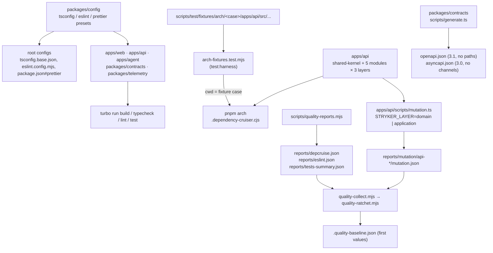

# Harness Foundation Design

**Spec**: `.specs/features/harness-foundation/spec.md`
**Status**: Approved (architecture-reviewer PASS on retry 1, 2026-10-30)

---

## Architecture Overview

The feature adds the six workspaces and connects each existing sensor to real code. No runtime is added: every
component is a workspace manifest, a configuration preset, pure shared-kernel code with its tests, or a harness script
that turns a sensor run into the report file `quality-collect.mjs` already reads.

Approach chosen: **presets as a real workspace, consumed by the root configs** (recommended and used). The
alternatives — keeping the root files as the source and having `packages/config` re-export them, or copying the
presets into every workspace — were rejected: the first inverts ADR 001's ownership (the package would depend on the
root), the second lets workspaces drift. All three deliver the same scope.

**Module syntax.** Code run directly by Node 26 (type stripping) imports sibling TypeScript files with `.ts`
specifiers; the preset adds `rewriteRelativeImportExtensions: true` (so `tsc` accepts them and rewrites them to `.js`
on emit) and `erasableSyntaxOnly: true` (so every file stays runnable by Node: no `enum`, no parameter properties, no
namespaces). Both are TypeScript 5.9 options (installed: 5.9.3) and only tighten what compiles. Every workspace uses
`.ts` specifiers for relative imports.

---

## Code Reuse Analysis

### Existing Components to Leverage

| Component                    | Location                                                                                | How to Use                                                                                                                                       |
| ---------------------------- | --------------------------------------------------------------------------------------- | ------------------------------------------------------------------------------------------------------------------------------------------------ |
| Root TypeScript options      | `tsconfig.base.json`                                                                    | Move into `packages/config/tsconfig.base.json`, plus the two options above; the root file extends it                                             |
| Root ESLint flat config      | `eslint.config.mjs`                                                                     | Move into `packages/config/eslint.mjs`, every rule unchanged, four ignores added (below); the root file re-exports it                            |
| Prettier options             | `.prettierrc.json`                                                                      | Move into `packages/config/prettier.json`; the root `package.json` gets `"prettier": "@d2rmm/config/prettier"` and `.prettierrc.json` is removed |
| Architecture rules           | `.dependency-cruiser.cjs`                                                               | Unchanged; the fixture test runs it from each fixture folder                                                                                     |
| Metric collector and ratchet | `scripts/quality-collect.mjs`, `scripts/lib/collect.mjs`, `scripts/quality-ratchet.mjs` | Unchanged; the new report files match the paths and shapes they already read                                                                     |
| Harness test runner          | `pnpm test:harness` (`node --test scripts/**/*.test.mjs`)                               | Picks up `scripts/test/arch-fixtures.test.mjs` and `scripts/test/quality-reports.test.mjs` with no config change                                 |
| Acceptance runner            | `tests/acceptance` (playwright-bdd, `missingSteps: 'fail-on-gen'`)                      | Add `steps/harness-foundation.steps.ts`; no config change                                                                                        |
| Turborepo tasks              | `turbo.json`                                                                            | Same task names; `test:mutation` gets `"cache": false` (below)                                                                                   |
| CI conditions                | `.github/workflows/ci.yml`                                                              | `hashFiles('apps/api/stryker.config.*')` and `packages/contracts/package.json` switch the mutation and drift steps on                            |

### Integration Points

| System                                    | Integration Method                                                                                                                                                      |
| ----------------------------------------- | ----------------------------------------------------------------------------------------------------------------------------------------------------------------------- |
| pnpm workspaces                           | `pnpm-workspace.yaml` already lists `apps/*`, `packages/*`, `tests/*`; root adds `@d2rmm/config: workspace:*` (the symlink `tsc`, ESLint and dependency-cruiser follow) |
| Lefthook `unit-related`                   | `pnpm exec vitest related` at the root needs Vitest at the root and a root `vitest.config.ts` with `test.projects`                                                      |
| Quality gate (`pnpm check`, pre-push, CI) | `quality:gate` runs `quality:reports` before `quality-collect.mjs`, so `tests.skipped`, `lint.warnings` and `arch.violations` are measured wherever the ratchet runs    |

---

## Components

### `@d2rmm/config` presets

- **Purpose**: Single source of the TypeScript, ESLint and Prettier configuration (HF-02).
- **Location**: `packages/config/`
- **Interfaces** (`package.json` `exports`):
  - `./tsconfig.base.json` — the current root options, plus `rewriteRelativeImportExtensions` and `erasableSyntaxOnly` (both `true`).
  - `./tsconfig.dom.json` — extends the base with `lib: ["ES2024", "DOM", "DOM.Iterable"]` for `apps/web` and `apps/agent`.
  - `./eslint` → `eslint.mjs` (default export) — the current root flat-config array with every rule unchanged. Its `ignores` keeps all current entries and adds `.claude/worktrees/**`, `**/.features-gen/**`, `**/.stryker-tmp/**` and `**/.turbo/**`: generated or foreign trees that `eslint .` would otherwise lint (other worktrees, playwright-bdd output, Stryker sandboxes). The `files` globs stay relative to the root, because ESLint resolves them against the loaded root `eslint.config.mjs`.
  - `./prettier` → `prettier.json` — the current Prettier options.
- **Dependencies**: `@eslint/js`, `typescript-eslint`, `eslint-config-prettier`, `globals` move from root `devDependencies` to this package's `dependencies`.
- **Scripts**: `build` and `typecheck` = `tsc -p tsconfig.json --noEmit` over `test/presets.test.ts`; `lint` = `eslint --max-warnings 0 .`; `test` = `vitest run`.
- **Tests**: `test/presets.test.ts` holds a literal copy of the expected configuration and asserts **deep equality**, not spot checks: the full `compilerOptions` of `tsconfig.base.json`, the full Prettier options, and the full ESLint array after resolving it (every `ignores` entry, `no-console`, `eqeqeq`, the `TSEnumDeclaration` ban, `no-explicit-any`, `consistent-type-imports`, the domain `no-restricted-globals` / `no-restricted-properties` block with its `files` glob, the `scripts`/hooks `no-console: off` override). For the plugin-provided blocks (`js.configs.recommended`, `tseslint.configs.strict`, `prettier`) it asserts they are present by reference. Losing or relaxing any rule fails this test, which replaces the content check the gate applied to the old root file.

Root files after the move: `tsconfig.base.json` = `{ "extends": "@d2rmm/config/tsconfig.base.json" }` (dependency-cruiser keeps reading it); `eslint.config.mjs` = `export { default } from '@d2rmm/config/eslint';`; `package.json` `"prettier": "@d2rmm/config/prettier"` (Prettier's documented shared-config form); `.prettierrc.json` removed.

### Workspace skeletons (`apps/web`, `apps/agent`, `packages/telemetry`)

- **Purpose**: Empty workspaces that build, type-check, lint and test (HF-01). AD-026: `apps/agent` has no `src-tauri/`.
- **Location**: `apps/web/`, `apps/agent/`, `packages/telemetry/`
- **Interfaces**: `package.json` (`name`, `private`, `type: module`, `version: 0.0.0`; `apps/agent`'s version is the release-please start), `tsconfig.json` extending the preset (`include: ["src", "scripts", "test"]` where they exist), `tsconfig.build.json` (`src` only, tests excluded), `src/index.ts` = `export {};`.
- **Scripts (all five code workspaces)**: `build` = `tsc -p tsconfig.build.json`; `typecheck` = `tsc --noEmit`; `lint` = `eslint --max-warnings 0 .` (the whole workspace, so `scripts/` and tests are linted where `pnpm lint` runs, not first in the ratchet); `test` = `vitest run --passWithNoTests`.
- **Known gap (follow-up for `api-web-skeleton`)**: the ESLint preset declares only `globals.node`; browser globals for `apps/web` and the agent UI come with their first code.

### `@d2rmm/contracts` generator

- **Purpose**: Generate the empty OpenAPI 3.1 and AsyncAPI 3.0 documents, deterministically (HF-04).
- **Location**: `packages/contracts/src/documents.ts`, `packages/contracts/scripts/generate.ts`
- **Interfaces**:
  - `buildOpenApiDocument(): OpenApiDocument` — `{ openapi: '3.1.0', info: { title: 'D2R Match Making API', version: '0.0.0' }, paths: {} }`.
  - `buildAsyncApiDocument(): AsyncApiDocument` — `{ asyncapi: '3.0.0', info: { title: 'D2R Match Making events', version: '0.0.0' }, channels: {} }`.
  - `scripts/generate.ts` imports `../src/documents.ts` and writes both to `packages/contracts/{openapi,asyncapi}.json` as `JSON.stringify(doc, null, 2) + '\n'` (Prettier-stable, no timestamps). `contracts:openapi` = `node scripts/generate.ts`.
- **Dependencies**: none. `documents.ts` is a placeholder: `api-web-skeleton` **replaces** it with generation from Zod and Fastify (ADR 009, ADR 020); it is not extended by hand.
- **Tests**: `src/documents.test.ts` — versions, empty `paths` / `channels`, and two calls returning equal documents.

### API shared kernel

- **Purpose**: Pure building blocks every domain uses; also the first mutation target (HF-06, AD-027).
- **Location**: `apps/api/src/shared-kernel/{result,clock,id-generator,index}.ts`
- **Interfaces**:
  - `type Result<T, E> = Ok<T> | Err<E>`; `ok(value)`, `err(error)`, `isOk(r)`, `isErr(r)` (type guards).
  - `interface Clock { now(): Date }`; `class FakeClock implements Clock` with `constructor(start: Date)`, `now()` returning a copy, `advance(ms: number)`, `set(date: Date)`.
  - `interface IdGenerator { next(): string }`; `class SequentialIdGenerator implements IdGenerator` with `constructor(prefix = 'id')`, `next()` returning `${prefix}-1`, `${prefix}-2`, …
- **Dependencies**: none (rule `shared-kernel-is-leaf`; no `Date.now`, no `Math.random`). Fakes live in the kernel because they are pure and every domain test needs them.
- **Tests**: one Vitest file per source file, 1:1 to HF-06 AC 1, written to kill mutants (equality on values, not truthiness).

### API modules × layers

- **Purpose**: The five modules of ADR 002 with the three layers of ADR 003 (HF-05).
- **Location**: `apps/api/src/modules/{identity,agents,matchmaking,lobby-room,ranking}/`
- **Interfaces**: `index.ts` = `export {};` (the public port, empty until a feature fills it); `domain/.gitkeep`, `application/.gitkeep`, `adapters/.gitkeep`. No `main/` yet (`api-web-skeleton`).
- **Expected warnings**: the `export {}` entry files have no importer yet and raise `no-orphans` **warnings** (severity `warn`; `arch.violations` counts errors only). They disappear as features import them. The rule is not changed.

### Mutation runner

- **Purpose**: Run Stryker once per layer with the layer's globs, thresholds and report path; write an empty report when a layer has nothing to mutate (HF-06, HF-09).
- **Location**: `apps/api/stryker.config.mjs`, `apps/api/scripts/mutation-plan.ts`, `apps/api/scripts/mutation.ts`
- **Interfaces**:
  - `mutation-plan.ts` exports `type Layer = 'domain' | 'application'`, `layerConfig(layer)` (the per-layer Stryker options: `mutate` — domain: `src/modules/*/domain/**/*.ts` + `src/shared-kernel/**/*.ts`; application: `src/modules/*/application/**/*.ts`; both excluding `*.test.ts` — `thresholds` `{ high: 90, low: 80, break: 80 }` / `{ high: 85, low: 70, break: 70 }`, `jsonReporter.fileName` = `../../reports/mutation/api-<layer>/mutation.json`, `htmlReporter.fileName` beside it, `incrementalFile` = `reports/stryker-incremental-<layer>.json`), `planLayer(root, layer): { files: string[]; reportPath: string }` and `emptyReport()` (`{ schemaVersion: '2', thresholds: { high: 80, low: 60 }, files: {} }`). The break values mirror the floors in `.quality-baseline.json`; a comment in both places names the other.
  - `stryker.config.mjs` imports `layerConfig` from `./scripts/mutation-plan.ts` and exports the shared options (`testRunner: 'vitest'`, `checkers: ['typescript']`, `reporters: ['json', 'html', 'clear-text', 'progress']`) merged with `layerConfig(process.env.STRYKER_LAYER)`.
  - `mutation.ts` — for `domain` then `application`: if `planLayer` finds no file, write `emptyReport()` to the report path and continue; otherwise spawn `stryker run` with `STRYKER_LAYER` set, forwarding the CLI arguments it received (CI passes `--incremental`). Exits with the first non-zero Stryker exit code. `test:mutation` = `node scripts/mutation.ts`.
  - `turbo.json`: `test:mutation` gets `"cache": false` — the reports land outside the workspace, so a cache hit would skip the run and leave no report. This runs the sensor more often; it loosens nothing.
- **Dependencies**: `@stryker-mutator/core`, `@stryker-mutator/vitest-runner`, `@stryker-mutator/typescript-checker` (dev).
- **Tests**: `scripts/mutation-plan.test.ts` — break thresholds per layer; report paths; on a temporary directory with no application file, the runner writes a report with zero mutants and exits 0 (HF-09); with a domain file, `planLayer` lists it. `apps/api/tsconfig.json` includes `scripts/`.

### Architecture violation fixtures

- **Purpose**: Prove each layer rule rejects its violation (HF-03) without touching the scanned tree (HF-05 AC 7).
- **Location**: `scripts/test/fixtures/arch/<case>/` and `scripts/test/arch-fixtures.test.mjs`
- **Cases** — each a folder mirroring `apps/api/src/...` plus a two-line `tsconfig.base.json` (the config resolves `tsConfig` from the working directory). The importer's layer is pinned so each case breaks exactly one error rule:
  - `domain-imports-adapter`: `modules/a/domain/x.ts` imports `modules/a/adapters/y.ts` → `domain-is-pure`
  - `application-imports-adapter`: `modules/a/application/x.ts` imports `modules/a/adapters/y.ts` → `application-no-adapters`
  - `cross-module-internal`: `modules/a/adapters/x.ts` imports `modules/b/domain/y.ts` → `no-cross-module-internals`
  - `module-imports-main`: `modules/a/adapters/x.ts` imports `main/local.ts` → `nobody-imports-main`
  - `clean`: `modules/a/adapters/x.ts` imports `modules/a/domain/y.ts` and `modules/b/index.ts` → no violation (control)
- **Interfaces**: the test spawns `depcruise --config <absolute repo path>/.dependency-cruiser.cjs --output-type json apps` with `cwd` = the case folder. For each violation case it asserts exit ≠ 0 and that the set of `rule.name` among `summary.violations` with `severity: 'error'` equals exactly `{ expected rule }`. For `clean` it asserts exit 0 and `summary.violations` empty. Fixture files are plain re-exports (`export { y } from '../adapters/y.ts';`) so they lint and format clean.
- **Reuses**: `node:test`, `node:child_process`, the repository config unchanged.

### Quality reports

- **Purpose**: Produce the three report files the collector reads, the same way locally and in CI (HF-07). It is a **producer only**: it never decides pass or fail.
- **Location**: `scripts/quality-reports.mjs`, `scripts/lib/tests-summary.mjs`, root `vitest.config.ts`
- **Interfaces**:
  - `quality-reports.mjs` runs `depcruise … --output-type json --output-to reports/depcruise.json apps packages tests`, `eslint --format json --output-file reports/eslint.json .`, and `vitest run --reporter=json --outputFile=reports/vitest.json` (root projects), then writes `reports/tests-summary.json`. It keeps each report even when the sensor fails, and exits non-zero only when a report could not be written.
  - `tests-summary.mjs` exports `summarize(vitestJson): { total, passed, failed, skipped }` (`skipped` = `numPendingTests + numTodoTests`).
  - root `vitest.config.ts`: `test.projects: ['apps/*', 'packages/*']` and `passWithNoTests: true`, so a project with no test yet (`packages/telemetry`) does not fail the root run.
  - root `package.json`: `quality:reports` = `node scripts/quality-reports.mjs`; `quality:gate` = `pnpm run harness:json && pnpm run quality:reports && node scripts/quality-collect.mjs && node scripts/quality-ratchet.mjs --context pr --current reports/quality.json`.
  - `ci.yml`: the enforcing steps stay as they are (`pnpm run lint`, `pnpm run arch`, `pnpm test`); only the `|| true` lines that wrote `reports/eslint.json` and `reports/depcruise.json` are removed, because `quality:gate` now writes them. The ratchet step calls `pnpm run quality:gate`.
- **Known gap**: `tests.skipped` counts Vitest projects only; a skipped `node:test` harness test or Playwright scenario is not counted (Playwright skips are already refused by the gate and `forbidOnly`).
- **Tests**: `scripts/test/quality-reports.test.mjs` — `summarize` on a Vitest JSON with pending and todo tests.

### Release configuration

- **Purpose**: release-please for the agent only (HF-11, AD-028).
- **Location**: `release-please-config.json`, `.release-please-manifest.json`
- **Interfaces**: config `{ "packages": { "apps/agent": { "release-type": "node", "component": "agent", "include-component-in-tag": true, "tag-separator": "-", "include-v-in-tag": true } } }` → tags `agent-v0.0.1`; manifest `{ "apps/agent": "0.0.0" }`.

### Harness level check

- **Purpose**: Keep harness-score at level 4 with the new files in place (HF-08).
- **Interfaces**: `pnpm harness:gate` runs after the last file lands (T17) and in the acceptance scenario `@HF-08`.

### Acceptance steps

- **Purpose**: Execute `acceptance.feature` as written (ADR 023).
- **Location**: `tests/acceptance/steps/harness-foundation.steps.ts`
- **Interfaces**: a `runCommand(cmd)` helper (`node:child_process` `spawnSync` with `cwd` = repository root, `shell: true`) that calls `test.info().setTimeout(300_000)` for the build, test and harness commands; steps assert exit codes and parse JSON files (`pnpm ls -r --depth -1 --json`, the contracts documents, the baseline, the release files). The workspace list is checked by **inclusion** (the root and `@d2rmm/acceptance` are also listed). The preset check covers the six workspaces and accepts an `extends` chain that reaches `@d2rmm/config` through the root `tsconfig.base.json`. Black box: no import from `apps/` or `packages/(telemetry|config)` (rule `acceptance-is-black-box`).

---

## Error Handling Strategy

| Error Scenario                       | Handling                                                                       | User Impact                                      |
| ------------------------------------ | ------------------------------------------------------------------------------ | ------------------------------------------------ |
| A layer has no file to mutate        | `mutation.ts` writes an empty report and continues                             | `pnpm test:mutation` exits 0; score stays `null` |
| Mutation score under the floor       | Stryker `thresholds.break` exits non-zero; `mutation.ts` propagates it         | `pnpm test:mutation` fails, naming the layer     |
| A sensor fails while writing reports | `quality-reports.mjs` keeps the report and moves on; the ratchet judges values | The ratchet reports the regressed metric         |
| A fixture stops violating its rule   | The fixture test asserts the rule set and fails                                | `pnpm test:harness` fails, naming the case       |

---

## Risks & Concerns

| Concern                                                                                                                  | Location (file:line)                                                      | Impact                                                         | Mitigation                                                                                                                                                                                     |
| ------------------------------------------------------------------------------------------------------------------------ | ------------------------------------------------------------------------- | -------------------------------------------------------------- | ---------------------------------------------------------------------------------------------------------------------------------------------------------------------------------------------- |
| Nothing writes `reports/tests-summary.json`; once `tests.skipped` has a value, its absence in CI is a ratchet regression | `.quality-baseline.json` (`tests.skipped`), `.github/workflows/ci.yml:93` | First PR after the baseline update fails the ratchet           | `quality-reports.mjs` and the new `quality:gate` order; CI's ratchet step calls `pnpm run quality:gate`                                                                                        |
| CI writes `reports/eslint.json` only for `scripts .claude/hooks`                                                         | `.github/workflows/ci.yml:64`                                             | `lint.warnings` would ignore workspace code                    | `quality-reports.mjs` lints `.`                                                                                                                                                                |
| `eslint .` would lint other worktrees, playwright-bdd output and Stryker sandboxes                                       | `eslint.config.mjs` ignores                                               | Non-zero, flaky `lint.warnings`                                | Four ignores added for generated or foreign trees only                                                                                                                                         |
| After the move, the root `eslint.config.mjs` is a one-line re-export, so a rule could be dropped in the preset unseen    | `packages/config/eslint.mjs`                                              | A sensor loosened silently                                     | Deep-equality presets test (above)                                                                                                                                                             |
| The dependency-cruiser config resolves `tsConfig` from the working directory                                             | `.dependency-cruiser.cjs:115`                                             | The fixture run would fail to start, not fail on the rule      | Each fixture case carries its `tsconfig.base.json`; the `clean` case proves the run starts                                                                                                     |
| Stryker's behaviour with an empty `mutate` set is not documented as exit 0                                               | — (Stryker docs)                                                          | HF-09 could depend on an undocumented behaviour                | `mutation.ts` never calls Stryker for an empty layer                                                                                                                                           |
| Acceptance scenarios that run `pnpm build`/`pnpm test` exceed the 60 s test timeout                                      | `tests/acceptance/playwright.config.ts:18`                                | Timeouts, not failures of the claim                            | The step helper raises the timeout for those commands via `test.info().setTimeout`                                                                                                             |
| `quality:gate` runs Vitest and ESLint again after `pnpm check` already did                                               | `package.json` `quality:gate`                                             | Slower pre-push and CI                                         | Accepted for F0; measured by `ci.duration_seconds` once set                                                                                                                                    |
| The moved rules in `packages/config/` are outside the gate's `HARNESS_FILES` list                                        | `.claude/hooks/lib/gate-rules.mjs:28-47`                                  | An edit to the preset or its test is not escalated by the gate | Deep-equality presets test now; **follow-up for the maintainer**: add `^packages/config/` to `HARNESS_FILES` (the hooks are self-protected, so the runner cannot) — listed in the phase review |
| Prettier loading a shared config from a package subpath is unverified here                                               | root `package.json` `prettier`                                            | `pnpm format:check` could fail to load options                 | T2's gate runs `pnpm format:check`; fallback is a root `prettier.config.mjs` re-exporting the preset                                                                                           |
| Exact versions of Vitest and Stryker are unknown before install                                                          | —                                                                         | A Stryker vitest-runner incompatible with the installed Vitest | Install the latest stable majors together; the first `pnpm test:mutation` proves compatibility                                                                                                 |

---

## Tech Decisions (only non-obvious ones)

| Decision                          | Choice                                                           | Rationale                                                                                    |
| --------------------------------- | ---------------------------------------------------------------- | -------------------------------------------------------------------------------------------- |
| Relative import specifiers        | `.ts` + `rewriteRelativeImportExtensions` + `erasableSyntaxOnly` | Node 26 runs scripts and configs from source; `tsc` still emits `.js` for built packages     |
| Library build tool                | `tsc -p tsconfig.build.json`                                     | No bundling needed in F0; Vite comes with the web app                                        |
| One Stryker config, layer by env  | `STRYKER_LAYER` + a runner script                                | CI already detects `apps/api/stryker.config.*`; one config keeps shared options in one place |
| Fixtures outside the scanned tree | `scripts/test/fixtures/arch/` with `cwd` per case                | The rules match `^apps/api/src`; mirroring that path under a separate cwd keeps them real    |
| Report production in one script   | `scripts/quality-reports.mjs`                                    | Same reports locally, in pre-push and in CI; the collector stays a pure reader               |
