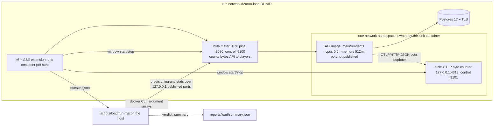

# Load Baseline Design

**Spec**: `.specs/features/load-baseline/spec.md`
**Status**: Approved (automatic gates: architecture-reviewer PASS, security-reviewer PASS, 2026-11-03)

---

## Architecture Overview

One command, `pnpm test:load`, runs a Node orchestrator (`scripts/load/run.mjs`, zero dependencies, like the other
scripts) that builds and starts everything as containers on a Docker network, then runs the full profile **one step at a
time**. Each step provisions its new players over HTTP in Node, then starts a short-lived k6 container that plays the
journey for those players. All numbers come from three independent meters: k6's own custom metrics (latency, errors,
requests, iterations), a **byte meter** in front of the API (bytes the API sends to players), and a **sink** that counts
the telemetry the API exports. Every rule that decides a verdict (steps, p95, error ratio, container health, the
100-player reading, the summary and its writer, the telemetry share, the guards, the publish guard) is a pure function
with a unit test under `scripts/test/load/` (ADR 026); the Docker calls sit behind one small runner port so the cleanup,
the preflight and the sequence are tested with a fake.



```mermaid
sequenceDiagram
  participant O as run.mjs
  participant K as k6 (per step)
  participant M as meter
  participant A as API
  O->>O: guards, preflight, sweep stale run resources, build images, start containers, migrate
  loop each step 25, 50, 100 ... 400, until a step fails
    O->>M: sign in, pair and claim for the players this step adds (outside any window)
    O->>K: start k6 with plan.json (players, cookies, tokens, addresses, offsets)
    K->>M: ramp 20 s, then the steady journey: both streams, heartbeats, a test match per 60 s per player
    K->>M: window start 30 s into the hold, stop 90 s later (the meter and the sink count; k6 is the only clock)
    K-->>O: out/step.json (p95, errors, requests, iterations, meter bytes, sink bytes)
    O->>A: docker stats samples, inspect (restart, OOM, running), psql count of rooms in created
    O->>O: step verdict (pure), stop or continue
  end
  O->>O: summary (pure), write reports/load/summary.json whole, cleanup in finally
```

### Approaches considered (Large)

| Approach                                                    | What                                                                                                                                                                                   | Verdict                                                                                                                                                                                                                                                              |
| ----------------------------------------------------------- | -------------------------------------------------------------------------------------------------------------------------------------------------------------------------------------- | -------------------------------------------------------------------------------------------------------------------------------------------------------------------------------------------------------------------------------------------------------------------- |
| **A. Node orchestrator + one k6 run per step (chosen)**     | Players are provisioned in Node; k6 only plays the steady journey of a fixed number of players for one step; the meters measure bytes outside k6; all verdicts are Node pure functions | Recommended. The k6 SSE extension blocks one connection per VU and has no cross-VU channel, so a long ramp with k6 thresholds cannot decide a verdict; per-step runs give exact windows and per-step reports and let the orchestrator stop at the first failed step. |
| B. One long k6 run with `ramping-vus` stages and thresholds | k6 owns the whole run and its verdict                                                                                                                                                  | Rejected: no way to read the container's restarts between steps, the window of the 100-player step cannot be isolated, and the first-failed-rule order (LB-11) would live in k6 thresholds that no unit test reaches (ADR 026).                                      |
| C. A Node load generator, no k6                             | `fetch` streams in a `node:26` container                                                                                                                                               | Rejected: AGENTS.md, ADR 014 and `docs/engineering/testing.md` name k6 for the load level; changing the tool is an ADR change and the spec says "k6". Kept as the escalation if the spike (T1) shows k6 cannot hold the streams.                                     |

---

## Code Reuse Analysis

### Existing Components to Leverage

| Component                                                                         | Location                                                                          | How to Use                                                                                                                                                                                                                                                                                                                           |
| --------------------------------------------------------------------------------- | --------------------------------------------------------------------------------- | ------------------------------------------------------------------------------------------------------------------------------------------------------------------------------------------------------------------------------------------------------------------------------------------------------------------------------------ |
| Zero-dependency scripts with pure `lib/` modules and `node:test` tests            | `scripts/lib/*.mjs`, `scripts/test/*.test.mjs` (collected by `pnpm test:harness`) | Modules in `scripts/load/lib/*.mjs`, tests in `scripts/test/load/*.test.mjs`: `classifyProof` in `scripts/lib/mutation-scope.mjs` accepts `node --test` only for files under `scripts/test/`, and `pnpm test:harness` globs `scripts/**/*.test.mjs`, so the tests join `pnpm test` with no config edit and are valid mutation proofs |
| `migrateDatabase(url)` and its CLI                                                | `apps/api/src/main/migrate.ts`                                                    | The run migrates the TLS database with `node apps/api/src/main/migrate.ts` inside the API image (`render.ts` does not migrate), with `?sslmode=verify-full` in the URL                                                                                                                                                               |
| Render's build and start commands                                                 | `render.yaml`                                                                     | The API image mirrors them: `corepack enable && pnpm install --frozen-lockfile --ignore-scripts`, then `node --import ./apps/api/src/main/instrument.ts apps/api/src/main/render.ts`                                                                                                                                                 |
| Simulated agent and SSE parser (wire shapes, `X-Forwarded-For`, observation body) | `tests/acceptance/support/agent-client.ts`, `support/sse.ts`                      | Reference for the k6 script's requests; not imported (another tree)                                                                                                                                                                                                                                                                  |
| Fake OTLP backend pattern                                                         | `apps/api/test/support/fake-telemetry-backend.ts`                                 | Reference for the sink's replies (`200 {}` on `/v1/traces`, `/v1/metrics`, `/v1/logs`)                                                                                                                                                                                                                                               |
| Black-box command steps                                                           | `tests/acceptance/steps/harness-foundation.steps.ts`                              | Reference for the LB-16, LB-17 and LB-18 steps (spawn a repo command, assert exit code and output)                                                                                                                                                                                                                                   |
| Quality collector and ratchet                                                     | `scripts/lib/collect.mjs`, `ratchet.mjs`, `.quality-baseline.json` `load.*`       | Unchanged: they already read `/maxConcurrentPlayers`, `/bytesPerPlayerHour`, `/p95StateLatencyMs` from `reports/load/summary.json`; a `null` field or a missing file means "not measured"                                                                                                                                            |
| Static workflow tests                                                             | `scripts/test/ci-workflow.test.mjs`                                               | Pattern for the static tests of this feature                                                                                                                                                                                                                                                                                         |
| Pinned images                                                                     | `infra/observability/compose.yaml` (`grafana/otel-lgtm` by digest)                | Same rule: every image of the run is pinned by tag and digest                                                                                                                                                                                                                                                                        |

### Integration Points

| System                 | Integration Method                                                                                                                                                                                                 |
| ---------------------- | ------------------------------------------------------------------------------------------------------------------------------------------------------------------------------------------------------------------ |
| API (`main/render.ts`) | Unchanged. Reached through the meter (`http://meter:8080` from k6, `http://127.0.0.1:<port>` from the orchestrator); configured only by an allow-listed environment (spec Assumptions)                             |
| Postgres               | A `postgres:17-alpine` container (the image the integration tests already pull) with TLS; room count by `docker exec` of `psql` with the constant query `select count(*) from lobby.rooms where stage = 'created'` |
| Quality ratchet        | `reports/load/summary.json` (gitignored); the maintainer runs `pnpm quality:ratchet --context phase --update` after a passing run                                                                                  |
| Docs                   | `docs/engineering/load-baseline.md` written by `pnpm load:publish` from a whitelist of summary fields; `docs/engineering/testing.md` names `scripts/load` instead of `tests/load` (AD-110)                         |

---

## Components

### Orchestrator

- **Purpose**: guard, preflight, sweep, build, start, run the steps, sample, summarise, clean up.
- **Location**: `scripts/load/run.mjs` (entry and the adapters: `spawn` with an argument array and `shell: false`, `fs`, `fetch`, signal handlers), `scripts/load/orchestrate.mjs` (the sequence, takes the ports)
- **Interfaces**:
  - `runLoad({ profile, env, docker, http, clock, fs }): Promise<{ summary, exitCode }>`
  - `Docker` port: `run(args)`, `exec(container, args)`, `inspect(container)`, `stats(container)`, `build(file, tag)`, `list(label)`, `rm(names)`, `networkRm(name)`, `cp(from, to)`
- **Dependencies**: `node:child_process` (only in `run.mjs`), `node:fs`, `node:os`, global `fetch`
- **Reuses**: nothing from `apps/*`; the run is black-box over HTTP and Docker
- **Run identity**: a run id from the alphabet `a-z0-9` (8 characters) names every container, the network and the work directory (`d2rmm-load-<runId>-*`) and labels each resource `d2rmm-load=<runId>`. At start a **sweep** removes any resource still labelled `d2rmm-load` (and its `d2rmm-load-*` temp directories) from an earlier killed run; one run at a time is supported, enforced by a lock directory holding the pid (a second start refuses instead of sweeping a live run). The sweep only touches names matching `^d2rmm-load-[a-z0-9]{8}$`, uses `lstat`, refuses symlinks, and requires the current uid and mode 0700 before removing.
- **Cleanup**: one idempotent `cleanup()` runs from the `finally` and from the handlers for `uncaughtException`, `unhandledRejection`, `SIGINT`, `SIGTERM` and `SIGHUP`; a repeated signal while it runs is ignored; each removal is tried even if an earlier one throws; the exit code stays non-zero when anything was left behind; it is safe with nothing created.

### Work directory and credentials

- `fs.mkdtemp` under `os.tmpdir()` (mode 0700) holds `in/` (the plan, the k6 script and `journey-state.mjs`, files mode 0600) and `out/` (only `step.json`). The k6 container mounts `in/` read-only and `out/` read-write; nothing else is mounted, the Docker socket never is.
- Session cookies and agent tokens exist only in `plan.json` and in memory. They never go on a docker command line, in `docker run -e`, in a log line, in `step.json` or in the summary; the orchestrator logs through a redactor, k6 is not run with `--http-debug`, and `journey.mjs` logs nothing about headers.
- The directory is removed by `cleanup()` (it is part of `cleanupPlan`) and by the startup sweep.

### Pure rules

All in `scripts/load/lib/`, each with a test in `scripts/test/load/<module>.test.mjs`:

| Module                   | Rule                                                                                                                                                                                                                                                                                                                                                                                                                                                                                                                                                                                                                                                                                                                                                                                                   | Requirement           |
| ------------------------ | ------------------------------------------------------------------------------------------------------------------------------------------------------------------------------------------------------------------------------------------------------------------------------------------------------------------------------------------------------------------------------------------------------------------------------------------------------------------------------------------------------------------------------------------------------------------------------------------------------------------------------------------------------------------------------------------------------------------------------------------------------------------------------------------------------ | --------------------- |
| `profile.mjs`            | `profileFor('full' \| 'smoke')` returns the step table (25, 50, 100, 150, 200, 300, 400; ramp 20 s, hold 120 s, window the last 90 s; smoke: one step of 5, hold 30 s) and the offsets of the window from the start of k6                                                                                                                                                                                                                                                                                                                                                                                                                                                                                                                                                                              | LB-07, LB-09          |
| `error-ratio.mjs`        | `errorRatio({ errors, requests, iterations })` = errors / (requests + iterations); 0 when the divisor is 0                                                                                                                                                                                                                                                                                                                                                                                                                                                                                                                                                                                                                                                                                             | LB-08                 |
| `container-health.mjs`   | `containerOk(before, after)` from two `docker inspect` results (running, restart count, `OOMKilled`, start time); `peakOf(samples)` for CPU and memory from `docker stats` samples                                                                                                                                                                                                                                                                                                                                                                                                                                                                                                                                                                                                                     | LB-08                 |
| `step-verdict.mjs`       | `verdictOf(step)` returns `{ passed, failedRule }` with the rule order `container`, `errors`, `latency`; p95 at most 2000 ms passes, 2001 ms fails; error ratio below 0.01 passes, 0.01 fails                                                                                                                                                                                                                                                                                                                                                                                                                                                                                                                                                                                                          | LB-08, LB-11          |
| `journey-state.mjs`      | The iteration's state machine (`idle`, `waiting-assigned`, `observed`, `created`, `timed-out` after 5 s). It is an ES module with no Node import; `journey.mjs` **imports this file** (the orchestrator copies it next to the script in `in/`), so the rule "one error per iteration without a `created` frame" is the code that runs under k6                                                                                                                                                                                                                                                                                                                                                                                                                                                         | LB-05, LB-08          |
| `percentile.mjs`         | `p95(values)` (nearest rank) over the step's windowed latency samples; `verdictOf` and the summary take their p95 from it, never from k6's Trend                                                                                                                                                                                                                                                                                                                                                                                                                                                                                                                                                                                                                                                       | LB-06                 |
| `summary.mjs`            | `buildSummary({ profile, steps, limits, versions, commit, times, error })`: the numbers, `passed`, `failure`, `ceilingReached`, `null` for a 100-player step that never ran, `error` for a tool failure; `exitCodeOf(summary)`. Its output has no cookie, token or `Bearer` text                                                                                                                                                                                                                                                                                                                                                                                                                                                                                                                       | LB-10 to LB-15, LB-22 |
| `write-summary.mjs`      | `writeSummary(fs, dir, summary)` writes a temp file in the directory and renames it, so the file is whole or absent; the smoke profile's name is `smoke-summary.json` and never `summary.json`                                                                                                                                                                                                                                                                                                                                                                                                                                                                                                                                                                                                         | LB-12                 |
| `bytes.mjs`              | `bytesPerPlayerHour(bytes, players, windowSeconds)`                                                                                                                                                                                                                                                                                                                                                                                                                                                                                                                                                                                                                                                                                                                                                    | LB-14                 |
| `telemetry-share.mjs`    | `telemetryNumbers(bytesInWindow, players, windowSeconds)` returns the four fields; share above 0.10 fails, exactly 0.10 passes                                                                                                                                                                                                                                                                                                                                                                                                                                                                                                                                                                                                                                                                         | LB-21, LB-22          |
| `target-guard.mjs`       | `guardTarget(env)` refuses a non-empty `LOAD_TARGET` or `DATABASE_URL` (loopback included), ignores unset and empty, names the variable. `guardDocker(env)` also refuses a `DOCKER_HOST` that is not a local unix socket, a `DOCKER_CONTEXT` other than the default, and any inherited `OTEL_*` variable, so the run cannot reach a daemon or a collector it did not start (AD-117)                                                                                                                                                                                                                                                                                                                                                                                                                    | LB-17                 |
| `preflight.mjs`          | `classifyDockerFailure(error)` returns `docker-missing`, `docker-down` or `image` and the message that names Docker or the image                                                                                                                                                                                                                                                                                                                                                                                                                                                                                                                                                                                                                                                                       | LB-18                 |
| `container-spec.mjs`     | Builds the `docker run` argument arrays: names, labels, network, `--cpus`, `--memory`, the API environment from an **allow-list** (never `process.env`): real clock, `D2RMM_ENV=staging`, `ENABLE_STAGING_ENDPOINTS=true`, no `D2RMM_ACCEPTANCE`, `SITE_ORIGIN`, `PORT`, `DATABASE_URL` with `sslmode=verify-full`, `NODE_EXTRA_CA_CERTS`, `OTEL_EXPORTER_OTLP_ENDPOINT=http://127.0.0.1:4318`, default sampler; the Postgres TLS command. Env-derived values (`LOAD_CPUS`, `LOAD_MEMORY`, `LOAD_K6_MEMORY`) pass strict patterns first (`^\d+(\.\d+)?$`, `^\d+[mg]$`). **Publish guard**: every `-p` is `127.0.0.1:<port or empty>:<port>`, never for the API, Postgres or k6; no `--network host`, no `--privileged`, no Docker socket mount; the staging variables appear only on the API container | LB-01, LB-02, LB-17   |
| `players.mjs`            | `playerFor(runId, index)`: a unique name (2 to 16 letters and digits), a distinct `X-Forwarded-For` address, so no rate-limit constant changes                                                                                                                                                                                                                                                                                                                                                                                                                                                                                                                                                                                                                                                         | LB-03, LB-04          |
| `provision-requests.mjs` | Builds the provisioning requests; every URL it builds has the host of the published meter port on `127.0.0.1`                                                                                                                                                                                                                                                                                                                                                                                                                                                                                                                                                                                                                                                                                          | LB-03                 |
| `cleanup-plan.mjs`       | `cleanupPlan(created)` lists every container, the network and the work directory to remove, whatever the exit path, including nothing created                                                                                                                                                                                                                                                                                                                                                                                                                                                                                                                                                                                                                                                          | LB-19                 |
| `publish.mjs`            | `publishPlan(summary, files)` refuses a missing, smoke or not passed summary and returns the document text from a whitelist of fields                                                                                                                                                                                                                                                                                                                                                                                                                                                                                                                                                                                                                                                                  | LB-16                 |
| `window-counter.mjs`     | The counter used by the meter and the sink: `start`, `add(n)`, `stop` returns `{ bytes, seconds }`; bytes outside a window are ignored                                                                                                                                                                                                                                                                                                                                                                                                                                                                                                                                                                                                                                                                 | LB-14, LB-21          |

### Byte meter and sink

- **Purpose**: the meter is a TCP pipe in front of the API that counts bytes sent from the API to the players, **headers and SSE framing included**, inside a window; the sink answers the API's OTLP exports and counts the bytes it receives in the same window. Both discard what they read after counting; neither writes a body, a query string, a `Cookie` or an `Authorization` header to disk or to a log.
- **Location**: `scripts/load/containers/meter.mjs`, `scripts/load/containers/sink.mjs` (each a few dozen lines around `window-counter.mjs`), run in `node:26-alpine` with `scripts/load` mounted read-only.
- **Interfaces**: the meter listens on `:8080` (it connects to the API at the sink container's name, port `PORT`) and `:9100` for control; the sink listens on `127.0.0.1:4318` (inside the API's network namespace) and `:9101` for control. Control: `POST /window/start`, `POST /window/stop` returning `{ "bytes": n, "seconds": s }`, `GET /stats` (open connections, peak). **Published to the host only on `127.0.0.1`**: the meter's `:8080` and `:9100` and the sink's `:9101` (the sink owns the API's network namespace, so its container carries the sink's and the API's ports); the API, Postgres and k6 publish nothing. The control endpoints require a per-run random bearer (in `plan.json` and the orchestrator's memory) and reject any request whose `Host` header is not `127.0.0.1:<port>`, so a local process or a rebinding page cannot move the windows; both checks have unit tests. The proxy port itself is unauthenticated by design (the players' own requests); the residual risk is test accounts on a throwaway database.
- **Dependencies**: `node:net`, `node:http`
- **Reuses**: `window-counter.mjs`
- **Why a meter**: the 70 KB budget is about what Render bills: bytes the service sends. A TCP-level count at the service's side includes headers, excludes TLS (Render's edge terminates it), and excludes setup traffic by the window. k6's own `data_received` is assumed not to include SSE bytes reliably with the extension (T1 checks it). The API sees the meter as its trusted proxy (`TRUST_PROXY_HOPS` 1), so each player's own `X-Forwarded-For` is its client address. The sink counts whatever the exporter puts on the wire (the OTLP exporters send JSON without compression, as read in `node_modules`).

### k6 journey

- **Purpose**: play the steady journey of N already-provisioned players for one step and record latency, errors, requests, iterations and the meters' window totals.
- **Location**: `scripts/load/k6/journey.mjs` (plain k6 JavaScript, **outside** the trees `pnpm arch` scans, so `k6/*` imports raise no `not-to-unresolvable`; the globals `open` and `__ENV` are declared with `/* global */` comments and no rule is relaxed; it uses no `console.log`, only `console.warn` and `console.error`; it is a `.mjs` file so `no-console` and the Node globals behave like the other scripts, and k6 accepts `.mjs`), `scripts/load/docker/k6.Dockerfile`.
- **Interfaces**: reads `in/plan.json` through `open`: `{ base, origin, version, players: [{ name, cookie, token, address }], offsets: { rampSeconds, windowStartSeconds, windowEndSeconds, holdSeconds }, matchEverySeconds }`; a `control` scenario calls the meter's and the sink's `window/start` and `window/stop` at the offsets on **k6's own clock**, and every latency, error, request and iteration is tagged with a `window` tag from the same clock, so nothing depends on the host's clock or the Docker VM's. `handleSummary` writes `out/step.json`: `{ latencySamplesMs, errors, requests, iterations, agentAssignedFrames, meterBytes, sinkBytes, windowSeconds }` (the windowed latency samples themselves, at most about 600 at 400 players, so the p95 that decides the verdict is computed in Node by `percentile.mjs` and not taken from k6's interpolated Trend) (sub-metrics are declared with empty thresholds so the summary exposes them). Control requests are tagged `role: control` and are not journey requests.
- **Roles per player** (spike T1 confirms the model; see Risks): a `site` scenario VU holds the site stream (cookie sent as an explicit `Cookie` header, because the session cookie is `Secure` and k6's jar will not resend it over `http`), and on `room.assigned` (the site stream also gets it) posts the observation with the player's **agent token** and measures observation to `room.stage_changed` with stage `created`; an `agent` scenario VU holds the agent stream (`Authorization: Bearer`, `X-Agent-Version`) and counts the `room.assigned` frames it receives (`agentAssignedFrames`; the smoke proof requires it to be above 0). **Assumed deviation from LB-05** (AD-108): the observation is triggered by the `room.assigned` frame on the site stream, which carries the same data, because k6 has no proven channel between the two VUs; the agent stream is held, counted and measured but does not trigger the post; a `heartbeat` scenario (`constant-arrival-rate` of players ÷ 15 per second) posts player `iteration mod players`' heartbeat; a `match` scenario (`constant-arrival-rate` of players ÷ 60 per second, starting when the ramp ends) posts the test match of player `iteration mod players` (Revision 1: no JavaScript timer runs while a stream is open). `X-Forwarded-For` is set per player; `Origin` is sent on the three same-origin routes (`test-login`, `pair`, `match-formed`); no `traceparent` is sent.
- **Dependencies**: k6 with `k6/x/sse` (the `phymbert/xk6-sse` extension), pinned in the image (AD-114); `journey-state.mjs`.
- **Reuses**: the wire shapes of `agent-client.ts` and `sse.ts`.

### Provisioner

- **Purpose**: sign in, pair and claim for the players a step adds, outside any window.
- **Location**: `scripts/load/provision.mjs` (impure: `fetch` against the meter's published port on `127.0.0.1`) with its request builders in `scripts/load/lib/provision-requests.mjs` (pure, tested).
- **Interfaces**: `provision(players, { base, origin, version }): Promise<Player[]>` where each player carries `cookie` (from `Set-Cookie`) and `token`. Per player: `POST /v1/auth/test-login`, `POST /v1/agents/pairing-codes`, `POST /v1/agents/pair`, then `POST /v1/agents/pairing-codes/claim` until `200` (a `202 pending` before the pair).
- **Dependencies**: global `fetch`, bounded concurrency (20 players at a time)
- **Reuses**: none; keeps earlier players (they are reused by the next, larger step)

### Images and TLS

- **API image**: `scripts/load/docker/api.Dockerfile` (`node:26-bookworm-slim`, corepack, the Render install command, then the Render start command) with a repo-root `.dockerignore` that is deny-by-default (`*`, then `!apps/api`, `!packages`, `!package.json`, `!pnpm-lock.yaml`, `!pnpm-workspace.yaml` and the other files the Render install needs, then the environment-file patterns, `**/*.pem`, `**/*.key` and `**/node_modules` excluded again); a static test pins those entries, so no local secret can land in an image layer.
- **k6 image**: `scripts/load/docker/k6.Dockerfile`: a multi-stage build that compiles k6 with the SSE extension; it never relies on k6's runtime auto-provisioning of extensions, which needs a network call to a build service at each run. The extension is third-party code that runs next to the players' tokens, so it is pinned hard.
- **Pins**: every `FROM` and every image the run starts carries a tag and a `@sha256:` digest (golang builder, k6 base, `node`, `postgres`); `xk6` and `xk6-sse` are pinned to commit SHAs with `GOFLAGS=-mod=readonly` and the checksum database on; T1 records them and they appear in the summary's `versions`. A static test fails on an unpinned `FROM`, on any image reference without a digest, and on `docker push`, `docker login` or `--push` anywhere under `scripts/load`.
- **TLS**: the private key **never reaches the host**. The Postgres password is random per run (`crypto.randomBytes`) and reaches the containers through a 0600 env-file in the work directory, never `-e` on a command line; the redactor also masks URL user-info and runs over every `inspect` and `stats` output before it is logged. A short-lived container of a pinned `alpine/openssl` image (Revision 1: `postgres:17-alpine` has no `openssl`; the container runs with `--entrypoint sh`, `--network none`, `--cap-drop ALL --cap-add CHOWN`, `--security-opt no-new-privileges`, `--read-only`, no published port, no environment and one mount, the volume) creates a throwaway CA and a server certificate for the Postgres container's name in a per-run **named volume**, signs it, deletes the CA key, sets the key file to uid 70 (the `postgres` user) and mode 0600 and the directory to mode 0755; the Postgres container mounts the volume read-only at `/tls` and starts the stock entrypoint with `-c ssl=on` and the file paths. The orchestrator copies only the **public CA certificate** out of the stopped certificate container with `docker cp` into the 0700 work directory; the copy is exactly `/tls/ca.crt` into a fixed file name and is checked to be a regular file with a single certificate block; the volume is labelled `d2rmm-load`, is created only if it does not exist (the name carries the run id), and is removed **after** the containers (it is part of `cleanupPlan` and of the startup sweep, which also lists volumes by label) and bind-mounts that file (never the volume) read-only into the API container and the migration; only Postgres mounts the volume; `NODE_EXTRA_CA_CERTS` points at it. No certificate or key is copied or baked into an image layer (no `COPY`, no build argument); the CA trusts nothing else and dies with the container.

---

## Data Models

```typescript
interface StepResult {
  players: number;
  latencyP95Ms: number | null;
  latencyCount: number;
  errors: number;
  requests: number;
  iterations: number;
  errorRatio: number;
  bytesReceived: number; // meter, window only
  telemetryBytes: number; // sink, window only
  windowSeconds: number;
  peakCpuPercent: number; // docker stats of the API container, whole step
  peakMemoryBytes: number;
  roomsCreated: number; // psql at the end of the step
  containerOk: boolean; // no restart, no OOM kill, still running
  passed: boolean;
  failedRule: 'container' | 'errors' | 'latency' | null;
}

interface Summary {
  // the three the quality ratchet reads, plus the room count, under exactly these names
  maxConcurrentPlayers: number;
  maxConcurrentRooms: number;
  bytesPerPlayerHour: number | null;
  p95StateLatencyMs: number | null;
  passed: boolean;
  failure: { step: number; rule: 'latency' | 'errors' | 'container' | 'telemetry' } | null;
  error: string | null; // a tool failure (Docker, k6, a build), not a finding
  ceilingReached: boolean;
  profile: 'full' | 'smoke';
  limits: { cpus: string; memory: string; k6Memory: string };
  versions: { k6: string; sseExtension: string; node: string; postgres: string; apiImage: string };
  commit: string;
  startedAt: string;
  endedAt: string;
  withinEgressBudget: boolean | null;
  telemetryBytesPerPlayerHour: number | null;
  telemetryMonthlyBytes: number | null;
  relayAllowanceMonthlyBytes: number; // 16 MiB x 30
  telemetryShareOfBudget: number | null;
  steps: StepResult[];
}
```

**Relationships**: `Summary` is built only by `buildSummary` from `StepResult`s and written only by `writeSummary`; `StepResult` and `Summary` have no field for a cookie or a token.

---

## Error Handling Strategy

| Error Scenario                                                                                                           | Handling                                                                                          | User Impact                                                                                 |
| ------------------------------------------------------------------------------------------------------------------------ | ------------------------------------------------------------------------------------------------- | ------------------------------------------------------------------------------------------- |
| `LOAD_TARGET` or `DATABASE_URL` non-empty, a remote `DOCKER_HOST`, a non-default `DOCKER_CONTEXT`, an inherited `OTEL_*` | `guardTarget` and `guardDocker` refuse before any Docker call                                     | Exit 2, message names the variable, nothing started                                         |
| Docker missing, daemon down, image build or pull fails                                                                   | `classifyDockerFailure` on the first failing call                                                 | Exit 2, message names Docker or the image, no container started                             |
| API container exits, restarts or is OOM-killed during a step                                                             | `containerOk` is false; verdict rule `container`; the run ends                                    | `passed: false`, `failure.rule: "container"`, exit 1                                        |
| k6 exits abnormally (OOM, crash)                                                                                         | The orchestrator records `error`, stops, still cleans up                                          | `summary.json` has `error`, `passed: false`, exit 1; not counted as a finding about the API |
| An iteration gets no `created` frame in 5 s                                                                              | k6 counts one error, the iteration restarts                                                       | Raises the step's error ratio                                                               |
| A `429` or non-2xx on a journey request                                                                                  | Counted as an error (LB-04)                                                                       | Same                                                                                        |
| Ctrl-C, SIGTERM, SIGHUP, an uncaught exception                                                                           | The same idempotent `cleanup()`; the summary is written with `error`                              | Containers, network and work directory removed                                              |
| A run was killed with SIGKILL                                                                                            | The next start's sweep removes what carries the `d2rmm-load` label and the stale temp directories | Nothing left after the next run                                                             |
| `docker rm` fails during cleanup                                                                                         | Each removal is tried; the failures are printed with the names left; exit stays non-zero          | The maintainer removes them by name                                                         |
| `load:publish` with a missing, smoke or not passed summary                                                               | `publishPlan` refuses                                                                             | Exit 1, nothing written                                                                     |

---

## Requirement Coverage

| Requirement                  | Component                                                        | Proof                                                                                                                                                                                                                                                                                          |
| ---------------------------- | ---------------------------------------------------------------- | ---------------------------------------------------------------------------------------------------------------------------------------------------------------------------------------------------------------------------------------------------------------------------------------------- |
| LB-01                        | `container-spec.mjs`, orchestrator, images                       | Unit test of the arguments, the publish guard and the TLS settings; smoke run                                                                                                                                                                                                                  |
| LB-02                        | `container-spec.mjs`                                             | Unit test of the API environment (allow-list, staging variables only on the API); sink bytes in the smoke run                                                                                                                                                                                  |
| LB-03                        | `players.mjs`, `provision-requests.mjs`, provisioner, k6 journey | Unit tests of names and requests (loopback host); smoke run                                                                                                                                                                                                                                    |
| LB-04                        | `players.mjs`, k6 journey                                        | Unit test of distinct addresses; unit test that a `429` counts; static test that pins the pairing limiter's constants by reading `apps/api/src/modules/agents/domain/sliding-window.ts` (10 code requests an hour per address, 10 submissions per 5 minutes per account); not a mutation proof |
| LB-05                        | `journey-state.mjs`, k6 journey                                  | Unit test of the state machine; static test that `journey.mjs` imports it; smoke run                                                                                                                                                                                                           |
| LB-06                        | `percentile.mjs`, k6 samples                                     | Unit tests; smoke cross-check                                                                                                                                                                                                                                                                  |
| LB-07                        | `profile.mjs`                                                    | Unit test of the table, the offsets and the stop rule                                                                                                                                                                                                                                          |
| LB-08                        | `error-ratio.mjs`, `container-health.mjs`, `step-verdict.mjs`    | Unit tests at the boundaries and for a restarted container                                                                                                                                                                                                                                     |
| LB-09                        | `profile.mjs`, `summary.mjs`                                     | Unit test; smoke run                                                                                                                                                                                                                                                                           |
| LB-10, LB-11, LB-13 to LB-15 | `summary.mjs`, `bytes.mjs`                                       | Unit tests over fixed `StepResult`s, including no cookie or token in the output                                                                                                                                                                                                                |
| LB-12                        | `write-summary.mjs`                                              | Unit test with a fake `fs`: whole file or none, on a failed run too, smoke name                                                                                                                                                                                                                |
| LB-16                        | `publish.mjs`                                                    | Acceptance scenarios `@LB-16` (three examples) plus unit tests of the document                                                                                                                                                                                                                 |
| LB-17, LB-18                 | `target-guard.mjs`, `preflight.mjs`                              | Acceptance scenarios `@LB-17`, `@LB-18` with a `docker` shim on `PATH`; unit tests of the extra Docker guards                                                                                                                                                                                  |
| LB-19                        | `cleanup-plan.mjs`, orchestrator                                 | Unit tests with a fake `Docker` port for a pass, a failed step, each signal, an uncaught exception, nothing created, and one `rm` that throws; the smoke run leaves nothing behind                                                                                                             |
| LB-20                        | root `package.json`, workflows                                   | Static test in `scripts/test/load-scripts.test.mjs`                                                                                                                                                                                                                                            |
| LB-21, LB-22                 | `telemetry-share.mjs`, sink                                      | Unit tests at 0.10 and just above; the four fields in the full run                                                                                                                                                                                                                             |

---

## Test Strategy

- **Unit** (`node:test`, in `scripts/test/load/`): every pure module above; a fake `Docker` port exercises `orchestrate.mjs` for the guards, the preflight, the stop rule, the cleanup and the summary writer. These are the tests the Verifier mutates with `node --test scripts/test/load/<file>.test.mjs` (ADR 026); none starts a container.
- **Static** (`scripts/test/load-scripts.test.mjs`): the three scripts exist; no workflow and neither `pnpm check` nor `pnpm test` names them; the API image mirrors `render.yaml`'s commands; every `FROM` and image reference is pinned by digest; no `docker push`, `docker login`, `--push`, `shell: true`, `exec(` or `sh -c` with interpolation under `scripts/load`; `journey.mjs` imports `journey-state.mjs`.
- **Acceptance**: `tests/acceptance/steps/load-baseline.steps.ts` spawns `node scripts/load/run.mjs` and `node scripts/load/publish.mjs` black-box (no import from `apps/*`) with a temporary root and a `docker` shim on `PATH`; no Docker and no load are needed.
- **Smoke** (`pnpm test:load:smoke`, 5 players, 30 s): the task gate of the run-level tasks and the proof of LB-01, LB-02, LB-03, LB-05 and LB-19; needs Docker, not part of `pnpm check`.
- **Full run** (`pnpm test:load`, about 20 minutes with the first image build): the last task; its summary is the F0 exit-criterion proof.

---

## Risks & Concerns

| Concern                                                                                                                                                                                                                                                       | Location                              | Impact                                                               | Mitigation                                                                                                                                                                                                                                                                                                                                                                                         |
| ------------------------------------------------------------------------------------------------------------------------------------------------------------------------------------------------------------------------------------------------------------- | ------------------------------------- | -------------------------------------------------------------------- | -------------------------------------------------------------------------------------------------------------------------------------------------------------------------------------------------------------------------------------------------------------------------------------------------------------------------------------------------------------------------------------------------- |
| The k6 SSE extension blocks one connection per VU, has no documented cross-VU channel, and its README does not say how a stream is held for a long time or whether a request can run while a stream is open (read in `phymbert/xk6-sse`, unverified by a run) | `scripts/load/k6/journey.mjs`         | The roles may not run as designed                                    | T1 is a spike with acceptance tests: build the image, hold a site and an agent stream, send heartbeats from another scenario, post inside an `event` handler, and check whether `data_received` counts SSE bytes. If it fails the run falls back to reopening the stream each iteration; if even that fails the feature stops and escalates (the Node generator needs a spec and tooling decision) |
| The extension and k6 versions cannot be pinned from here                                                                                                                                                                                                      | `k6.Dockerfile`                       | A moving build breaks the run                                        | T1 records exact versions and commits; no runtime auto-provisioning                                                                                                                                                                                                                                                                                                                                |
| Docker Desktop on the maintainer's machine has 3.8 GiB in its VM; 800 k6 VUs, Postgres, a 512 MB API and the meters may not fit                                                                                                                               | `run.mjs` preflight, `LOAD_K6_MEMORY` | k6 or the API is OOM-killed and the run is meaningless               | Preflight prints the VM memory and warns below 6 GiB; an OOM of k6 is an `error`, an OOM of the API is the `container` rule; `LOAD_K6_MEMORY` default `1500m`, documented                                                                                                                                                                                                                          |
| The API pool defaults to 10 connections (`render.ts` sets no `max`), likely the first bottleneck                                                                                                                                                              | `apps/api/src/main/render.ts:39`      | The run fails the minimum                                            | It is the finding the run exists to report; the summary names the step and the rule, the docs name the pool as the first suspect; a capacity change is out of scope (spec)                                                                                                                                                                                                                         |
| Every session lookup hits Postgres (no session cache)                                                                                                                                                                                                         | `platform/http/guards.ts`             | Latency under load                                                   | Same: reported, not changed                                                                                                                                                                                                                                                                                                                                                                        |
| The meter is one Node process in the path                                                                                                                                                                                                                     | `meter.mjs`                           | It could cap the run before the API does                             | It only pipes sockets and adds a counter; the smoke run compares latency with a direct run once; the meter's container has no CPU limit                                                                                                                                                                                                                                                            |
| `docker stats` CPU% is relative to the VM's cores, so with `--cpus 0.5` it tops at about 50                                                                                                                                                                   | `orchestrate.mjs`                     | Misread peak CPU                                                     | The summary also records the limit; the docs say how to read it                                                                                                                                                                                                                                                                                                                                    |
| The `Secure` `__Host-` session cookie is not resent by k6's jar over `http`                                                                                                                                                                                   | `journey.mjs`                         | Every site request 401                                               | The provisioner reads `Set-Cookie` and the script sends `Cookie` itself (the server parses the header by hand)                                                                                                                                                                                                                                                                                     |
| The published ports of the meter and the sink on the host                                                                                                                                                                                                     | `container-spec.mjs`                  | A `0.0.0.0` publish would expose an API with test sign-in to the LAN | Only `127.0.0.1:<port>` is accepted by the publish guard and its unit test; the API, Postgres and k6 publish nothing                                                                                                                                                                                                                                                                               |
| The extension is third-party code beside the players' tokens                                                                                                                                                                                                  | `k6.Dockerfile`, `plan.json`          | A compromised extension could read tokens                            | Tokens are throwaway test accounts on a database that dies with the run; the build is pinned by commit and checksums; `plan.json` is removed with the work directory. An `--internal` run network is not used because the published ports need a gateway                                                                                                                                           |
| Docker Desktop's VM clock can drift from the host's                                                                                                                                                                                                           | `journey.mjs`                         | A window set from the host's clock could misalign with the meters    | The window is an offset on k6's own clock and k6 starts and stops the meters' counting itself; no host timestamp is compared                                                                                                                                                                                                                                                                       |
| `scripts/lib/*` and the gate rules treat harness files specially                                                                                                                                                                                              | `.claude/hooks/lib/gate-rules.mjs`    | An edit to a harness file asks the maintainer                        | The new code sits in `scripts/load/`, `scripts/test/load/` and `scripts/test/load-scripts.test.mjs`, none of which is a harness path; no harness file is edited                                                                                                                                                                                                                                    |

---

## Revision 1 (2026-11-03): what the first real run found

The first run of the assembled system (T32) found three points the design did not hold. They are changes of mechanism, not of intent: the roles, the meters, the verdict rules, the spec and the requirement coverage stand. AD-120 to AD-122.

1. **No `openssl` in `postgres:17-alpine`** (AD-120). The throwaway CA and server certificate are made by a short-lived container of a pinned `alpine/openssl` image into a per-run named volume (labelled, removed by `cleanupPlan`), which the Postgres container mounts read-only; this is the fallback the TLS section already named. The private key stays in the volume (never on the host); the public CA is copied out of the stopped certificate container. `container-spec.mjs` builds the certificate container and the volume, `images.mjs` pins `alpine/openssl` by digest, `cleanup-plan.mjs` lists the volume, `orchestrate.mjs` runs the extra step before Postgres. C33 keeps its claim: Postgres starts with TLS from a certificate made inside a container and never on the host, and the password comes from an env-file.
2. **No JavaScript timer fires while a stream is open** (AD-121). With k6 2.3 and `xk6-sse` 0.2.0, `sse.open` runs its handlers in a Go control loop, and a `setTimeout` or `setInterval` created in an `open` callback is stopped without firing (proved by the run: `setTimeout 2 was stopped because the VU iteration was interrupted`). So: (a) the **match** of each player comes from a `match` scenario, a `constant-arrival-rate` of players ÷ 60 per second that starts when the ramp ends and posts the test match of player `iteration mod players` (every player once per 60 s, like the heartbeat scenario); (b) a stream ends at the step's end through the `timeout` argument of `sse.open`, not a timer (T36 proves it on the real run; if it does not end the stream, the step's scenario `gracefulStop` and `maxDuration` end it and the finding is recorded); (c) the **5 s `created` rule** is evaluated where a frame or the end arrives, not by a timer: a `created` frame at or after 5 000 ms from its observation is one error and no latency sample; before any new frame is handled a stale `observed` iteration is settled with one error (so a later assignment starts a fresh iteration and no error is lost); an observation still pending 5 000 ms or more when the stream ends is one error (`onClose` in `journey-state.mjs`). **Each error is tallied in the window of its observation time** (`observedAt`), not of the moment it is found, so an error found at the end of the stream still counts in the step's window. The outcome per iteration is the spec's (an iteration with no `created` frame within 5 s is one error); only the moment it is found moves. (d) The site handler starts an iteration on each `room.assigned` that finds none or a settled one. A posted match whose assignment never arrives is not an iteration; the `match` scenario records `matchesPosted` and the orchestrator counts `matchesPosted − iterations` (when positive) as errors (T37), so an overloaded API cannot hide lost assignments. The `match` scenario's rate is an integer `rate` per `timeUnit: '60s'` (one match per player per minute).
3. **Window geometry** (AD-122, completes AD-118). A match no longer starts during the ramp, so the window of every profile contains matches: the full profile's window (50 s to 140 s) holds at least one match per player after the first 60 s cycle starts at 20 s (the player's match falls between 20 s and 80 s, its `created` frame a few ms later); the smoke profile, 5 players, one match every 12 s from 20 s, has three matches in its window (20 s to 50 s). The smoke profile's window is its whole hold, so a match fires in it by construction.

Three defects the run also found were fixed without a design change: the API image installs `corepack` first (Node 25 and later do not bundle it), the certificate directory is mode 0755 so Postgres can read the certificate, and `exec.scenario.iterationInInstance` replaces `iterationInScenario` for the player index.

---

## Tech Decisions (only non-obvious ones)

| Decision                                                                                         | Choice                                                                              | Rationale                                                                                                                               |
| ------------------------------------------------------------------------------------------------ | ----------------------------------------------------------------------------------- | --------------------------------------------------------------------------------------------------------------------------------------- |
| One k6 run per step, players provisioned in Node (AD-108)                                        | Node decides, k6 plays                                                              | Windows, stop rule and verdict order stay in unit-tested pure code                                                                      |
| Bytes at a TCP meter in front of the API (AD-109)                                                | Meter counts API to player bytes in a window                                        | Matches what Render bills (headers included, TLS excluded); independent of k6's counters                                                |
| Scripts live in `scripts/load/`, not `tests/load` (AD-110)                                       | `testing.md` updated; unit tests in `scripts/test/load/`                            | `pnpm arch` scans `tests/` and rejects `k6/*` imports as unresolvable; `classifyProof` accepts `node --test` only under `scripts/test/` |
| First failed rule order: `container`, `errors`, `latency` (AD-111)                               | Fixed                                                                               | The spec names the rule without an order; a dead container explains everything else                                                     |
| API image mirrors Render's build and start (AD-112)                                              | Same install and `--import` start command                                           | The run measures what ships                                                                                                             |
| Throwaway TLS Postgres (AD-113)                                                                  | CA and certificate made inside the Postgres container; only the public CA leaves it | `render.ts` verifies certificates and may not change; no private key on the host                                                        |
| k6 with the SSE extension built into a pinned image, no auto-provisioning (AD-114)               | Multi-stage build, commit and digest pins                                           | Reproducible, no runtime network call                                                                                                   |
| A tool failure is `error`, not a `failure` rule (AD-115)                                         | Extra summary field                                                                 | The spec's four rules describe findings about the system under test                                                                     |
| Telemetry bytes counted on the wire at the sink, headers included (AD-116)                       | Same definition as the meter                                                        | One definition of "bytes" in the whole summary                                                                                          |
| The run also refuses a remote Docker host, a non-default context and inherited `OTEL_*` (AD-117) | `guardDocker` beside `guardTarget`                                                  | LB-17's intent is "touch only what the run started"; those variables are the other ways to reach something else                         |

> **Project-level decisions:** AD-108 to AD-117 are appended to `.specs/STATE.md` (assumed) and queued in `.specs/phases/F0/decisions.md` for the phase review.

---

## Conformity

- ADR 026: no proof of a mutation starts a container; every rule is a pure function with a unit test under `scripts/test/`.
- ADR 022: gates run through `scripts/attempt.mjs`; the smoke and full runs are task gates of their own.
- ADR 006: nothing new is added to the product (no Redis, no queue, no second instance); the run uses containers on the maintainer's machine only.
- AGENTS.md rules 6 and 7: the guards refuse any target the run did not start; no production database, no deployed service, nothing pushed (and a static test forbids `docker push`).
- Rule 4: no sensor, threshold or baseline value is loosened; the baseline `load.*` values move from `null` to numbers by the maintainer's `--update`.
