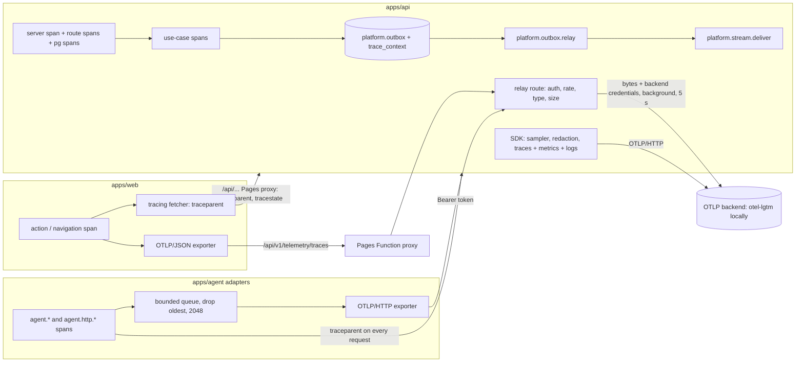
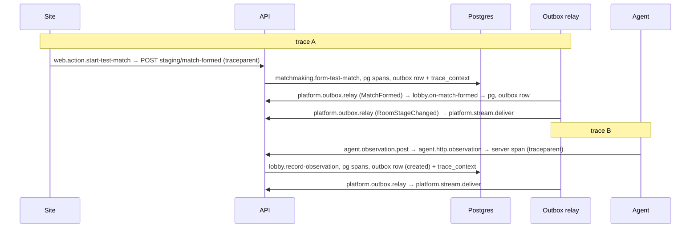

# Observability End to End Design

**Spec**: `.specs/features/observability-e2e/spec.md`
**Status**: Draft (waiting for architecture-reviewer and security-reviewer)

---

## Architecture Overview

Three senders, one exporter. The API installs the OpenTelemetry SDK before any application import, instruments HTTP,
Fastify and `pg`, records the skeleton's metrics and exports traces, metrics and logs to the backend named by
`OTEL_EXPORTER_OTLP_*`. The site and the agent never hold backend credentials: they send OTLP traces to
`POST /v1/telemetry/traces` on the API, which forwards the bytes unchanged. The outbox carries the trace across its only
asynchronous hop in a new `trace_context` column.



### The two traces of a room (AD-092)



Trace A holds the site action, the request span, the use-case spans, `pg` spans, both relay rows and the delivery of
`awaiting_host`. Trace B holds the agent's span as the parent of the API spans of its heartbeat and observation, and the
delivery of `created`. No link joins them.

---

## Code Reuse Analysis

### Existing Components to Leverage

| Component                                  | Location                                                 | How to Use                                                                                                                                                             |
| ------------------------------------------ | -------------------------------------------------------- | ---------------------------------------------------------------------------------------------------------------------------------------------------------------------- |
| `withSpan`                                 | `apps/api/src/shared-kernel/tracing.ts`                  | Unchanged; call sites drop `accountId`/`agentId` and rename `roomId` to the `d2r.room.id` constant (AD-091)                                                            |
| `loadConfig(env)`                          | `apps/api/src/main/config.ts`                            | The only `process.env` reader of the API; gains the `OTEL_*` settings (`telemetry` block)                                                                              |
| `createGuards`, `bearerToken`, cookie read | `apps/api/src/platform/http/guards.ts`                   | New guard `requireAgentOrSite` composes the same agent and session authentication; an origin-only check sits next to `requireSameOrigin`                               |
| `answerError`                              | `apps/api/src/main/app.ts:107-123`                       | Already maps 413 and 415; the relay's pre-body checks answer through the same error shape                                                                              |
| `OutboxRelay`, `PostgresOutbox`            | `apps/api/src/platform/outbox-relay.ts`, `.../outbox.ts` | Extended in place: `append` writes `trace_context`, the batch reads it, `#publish` wraps the span                                                                      |
| `StreamHub` / `Connection`                 | `apps/api/src/platform/stream-hub.ts`                    | `sse.connections` up-down counter at `add`/`onClose`; `platform.stream.deliver` span per accepted delivery                                                             |
| `InMemorySpanExporter` pattern             | `apps/api/src/shared-kernel/tracing.test.ts`             | Same test pattern for every new span test                                                                                                                              |
| `ControllableClock`, `/__test/clock`       | `apps/api/src/main/local.ts`, `test-controls.ts`         | The acceptance stack's frozen clock keeps `outbox.lag` and `room.stage_duration` at 0 in the e2e run; their values are proved by unit tests with `FakeClock`           |
| Pages proxy allow-list                     | `apps/web/functions/api/[[path]].ts:16-24`               | `traceparent` is already allowed; this feature adds `tracestate`. `/api/v1/telemetry/traces` already matches `PATH_PATTERN`                                            |
| `createApiClient(fetcher)`                 | `apps/web/src/shared/api-client.ts`                      | The injectable `Fetcher` is the seam for the tracing fetcher                                                                                                           |
| `telemetry.rs` (`init`, `traceparent_for`) | `apps/agent/src-tauri/adapters/src/telemetry.rs`         | Extended: `init` also builds the exporter and returns a guard; `traceparent_for` stays                                                                                 |
| `HttpGateway` / `ApiClient` spans          | `apps/agent/src-tauri/adapters/src/http/`                | Unchanged: the six `agent.http.*` spans and the `traceparent` header already exist (AGS-12)                                                                            |
| `Runtime::start`, `Handle::read_once`      | `apps/agent/src-tauri/core/src/runtime.rs`               | The headless example drives the real core through them                                                                                                                 |
| Acceptance `stack.ts`, `World`, steps      | `tests/acceptance/support/`                              | Extended with a lazily started traced stack; existing steps (`is signed in on the site`, `starts a test match`) are reused                                             |
| Testcontainers                             | `tests/acceptance/support/global-setup.ts`               | Starts `grafana/otel-lgtm` the same way it starts Postgres                                                                                                             |
| `.dependency-cruiser.cjs`                  | repo root                                                | `application-no-adapters` already forbids `@opentelemetry/sdk-*` in `application`; tightened to forbid the telemetry package's `./node` and `./web` subpaths there too |

### Integration Points

| System         | Integration Method                                                                                                                                                                    |
| -------------- | ------------------------------------------------------------------------------------------------------------------------------------------------------------------------------------- |
| Postgres       | New migration `0002_outbox_trace_context` (never an edit of `0001`), registered in the hard-coded map of `platform/postgres/migrator.ts`; `OutboxTable.trace_context: string \| null` |
| `openapi.json` | One route, `POST /v1/telemetry/traces`, with a minimal schema (`202`, `401`, `403`, `413`, `415`, `429`); added to the `ROUTES` list of `openapi.int.test.ts`                         |
| Render         | `render.yaml` start command gains the `--import` preload; env names only, no secret value                                                                                             |
| CI             | `integration` job gains a Rust toolchain and the site build with `VITE_TELEMETRY=on`; Docker is already present                                                                       |
| `deny.toml`    | `opentelemetry-otlp`, `opentelemetry-http` and their transitive crates must pass the existing licence and ban checks                                                                  |

---

## Components

### Telemetry package `@d2rmm/telemetry`

- **Purpose**: the shared, pure telemetry vocabulary and the SDK bootstraps that take their settings as arguments.
- **Location**: `packages/telemetry/src/`, exported as source like `@d2rmm/contracts` (`exports` point at `./src/*.ts`, so the
  Render install and the acceptance spawn need no build step). Three entry points:
  - `.` - `attributes.ts` (the `d2r.*` constants), `redaction.ts`, `trace-context.ts`, `resource.ts`. Depends on
    `@opentelemetry/api`, `@opentelemetry/core` and `@opentelemetry/resources` only, so `application` may import it.
  - `./node` - `node-sdk.ts`: `startNodeTelemetry(options): TelemetryHandle` (traces, metrics, logs, sampler, views,
    exporters). Imports the SDK packages. `main/` only.
  - `./web` - `web-sdk.ts`: `startWebTelemetry(options): WebTelemetry` and `tracing-fetcher.ts`. Browser only.
- **Interfaces**:
  - `redactAttributes(attributes: Attributes): Attributes` - drops forbidden keys (full key or last dot segment in
    `authorization, cookie, set-cookie, token, code, secret, password, image, battletag`, case-insensitive), drops
    `client.address`, `user_agent.original`, `enduser.*`, strips `?…`/`#…` from `url.full`, `http.url`, `http.target`,
    `url.query`.
  - `RedactingSpanExporter(inner)`, `RedactingLogRecordExporter(inner)` - copy each record with `redactAttributes` applied
    before delegating (ended spans are not mutated).
  - `boundedMetricViews(): ViewOptions[]` - one `View` per instrument with `attributeKeys` limited to the bounded sets
    (`http.route`, `http.response.status_class`, `d2r.stream.kind`, `d2r.room.stage`, `d2r.difficulty`, `d2r.queue.mode`)
    and a drop view for the HTTP instrumentation's own duration histogram (AD-095).
  - `traceparentOf(context): string \| undefined`, `contextFromTraceparent(text): Context` - W3C only, using an explicit
    `W3CTraceContextPropagator` so they work with no global propagator registered.
  - `samplerFrom(ratioText: string \| undefined): Sampler` - `ParentBasedSampler(TraceIdRatioBased(ratio))`, `0.1` when
    undefined or invalid.
  - `startNodeTelemetry({ serviceName, serviceVersion, environment, endpoint, headers, samplerArg, intervalMs, onExportError })`.
- **Dependencies**: `@opentelemetry/{api,core,resources,sdk-trace-base,sdk-metrics,sdk-logs,exporter-trace-otlp-http,exporter-metrics-otlp-http,exporter-logs-otlp-http,semantic-conventions}`;
  web adds `sdk-trace-web`. Instrumentation packages are installed in `apps/api` because they hook modules of the app.
- **Reuses**: nothing; it replaces `export {};`. It reads no `process.env` (OBS-39); a lint block forbids it.

### API bootstrap (`main/instrument.ts`)

- **Purpose**: install the SDK before `fastify`, `pg` and `http` are imported, because their instrumentation patches the
  modules at load time (the entry points import `pg` and `kysely` statically).
- **Location**: `apps/api/src/main/instrument.ts`, loaded with `node --import ./src/main/instrument.ts src/main/local.ts`
  (and `render.ts`, `render.yaml`, `stack.ts`). It registers `import-in-the-middle`'s hook, reads `loadConfig`, and when
  `OTEL_EXPORTER_OTLP_ENDPOINT` is set calls `startNodeTelemetry` with `HttpInstrumentation`, `FastifyOtelInstrumentation`
  and `PgInstrumentation` (`enhancedDatabaseReporting: false`, so a statement carries placeholders, not values). Unset: it
  does nothing and the process starts as today (OBS-02).
- **Interfaces**: `TelemetryHandle.shutdown(): Promise<void>` is called by both roots' signal handlers; `getTelemetryHandle()`
  lets `buildApp` read the forwarder settings without a second `process.env` read.
- **Dependencies**: `@d2rmm/telemetry/node`, the instrumentation packages, `main/config.ts`.
- **Reuses**: `loadConfig` for every setting; the config gains `telemetry: { endpoint, headers, samplerArg, intervalMs }`.

### Pino correlation and log export

- **Purpose**: JSON log lines with `trace_id` and `span_id`, and the same records over OTLP (OBS-26, OBS-27).
- **Location**: `main/app.ts` logger options gain a `mixin` that reads `trace.getActiveSpan()?.spanContext()`; export uses
  the pino log-sending instrumentation registered in `instrument.ts`, wrapped by `RedactingLogRecordExporter`. The
  `console.error` calls in `app.ts`, `outbox-relay.ts` and `stream-hub.ts` become `app.log` calls (they bypass pino today),
  except in places with no logger, where a `Logger` callback is injected.
- **Reuses**: `REDACTED_LOG_PATHS` stays; the `logSink` test hook stays.

### Metrics

- **Purpose**: the five instruments of AD-087.
- **Location and shape**:
  - `http.server.request.duration` and `http.server.response.body.size` - `platform/http/request-metrics.ts`, a Fastify
    `onResponse` hook that records both by `http.route` (the route template) and `http.response.status_class`. Streams
    (`reply.hijack()`) never reach `onResponse`, so `/v1/stream` is covered by `sse.connections` only (AD-095).
  - `sse.connections` - `UpDownCounter` in `StreamHub`: `+1` where the connection joins the set, `-1` in its `onClose`,
    attribute `d2r.stream.kind` (`agent` or `site`).
  - `outbox.lag` - `ObservableGauge` in `platform/outbox-lag.ts`: `select min(created_at) from platform.outbox where
published_at is null and failed_at is null` (served by the partial index), `0` when none, computed with the injected
    `Clock`.
  - `room.stage_duration` - a port `RoomMetrics { stageLeft(stage, difficulty, mode, seconds) }` in the lobby application
    ports, an OpenTelemetry adapter in `lobby-room/adapters/telemetry/`, an in-memory fake for unit tests. The use case
    `lobby.record-observation` calls it once, in the `created` branch, with `clock.now() - rooms.openedAt(roomId)`. The
    repository port gains `openedAt(roomId): Promise<Date | undefined>` (reads `lobby.rooms.created_at`, the instant the
    room opened in `awaiting_host`) and `LobbyRoomDeps` gains `clock` (the domain stays timestamp-free).
- **Reuses**: `Clock`, the application-port pattern, `InMemory*` fakes under `testing/`.

### Trace context across the outbox

- **Purpose**: OBS-05, OBS-06, OBS-07.
- **Location**: `platform/postgres/outbox.ts`, `platform/outbox-relay.ts`, `platform/stream-hub.ts`, migration `0002`.
- **Interfaces**:
  - `PostgresOutbox.append` writes `trace_context = traceparentOf(context.active())` for every row of the call (`null` when
    there is no valid sampled-or-not span context) in the same insert, inside the transaction.
  - `OutboxRelay.#publish(row)` runs `context.with(row.trace_context ? contextFromTraceparent(row.trace_context) : ROOT_CONTEXT, …)`
    and inside it `tracer.startActiveSpan('platform.outbox.relay', …)` around `bus.publish`. The explicit context is
    mandatory: `wake()` is unawaited after commit and a drain handles up to 100 rows of different traces in the context of
    whoever woke it. Attributes: `d2r.outbox.event_type`.
  - `StreamHub.#dispatch` opens `platform.stream.deliver` (child of the active relay span) for each connection whose
    `#accepts` returns true; attributes: `d2r.stream.kind`. Transient events dispatched from a request become children of
    that request's span.
- **Dependencies**: `@opentelemetry/api`, `@d2rmm/telemetry` (`.`).

### Relay route `POST /v1/telemetry/traces`

- **Purpose**: OBS-10 to OBS-16, OBS-20.
- **Location**: `platform/http/telemetry-relay.ts` (a Fastify plugin registered from `app.ts` with the forwarder settings from
  the telemetry handle), `platform/http/relay-limiter.ts`, a new guard in `guards.ts`.
- **Interfaces and behaviour**:
  - Scoped content-type parsers for `application/x-protobuf` and `application/json` that return a `Buffer` unchanged;
    `bodyLimit: 1_048_576`.
  - `onRequest` runs the checks in the specified order, before Fastify reads the body: (1) `requireAgentOrSite` - an
    `Authorization` header selects the bearer path, otherwise the session cookie path; failure is `401`; a valid session
    whose `Origin` is not `siteOrigin` is `403`; (2) per-principal rate, `agent:<id>` or `account:<id>`, 60 a minute; a
    request with no valid credentials is counted per `rateLimitKey(ip)` and the 121st in a minute gets `429` before the
    `401`; (3) content type and `content-encoding` (`415`); (4) a declared `content-length` over the limit (`413`). A body
    that exceeds the limit while streaming fails with `FST_ERR_CTP_BODY_TOO_LARGE`, mapped to `413` by `answerError`.
  - The handler replies `202` with an empty body, then calls `forwarder.forward(body, contentType)` without awaiting it.
  - `Forwarder`: `fetch(endpoint + '/v1/traces', { method: 'POST', headers: { 'content-type', ...credentialHeaders }, body, signal: AbortSignal.timeout(5000) })`;
    any failure logs one warning (`relay-forward-failed`, status or error class only) and never retries; the response is
    read to completion and discarded; at most 32 forwards are in flight, a 33rd is dropped with a counter increment on the
    warning rate limit. With no endpoint configured the relay answers `202` and drops.
  - `RelayLimiter`: an in-memory sliding window (`Map<string, number[]>`) pruned on every check; a platform-local class,
    because `SlidingWindowLimit` is internal to the agents module (`platform-uses-public-ports`).
  - The route is excluded from HTTP-server instrumentation (`ignoreIncomingRequestHook`) so the relay does not trace its own
    traffic; `/healthz` is excluded too.
- **Reuses**: `bearerToken`, `authenticateAgent`, `authenticateSession`, `rateLimitKey` (copied into the platform limiter as
  a pure function with its own test, because the agents function is internal), `answerError`.

### Site telemetry

- **Purpose**: OBS-04, OBS-21, OBS-44.
- **Location**: `apps/web/src/shared/telemetry.ts` (composition), `apps/web/src/shared/tracing-fetcher.ts` re-exported from
  the package, `apps/web/src/vite-env.d.ts` (new, types `VITE_TELEMETRY`), `main.tsx` calls `startWebTelemetry` before
  rendering, `app/App.tsx` builds `defaultClient` with the tracing fetcher.
- **Interfaces**:
  - `startWebTelemetry({ enabled, relayPath: '/api/v1/telemetry/traces', serviceVersion, environment })` creates a
    `WebTracerProvider` with `BatchSpanProcessor(RedactingSpanExporter(OTLPTraceExporter))` only when `enabled`
    (`import.meta.env.VITE_TELEMETRY === 'on'`); disabled returns a no-op and installs nothing (OBS-44).
  - `tracedAction(name, fn)` - `startActiveSpan`; `fn` calls the API client synchronously, so the fetch happens inside the
    span.
  - `tracingFetcher(base)` - wraps a `Fetcher`: opens a client span `HTTP <METHOD> <route>`, sets `url.path` without the
    query, injects `traceparent` and `tracestate` into the request headers, ends the span on the response.
  - `navigationSpan(location)` - one `web.navigation` span at start and on `popstate`, attribute `url.path` (the pathname
    only).
  - `StartTestMatchButton` wraps `client.matchFormed()` in `tracedAction('web.action.start-test-match', …)`.
- **Dependencies**: `@d2rmm/telemetry/web`. The site export goes to the relay through the same-origin proxy, which carries
  the cookie and `Origin` (no CORS).
- **Reuses**: `createApiClient`'s `Fetcher` seam; the proxy.

### Agent exporter and headless example

- **Purpose**: OBS-18, OBS-19, OBS-22, OBS-38, and the agent half of OBS-24.
- **Location**: `apps/agent/src-tauri/adapters/src/telemetry/` (`mod.rs` keeps `init`/`traceparent_for`; new `export.rs`,
  `queue.rs`, `relay_client.rs`), `adapters/examples/headless.rs`.
- **Interfaces**:
  - `BoundedQueue<T>` (`queue.rs`) - pure, capacity 2048, `push` drops the oldest, `drain(max)`; unit-tested and under
    mutation scope. OpenTelemetry's batch processor drops the newest span, so the agent has its own `SpanProcessor`
    (`DropOldestProcessor`) over this queue and a spawned export task on an interval; `on_end` never awaits.
  - `RelayHttpClient` (`relay_client.rs`) - implements `opentelemetry_http::HttpClient` over `reqwest`, adds
    `Authorization: Bearer <token>` and `X-Agent-Version` from a `HeaderSource` trait object per request, maps `401/403/413/415`
    to "drop this batch" and `429` to "no export before `Retry-After`" (a `BlockedUntil` value using the injected clock), and
    otherwise returns the status. A pure `outcome_of(status, retry_after) -> ExportOutcome` is unit-tested.
  - `init(mode, export: Option<ExportConfig>) -> TelemetryGuard` - builds the provider with `service.name=d2rmm-agent`,
    `service.version`, `deployment.environment`, `d2r.agent.version`; `TelemetryGuard::shutdown()` flushes. The Windows shell
    keeps the guard in its state; error logging goes through a once-a-minute limiter (`LogGate`, pure and tested).
  - `HeaderSource` is implemented in the composition root (`app.rs`, the headless example) from the token store, so the core
    stays free of OpenTelemetry (OBS-22) and the token is read per request, never captured.
  - `examples/headless.rs` - a composition root for the e2e run: `Runtime::start` with the real `HttpGateway`, an in-memory
    `TokenStore`, a `ProcessSource` that reports the game open, a `TextReader` that returns the contents of the file given by
    `--screen-text-file`, and the exporter. `--api-base` is a runtime argument parsed with `AllowLoopbackHttp::Yes`.
    It prints JSON lines on stdout (`code`, `paired`, `assignment`, `observed`), and on each `read` line from stdin it calls
    `Handle::read_once`. The example is never built by the release workflow and has no `fixture-read` feature (AD-096).
- **Dependencies**: `opentelemetry-otlp` (`http-proto`, `reqwest-client`, `trace`), `opentelemetry-http`; versions aligned
  with the locked `opentelemetry 0.33`.
- **Reuses**: `HttpGateway`, `Runtime`, `Mode`, `level_filter`, the existing `agent.*` spans.

### Local backend and the end-to-end proof

- **Purpose**: OBS-23, OBS-24, OBS-25, OBS-35.
- **Location**: `infra/observability/compose.yaml` (the image `grafana/otel-lgtm` pinned to a tag, ports 3000, 4317, 4318 and
  3200 for Tempo's query API, the `dashboards/` mount and a provisioning provider file), `infra/observability/dashboards/skeleton.json`,
  root scripts `obs:up` and `obs:down`, `tests/acceptance/support/telemetry-backend.ts`, `tests/acceptance/support/trace-reader.ts`,
  `tests/acceptance/support/headless-agent.ts`, `tests/acceptance/steps/observability.steps.ts`.
- **Interfaces**:
  - `startTelemetryBackend()` - Testcontainers `GenericContainer` using the image line parsed from `compose.yaml`, waits for
    Tempo readiness; on a missing Docker socket throws an error whose message names Docker (OBS-25). Started once per run by
    the first `@slow` step, closed in teardown.
  - `Stack.startTracedStack({ otlpEndpoint })` - starts a staging API (`OTEL_EXPORTER_OTLP_ENDPOINT`, sampler `1.0`) and a
    Pages dev server on the site built with `VITE_TELEMETRY=on`; the `World` switches its base URLs to it for the scenario.
    The relay scenarios start the same stack pointed at a `FakeTelemetryBackend` (an HTTP recorder in the test process).
  - `readTrace(traceId)` - polls Tempo for 30 s, returns span names and parent edges; `assertTraceA`, `assertTraceB`
    check the edges of OBS-08 and OBS-12; the scan helper walks every exported span, metric and log record for the forbidden
    keys, query strings and the player name.
  - `HeadlessAgent` - spawns `cargo run --example headless` (built once), parses its stdout lines, writes the screen text
    file, sends `read`.
- **Reuses**: `freePort`, `launch`, `waitFor`, `World`, the existing sign-in and test-match steps.

### Dashboard as code

- `skeleton.json` holds panels for request rate, error rate and duration per route (from `http_server_request_duration`),
  `outbox_lag` and `sse_connections`. `dashboard-metrics.test.ts` reads the panel queries, extracts metric names and fails
  if one is not defined by the code (a registry `INSTRUMENT_NAMES` exported from `@d2rmm/telemetry` and used by the
  instrument creators) (OBS-36).

---

## Data Models

```typescript
// platform.outbox gains one nullable column (migration 0002_outbox_trace_context)
interface OutboxTable {
  // ...existing columns unchanged
  trace_context: string | null; // W3C traceparent, e.g. "00-<32 hex>-<16 hex>-01"
}

interface TelemetryConfig {
  endpoint: string | undefined; // OTEL_EXPORTER_OTLP_ENDPOINT
  headers: Readonly<Record<string, string>>; // OTEL_EXPORTER_OTLP_HEADERS, never logged or put on a span
  samplerArg: string | undefined; // OTEL_TRACES_SAMPLER_ARG
  intervalMs: number; // OTEL_METRIC_EXPORT_INTERVAL, default 15000
}

interface RoomMetrics {
  stageLeft(stage: 'awaiting_host', difficulty: Difficulty, mode: Mode, seconds: number): void;
}
```

**Relationships**: `trace_context` is read only by the relay; rows written before the migration are `null` and publish as
root spans (OBS-07). `RoomMetrics` is implemented by the lobby adapter; the application never imports the SDK.

---

## Error Handling Strategy

| Error Scenario                                        | Handling                                                                                                                      | User Impact                           |
| ----------------------------------------------------- | ----------------------------------------------------------------------------------------------------------------------------- | ------------------------------------- |
| `OTEL_EXPORTER_OTLP_ENDPOINT` unset                   | `instrument.ts` installs nothing; the relay answers `202` and drops                                                           | None                                  |
| Backend down or slow                                  | The SDK exporters fail in their own timers; one error log per minute; the relay forwards in the background with a 5 s timeout | None; answers identical (OBS-37)      |
| Relay called without credentials / wrong origin       | `401` / `403`, nothing forwarded                                                                                              | Exporter drops the batch              |
| Relay over rate / wrong type / too large              | `429` with `Retry-After` / `415` / `413`                                                                                      | Agent waits or drops; site drops      |
| 33rd concurrent forward                               | Dropped, one warning                                                                                                          | A few spans missing                   |
| Outbox row with no `trace_context` or a malformed one | Relay uses `ROOT_CONTEXT`; never fails the row                                                                                | A root span in place of a child       |
| SDK load error at start                               | `instrument.ts` catches, logs one line, continues without telemetry                                                           | None                                  |
| Agent queue full                                      | Oldest span dropped                                                                                                           | Oldest spans missing in a long outage |
| Agent relay answers `401/403/413/415` / `429`         | Batch dropped / exporter waits `Retry-After`                                                                                  | None                                  |
| Docker missing in the trace scenario                  | Step fails naming Docker; the scenario never passes unread                                                                    | Developer sees the cause              |

---

## Test Strategy

Each `# not-scenario:` proof in `acceptance.feature` has a named test; the tasks map them one to one.

| Level                    | Tests                                                                                                                                                                                                                                                                                                                  |
| ------------------------ | ---------------------------------------------------------------------------------------------------------------------------------------------------------------------------------------------------------------------------------------------------------------------------------------------------------------------- |
| Unit (telemetry package) | `redaction.test.ts` (each forbidden key and URL fixture, the keep examples), `trace-context.test.ts` (round trip, malformed input), `sampler.test.ts`, `attributes.test.ts`, `resource.test.ts`, `views.test.ts`                                                                                                       |
| Unit (API)               | relay limiter, relay check order (table-driven), forwarder (fake `fetch`, timeout, no retry, cap of 32), pino mixin, `RoomMetrics` with `FakeClock`, instrument-name registry vs dashboard                                                                                                                             |
| Unit (web)               | tracing fetcher (header + `url.path`), navigation span without the query, no exporter unless `VITE_TELEMETRY=on`, exporter targets the relay path                                                                                                                                                                      |
| Unit (agent, Rust)       | `BoundedQueue` drop-oldest, `outcome_of`, `LogGate`, resource attributes, "exporter never blocks a caller" with a slow fake relay; architecture test: the domain and core manifests have no OTel crate, `opentelemetry-otlp` lives in adapters                                                                         |
| Integration (API)        | Testcontainers: outbox round trip with and without `trace_context`; relay against a fake backend for all of OBS-10 to OBS-16; spans over `pg` with a bound value; logs and metrics through in-memory exporters/readers; both composition roots start with the endpoint unset; the suite against a closed port (OBS-37) |
| Pages Function           | `traceparent` and `tracestate` reach a fake API                                                                                                                                                                                                                                                                        |
| Harness                  | `compose.yaml` pins a tag; `obs:up`/`obs:down`; dashboard provisioned; `.env.example` lists every `OTEL_*` the config reads; lint fails on `process.env` in the telemetry package                                                                                                                                      |
| Acceptance               | The `@slow @web` trace scenarios and the relay outline, with the traced stack, the lgtm container and the headless agent                                                                                                                                                                                               |

Mutation scope is unchanged except for `adapters/src/telemetry/{queue,relay_client}.rs` pure functions, which are added to
`.cargo/mutants.toml` with unit tests as their proof (ADR 026), and the lobby application change (covered by the existing
Stryker scope).

---

## Risks & Concerns

| Concern                                                                                                                                                | Location (file:line)                                          | Impact                                                                                      | Mitigation                                                                                                                                                                                                                                                                                                                                                                             |
| ------------------------------------------------------------------------------------------------------------------------------------------------------ | ------------------------------------------------------------- | ------------------------------------------------------------------------------------------- | -------------------------------------------------------------------------------------------------------------------------------------------------------------------------------------------------------------------------------------------------------------------------------------------------------------------------------------------------------------------------------------- |
| Auto-instrumentation of ESM programs run as TypeScript (type stripping, `import-in-the-middle`) is not verified in this repository                     | `apps/api/src/main/local.ts:5-6`, `render.ts:5-6`, `app.ts:6` | `pg`/`fastify` spans could be missing; both entry points change                             | T1 is a spike with a gate: a test that boots `local.ts` with the preload and finds a `pg` span under the server span. Fallback if it fails: a Fastify `onRequest` hook creating the server span with `propagation.extract`, and a Kysely `log` callback creating the `pg` span after the fact. The packages named here are the choice to confirm in the spike; none is installed today |
| Exact OpenTelemetry package names and versions (Fastify instrumentation, pino log sending, Rust OTLP crate API) were not checked against documentation | `packages/telemetry/package.json`, `adapters/Cargo.toml`      | A wrong package or API shape would stall a task                                             | The spike pins versions from the registry and records them in `tasks.md`; the Rust `SpanExporter`/`HttpClient` shapes are read from the locked 0.33 sources before T-agent starts                                                                                                                                                                                                      |
| Relay is a public write path to the maintainer's quota                                                                                                 | `platform/http/telemetry-relay.ts` (new)                      | Abuse by a holder of any session or token                                                   | Authentication, origin check, 60/min per principal, 120/min per address, 1 MiB, 32 forwards in flight, no retry, no response data (AD-084); `security-reviewer` runs on this design and the diff                                                                                                                                                                                       |
| Forged or unredacted telemetry from clients                                                                                                            | relay pass-through                                            | PII or a secret reaches the backend if a sender does not redact                             | Redaction is applied by the sender (`RedactingSpanExporter` in both senders, tested); the scan in the trace scenario covers the real senders; the backend is treated as untrusted (AD-084)                                                                                                                                                                                             |
| Backend credentials in `OTEL_EXPORTER_OTLP_HEADERS`                                                                                                    | `main/config.ts`, forwarder, logs                             | A secret in a log, span or response                                                         | Headers live only in the forwarder and the SDK exporter; log redaction paths and a test assert absence (OBS-16); `.env.example` has placeholders; `pnpm secrets:scan`                                                                                                                                                                                                                  |
| `StreamHub` and the relay write `console.error` outside pino                                                                                           | `outbox-relay.ts:85,165`, `stream-hub.ts:327`, `app.ts:214`   | Log lines without a trace id and not exported                                               | Replace with an injected logger in the same tasks that touch those files                                                                                                                                                                                                                                                                                                               |
| The agent's `agent.stream.connect` span is long-lived                                                                                                  | `core/src/follow_stream.rs:30`                                | The span is exported only when the stream drops; its trace shows a missing parent meanwhile | Documented; neither trace A nor trace B depends on it; the e2e asserts edges for heartbeat and observation only                                                                                                                                                                                                                                                                        |
| Frozen acceptance clock                                                                                                                                | `local.ts:35`                                                 | `outbox.lag` and `room.stage_duration` read 0 in the e2e run                                | Their values are proved by unit tests with `FakeClock`; the e2e proves traces only                                                                                                                                                                                                                                                                                                     |
| The site is built with telemetry on for the acceptance run                                                                                             | `tests/acceptance/support/stack.ts:184`, CI `integration` job | Extra relay POSTs in every site scenario                                                    | The relay answers `202` and drops when no endpoint is set; the whole acceptance suite is a task gate                                                                                                                                                                                                                                                                                   |
| New Rust toolchain and build time in the `integration` job                                                                                             | `.github/workflows/ci.yml:106-132`                            | Longer CI                                                                                   | Cache `target`; build the example once; the job already has a 25 min limit; extending CI is within `harness-edits`                                                                                                                                                                                                                                                                     |
| `deny.toml` may reject the OTLP crates' transitive dependencies                                                                                        | `apps/agent/src-tauri/deny.toml`                              | Agent job red                                                                               | `cargo deny check` is the gate of the Cargo task; if a licence is missing the task stops as a maintainer decision (sensor change)                                                                                                                                                                                                                                                      |
| Duplicated sliding-window logic in `platform`                                                                                                          | `platform/http/relay-limiter.ts` (new)                        | Two implementations of the same rule                                                        | Accepted: the agents module keeps its limiter internal (module boundary); noted for F1                                                                                                                                                                                                                                                                                                 |
| `ControllableClock` in `D2RMM_ACCEPTANCE` and the `Clock` port in `lobby`                                                                              | `lobby-room-use-cases.ts:18-26`                               | Adding `clock` to `LobbyRoomDeps` touches every construction site                           | One task updates `buildApp` and the test factories together                                                                                                                                                                                                                                                                                                                            |

---

## Tech Decisions (only non-obvious ones)

| Decision                                          | Choice                                                                                                                      | Rationale                                                                                                                                                                                   |
| ------------------------------------------------- | --------------------------------------------------------------------------------------------------------------------------- | ------------------------------------------------------------------------------------------------------------------------------------------------------------------------------------------- |
| How the SDK loads before the application (AD-094) | `node --import ./src/main/instrument.ts` preload; the telemetry package exports source like `@d2rmm/contracts`              | The roots import `pg` statically, so dynamic imports would rewrite both; a build step would break Render's install (no turbo build)                                                         |
| Where request metrics come from (AD-095)          | A Fastify `onResponse` hook with the route template; the HTTP instrumentation's own duration histogram is dropped by a view | The HTTP instrumentation has no route template; one source avoids duplicated series. Differs from AD-087's "from the HTTP instrumentation" wording; the instruments and names are unchanged |
| Headless agent for the e2e (AD-096)               | An example in the adapters crate with a text-file `TextReader`, driven over stdin/stdout; real core, gateway and exporter   | The Tauri `fixture-read` path is Windows-only (OCR, keyring); the spec's intent (the agent itself emits `agent.http.*` spans) is met on Linux CI                                            |
| Agent queue (AD-096)                              | Own `DropOldestProcessor` over `BoundedQueue`                                                                               | OpenTelemetry's batch processor drops the newest span; OBS-18 asks for the oldest                                                                                                           |
| Browser instrumentation                           | A tracing `Fetcher` and a manual action/navigation span, not `instrumentation-fetch`                                        | F0's client has one fetcher and no router (AD-046); explicit headers avoid async-context loss in the browser (no zone)                                                                      |
| Relay without a backend or at capacity (AD-097)   | `202` and drop; 32 forwards in flight; limiter local to `platform`                                                          | The spec fixes `202` at once and no retry; a bound keeps a free single instance safe (ADR 006)                                                                                              |
| `room.stage_duration` source                      | `lobby.rooms.created_at` through `rooms.openedAt`, `Clock` in the deps                                                      | The aggregate has no timestamps and `awaiting_host` begins when the room opens; no schema change                                                                                            |
| Backend in tests                                  | Testcontainers starts `otel-lgtm` lazily from the `@slow` step; `compose.yaml` is the single place the tag is written       | No new global dependency for the non-trace scenarios; `obs:up` stays for the developer                                                                                                      |

New project-level decisions recorded in `.specs/STATE.md`: AD-094…AD-097.

---

## Conformity

| Source                  | How the design conforms                                                                                                                                                                               |
| ----------------------- | ----------------------------------------------------------------------------------------------------------------------------------------------------------------------------------------------------- |
| ADR 013                 | OTLP only; backend named in `main/` and `instrument.ts` by env; no provider SDK; `traceparent` links the agent                                                                                        |
| ADR 003 / 027           | Spans in `application` (API) and `core` (agent); the exporter and the OTLP crates in adapters; the domain emits nothing; `application` imports `@opentelemetry/api` and the telemetry root entry only |
| ADR 010                 | The relay answers an empty `202`; the agent only sends data                                                                                                                                           |
| ADR 006                 | One instance, in-memory limits, no queue service, bounded forwards                                                                                                                                    |
| ADR 026                 | New pure agent logic (`BoundedQueue`, `outcome_of`, `LogGate`) has unit tests as its mutation proof                                                                                                   |
| AD-084…AD-093           | Unchanged except the wording point on AD-087, recorded as AD-095                                                                                                                                      |
| AGENTS.md rules 1, 2, 6 | No import of `main/`; `openapi.json` regenerated; no secret value in the repository                                                                                                                   |
