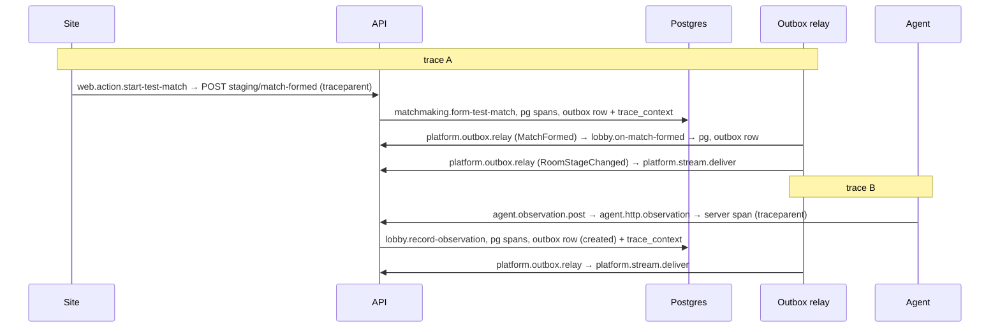

# Observability End to End Design

**Spec**: `.specs/features/observability-e2e/spec.md`
**Status**: Draft, revision 2 (architecture-reviewer FAIL and security-reviewer FAIL on revision 1; every finding addressed below)

---

## Architecture Overview

Three senders, one exporter. The API installs the OpenTelemetry SDK before any application import, instruments HTTP,
Fastify and `pg`, records the skeleton's metrics and exports traces, metrics and logs to the backend named by
`OTEL_EXPORTER_OTLP_*`. The site and the agent never hold backend credentials: they send OTLP traces to
`POST /v1/telemetry/traces` on the API, which forwards the bytes unchanged. The outbox carries the trace across its only
asynchronous hop in a new `trace_context` column.


### The two traces of a room (AD-092)



Trace A holds the site action, the request span, the use-case spans, `pg` spans, both relay rows and the delivery of
`awaiting_host`. Trace B holds the agent's span as the parent of the API spans of its heartbeat and observation, and the
delivery of `created`. No link joins them.

**Trust in trace ids.** A client chooses the trace id and the parent span id of its own requests, so a client can graft
spans into a trace id of its choosing. `trace_context` is written by the server from the active span in a fixed format
and bound as a SQL parameter, so a client cannot inject anything else into it, but its ids are client-influenced. Trace
ids are treated as untrusted labels, never as authorization.

---

## Code Reuse Analysis

### Existing Components to Leverage

| Component                                  | Location                                                 | How to Use                                                                                                                                                |
| ------------------------------------------ | -------------------------------------------------------- | --------------------------------------------------------------------------------------------------------------------------------------------------------- |
| `withSpan`                                 | `apps/api/src/shared-kernel/tracing.ts`                  | Unchanged; call sites drop `accountId`/`agentId` and rename `roomId` to the `d2r.room.id` constant (AD-091)                                               |
| `loadConfig(env)`                          | `apps/api/src/main/config.ts`                            | The only `process.env` reader of the API; gains the `OTEL_*` settings (`telemetry` block) and their validation                                            |
| `createGuards`, `bearerToken`, cookie read | `apps/api/src/platform/http/guards.ts`                   | New guard `requireAgentOrSite` composes the same agent and session authentication; an origin-only check sits next to `requireSameOrigin`                  |
| `authenticateAgent`                        | `apps/api/src/modules/agents/application/`               | Reads a cache and the repository only; it writes no presence or last-seen state, so the relay can call it without side effects                            |
| `answerError`                              | `apps/api/src/main/app.ts:107-123`                       | Already maps 413 and 415; the relay's pre-body checks answer through the same error shape                                                                 |
| `OutboxRelay`, `PostgresOutbox`            | `apps/api/src/platform/outbox-relay.ts`, `.../outbox.ts` | Extended in place: `append` writes `trace_context`, the batch reads it, `#publish` wraps the span                                                         |
| `StreamHub` / `Connection`                 | `apps/api/src/platform/stream-hub.ts`                    | `sse.connections` up-down counter at `add`/`onClose`; `platform.stream.deliver` span per accepted delivery                                                |
| `InMemorySpanExporter` pattern             | `apps/api/src/shared-kernel/tracing.test.ts`             | Same test pattern for every new span test                                                                                                                 |
| `ControllableClock`, `/__test/clock`       | `apps/api/src/main/local.ts`, `test-controls.ts`         | The acceptance stack's frozen clock keeps `outbox.lag` and `room.stage_duration` at 0 in the e2e run; unit tests with `FakeClock` prove their values      |
| `scheduler.every`                          | `apps/api/src/main/app.ts:212-216`                       | Runs the relay limiter's sweep                                                                                                                            |
| Pages proxy allow-list                     | `apps/web/functions/api/[[path]].ts:16-24`               | `traceparent` is already allowed; this feature adds `tracestate` (dropped when over 512 bytes). `/api/v1/telemetry/traces` already matches `PATH_PATTERN` |
| `createApiClient(fetcher)`                 | `apps/web/src/shared/api-client.ts`                      | The injectable `Fetcher` is the seam for the tracing fetcher                                                                                              |
| `telemetry.rs` (`init`, `traceparent_for`) | `apps/agent/src-tauri/adapters/src/telemetry.rs`         | Becomes `telemetry/mod.rs` (a rename); `init` also builds the exporter and returns a guard; `traceparent_for` stays                                       |
| `HttpGateway` / `ApiClient` spans          | `apps/agent/src-tauri/adapters/src/http/`                | Unchanged: the six `agent.http.*` spans and the `traceparent` header already exist (AGS-12)                                                               |
| `Runtime::start`, `Handle::read_once`      | `apps/agent/src-tauri/core/src/runtime.rs`               | The headless example drives the real core through them                                                                                                    |
| Acceptance `stack.ts`, `World`, steps      | `tests/acceptance/support/`                              | Extended with a lazily started traced stack; existing steps (`is signed in on the site`, `starts a test match`) are reused                                |
| Testcontainers                             | `tests/acceptance/support/global-setup.ts`               | Starts `grafana/otel-lgtm` the same way it starts Postgres                                                                                                |

### Integration Points

| System         | Integration Method                                                                                                                                                                                                  |
| -------------- | ------------------------------------------------------------------------------------------------------------------------------------------------------------------------------------------------------------------- |
| Postgres       | New migration `0002_outbox_trace_context` (never an edit of `0001`), registered in the hard-coded map of `platform/postgres/migrator.ts`; `OutboxTable.trace_context: string \| null`                               |
| `openapi.json` | One route, `POST /v1/telemetry/traces`, with a minimal schema (`202`, `401`, `403`, `413`, `415`, `429`); added to the `ROUTES` list of `openapi.int.test.ts`                                                       |
| Render         | `render.yaml` start command gains the `--import` preload; env names only, no secret value                                                                                                                           |
| CI             | `integration` job gains a Rust toolchain and the site build with `VITE_TELEMETRY=on`; Docker is already present                                                                                                     |
| `deny.toml`    | `opentelemetry-otlp` (with `reqwest-client` on rustls, never `native-tls`) and `opentelemetry-http` must pass the existing licence, ban and duplicate-version checks; `deny.toml` is never edited to make them pass |

---

## Components

### Telemetry package `@d2rmm/telemetry`

- **Purpose**: the shared telemetry vocabulary, pure helpers and the SDK bootstraps that take their settings as arguments.
- **Location**: `packages/telemetry/src/`, exported as source like `@d2rmm/contracts`. Task 1 changes `package.json`
  `exports` from `./dist/index.js` to `./src/*.ts`, drops the `build` script's role for consumers, and adds the entries.
  Three entry points, with the SDK kept out of the root:
  - `.` (`index.ts` re-exporting `attributes.ts`, `redact-attributes.ts`, `trace-context.ts`, `instrument-names.ts`) -
    plain functions over `@opentelemetry/api` and `@opentelemetry/core` types only. **No `@opentelemetry/sdk-*`,
    `exporter-*` or `resources` import is reachable from this entry.** `application` and `adapters` may import it.
  - `./node` - `node-sdk.ts` and the shared `sdk/` folder (`sampler.ts`, `views.ts`, `redacting-exporters.ts`,
    `resource.ts`): `startNodeTelemetry(options): TelemetryHandle`. `main/` and the API's `instrument.ts` only.
  - `./web` - `web-sdk.ts`, `tracing-fetcher.ts`, the same `sdk/` folder. Browser only.
- **Interfaces**:
  - `redactAttributes(attributes: Attributes): Attributes` (root) - drops keys whose full key or last dot segment is in
    `authorization, cookie, set-cookie, token, code, secret, password, image, battletag` (case-insensitive; so
    `http.request.header.authorization`, `http.request.header.cookie`, `pairing.code` and `x-token` go, while
    `http.response.status_code`, `db.statement`, `d2r.room.id` stay), drops `client.address`, `user_agent.original`,
    `enduser.*`, and strips `?…`/`#…` from `url.full`, `http.url`, `http.target`, `url.query`. `scrubText(text: string): string`
    (root) replaces `Bearer <token>`, session-cookie and `code=`/`token=` patterns with `[redacted]`.
  - `RedactingSpanExporter(inner)`, `RedactingLogRecordExporter(inner)` (`./node`, `./web`) - copy each record (ended spans
    are not mutated) and apply, beyond attributes: **span events** (attributes redacted; `exception.message` and
    `exception.stacktrace` removed, `exception.type` kept - a `pg` error's DETAIL can hold row values), **status
    message** cleared, **link attributes**, **resource attributes** (only `service.*`, `deployment.environment`,
    `d2r.agent.version`, `telemetry.sdk.*` pass), and the **log body** through `scrubText`.
  - `boundedMetricViews(): ViewOptions[]` (`./node`) - one `View` per instrument with `attributeKeys` limited to the
    bounded sets (`http.route`, `http.response.status_class`, `d2r.stream.kind`, `d2r.room.stage`, `d2r.difficulty`,
    `d2r.queue.mode`) and a drop view for the HTTP instrumentation's duration histogram (AD-095).
  - `traceparentOf(context): string | undefined`, `contextFromTraceparent(text): Context` (root) - W3C only, via an
    explicit `W3CTraceContextPropagator`, so they work with no global propagator registered. `TraceparentOnlyPropagator`
    (root) extracts `traceparent` and ignores `tracestate`: the API's global propagator, so `tracestate` is never
    parsed, stored or re-propagated.
  - `samplerFrom(ratioText: string | undefined): Sampler` (`./node`, `./web`) - `ParentBasedSampler` with
    `root`, `remoteParentSampled` and `remoteParentNotSampled` all set to `TraceIdRatioBased(ratio)` (`0.1` when undefined
    or invalid), so a caller's `sampled=1` flag cannot force an export; a local parent is still followed. Because
    `TraceIdRatioBased` decides by trace id, the API, the site and the agent given the same ratio take the same decision
    for the same trace.
  - `INSTRUMENT_NAMES` (root) - the metric names the code defines; creators use them; the dashboard test compares.
  - `startNodeTelemetry({ serviceName, serviceVersion, environment, endpoint, headers, samplerArg, intervalMs, onExportError })`.
- **Dependencies**: `@opentelemetry/{api,core}` for the root; `resources, sdk-trace-base, sdk-metrics, sdk-logs,
exporter-trace-otlp-http, exporter-metrics-otlp-http, exporter-logs-otlp-http, semantic-conventions` for `./node`;
  `sdk-trace-web` for `./web`. Instrumentation packages are installed in `apps/api`.
- **Reuses**: nothing; it replaces `export {};`. It reads no `process.env` (OBS-39): `packages/config/eslint.mjs` gains a
  `n/no-process-env` block for `packages/telemetry/src/**` with a fixture test in `packages/config/test/rules.test.ts`.
- **Enforcement** (`.dependency-cruiser.cjs`, tightening only): (1) `application-no-adapters` and `domain-is-pure` also
  match `^packages/telemetry/src/(node|web|sdk)/`; (2) a new rule `telemetry-root-has-no-sdk` forbids the root files
  (`index`, `attributes`, `redact-attributes`, `trace-context`, `instrument-names`) from importing
  `node_modules/@opentelemetry/(sdk-|exporter-|resources)`, transitive imports included because the root files import only each other.
  The existing `acceptance-is-black-box` rule is respected: acceptance support code never imports `@d2rmm/telemetry`; it
  keeps its own copy of the forbidden-key list in `tests/acceptance/support/forbidden-keys.ts`, and a harness test in
  `packages/telemetry` reads that file as text and fails if the lists differ.

### API bootstrap (`main/instrument.ts`)

- **Purpose**: install the SDK before `fastify`, `pg` and `http` are imported, because their instrumentation patches the
  modules at load time (`local.ts:6`, `render.ts:7` and `app.ts:6` import them statically).
- **Location**: `apps/api/src/main/instrument.ts`, loaded with `node --import ./src/main/instrument.ts src/main/local.ts`
  (and `render.ts`, `render.yaml`, `stack.ts`). It registers `import-in-the-middle`'s hook, reads `loadConfig`, and when
  `OTEL_EXPORTER_OTLP_ENDPOINT` is set calls `startNodeTelemetry` with `HttpInstrumentation` (no header capture:
  `headersToSpanAttributes` and request-header options stay unset), `FastifyOtelInstrumentation`, `PgInstrumentation`
  (`enhancedDatabaseReporting: false`, so a statement carries placeholders, not values) and the pino log correlation and
  sending instrumentation. Unset: it does nothing and the process starts as today (OBS-02). A load error is caught,
  logged once and the process continues without telemetry.
- **Interfaces**: `TelemetryHandle.shutdown(): Promise<void>` is called by both roots' signal handlers;
  `getTelemetryHandle()` hands the forwarder settings to `buildApp` without a second `process.env` read.
- **Config validation** (`main/config.ts`): `OTEL_EXPORTER_OTLP_ENDPOINT` must be `https:` unless the host is loopback,
  must not contain user info, and is never logged with credentials; `OTEL_EXPORTER_OTLP_HEADERS` is parsed into a map that
  only the forwarder and the SDK exporter receive; `OTEL_TRACES_SAMPLER_ARG` a number in `[0, 1]`;
  `OTEL_METRIC_EXPORT_INTERVAL` default `60000` (the acceptance stack sets `5000`).
- **Reuses**: `loadConfig`; the config gains `telemetry: { endpoint, headers, samplerArg, intervalMs }`.

### Pino correlation and log export

- **Purpose**: JSON log lines with `trace_id` and `span_id`, and the same records over OTLP (OBS-26, OBS-27).
- **Location**: `main/app.ts` logger options gain a `mixin` reading `trace.getActiveSpan()?.spanContext()`; export uses the
  pino log-sending instrumentation registered in `instrument.ts`, behind `RedactingLogRecordExporter`. Fallback if the
  instrumentation does not load under ESM-as-TypeScript (the spike gates it): a pino destination stream that parses each
  line and emits it through the Logs API with the same redaction. The `console.error` calls in `app.ts`, `outbox-relay.ts`
  and `stream-hub.ts` become logger calls (they bypass pino today).
- **Reuses**: `REDACTED_LOG_PATHS` stays; the `logSink` test hook stays.

### Metrics

- **Purpose**: the five instruments of AD-087.
- **Location and shape**:
  - `http.server.request.duration` and `http.server.response.body.size` - `platform/http/request-metrics.ts`, a Fastify
    `onResponse` hook by `http.route` (the route template) and `http.response.status_class`. Streams (`reply.hijack()`)
    never reach `onResponse`, so `/v1/stream` is covered by `sse.connections` only (AD-095).
  - `sse.connections` - `UpDownCounter` in `StreamHub`: `+1` where the connection joins the set, `-1` in its `onClose`,
    attribute `d2r.stream.kind` (`agent` or `site`).
  - `outbox.lag` - `ObservableGauge` in `platform/outbox-lag.ts`: `select created_at from platform.outbox where
published_at is null and failed_at is null order by id limit 1` (the partial index is on `(id)`), `0` when none,
    computed with the injected `Clock`. It runs once per metric export (default 60 s), so it adds no wake-up beyond the
    existing 1 s `agents.sweep` and no Neon CU concern.
  - `room.stage_duration` - a port `RoomMetrics { stageLeft(stage, difficulty, mode, seconds) }` in the lobby application
    ports, an OpenTelemetry adapter in `lobby-room/adapters/telemetry/`, an in-memory fake for unit tests. The use case
    `lobby.record-observation` calls it once, in the `created` branch, with `clock.now() - rooms.openedAt(roomId)`. The
    repository port gains `openedAt(roomId): Promise<Date | undefined>` (reads `lobby.rooms.created_at`, the instant the
    room opened in `awaiting_host`) and `LobbyRoomDeps` gains `clock`; the domain stays timestamp-free.
- **Reuses**: `Clock`, the application-port pattern, `InMemory*` fakes under `testing/`.

### Trace context across the outbox

- **Purpose**: OBS-05, OBS-06, OBS-07.
- **Location**: `platform/postgres/outbox.ts`, `platform/outbox-relay.ts`, `platform/stream-hub.ts`, migration `0002`.
- **Interfaces**:
  - `PostgresOutbox.append` writes `trace_context = traceparentOf(context.active())` for every row of the call (`null`
    when there is no valid span context) in the same insert, inside the transaction.
  - `OutboxRelay.#publish(row)` runs `context.with(row.trace_context ? contextFromTraceparent(row.trace_context) : ROOT_CONTEXT, …)`
    and inside it `tracer.startActiveSpan('platform.outbox.relay', …)` around `bus.publish`. The explicit context is
    mandatory: `wake()` is unawaited after commit and a drain handles up to 100 rows of different traces in the context
    of whoever woke it. A malformed value yields `ROOT_CONTEXT`. Attribute: `d2r.outbox.event_type`.
  - `StreamHub.#dispatch` opens `platform.stream.deliver` (child of the active relay span) for each connection whose
    `#accepts` returns true; attribute `d2r.stream.kind`. Transient events dispatched from a request become children of
    that request's span.
- **Dependencies**: `@opentelemetry/api`, `@d2rmm/telemetry` (root entry).

### Relay route `POST /v1/telemetry/traces`

- **Purpose**: OBS-10 to OBS-16, OBS-20.
- **Location**: `platform/http/telemetry-relay.ts` (a Fastify plugin registered from `app.ts` with the forwarder settings),
  `platform/http/relay-limiter.ts`, a new guard in `guards.ts`.
- **Behaviour and check order** (all in `onRequest`, before Fastify reads the body):
  1. **Address gate (cheap, in memory).** The address key is `rateLimitKey(request.ip)` after trust-proxy resolution
     (`TRUST_PROXY_HOPS`); an unparseable address maps to one fixed bucket and IPv4-mapped IPv6 (`::ffff:a.b.c.d`) is
     tested. This bucket counts only requests that carry **no credential** and requests whose **authentication failed**,
     120 a minute; when it is full the answer is `429` with `Retry-After` _before_ any credential is looked up, which is
     the spec's "429 first" for an unauthenticated address (OBS-14) and keeps a flood of bad tokens off the database.
     Valid principals never count against it. Behind the Pages proxy every site request shares the proxy's egress
     address, so a flood of invalid cookies through the proxy can fill that shared bucket and delay site telemetry; this
     only costs telemetry and is accepted and tested.
  2. **Authentication.** An `Authorization` header selects the bearer path (`authenticateAgent`; revoked or unknown is
     `401`; the minimum-version gate `requireAgentVersion` is **not** applied, so old agents' spans are still accepted);
     otherwise the session cookie path (`authenticateSession`). A failure is `401` and counts toward the address gate. A
     valid session whose `Origin` is missing or not exactly `siteOrigin` (no trailing slash, no subdomain) is `403`. The
     origin-only guard does not require JSON, and a request with `Authorization` never takes the cookie path.
  3. **Per-principal rate**, `agent:<id>` or `account:<id>`: 60 requests a minute and a byte budget of 8 MiB a minute,
     plus a global cap of 32 MiB a minute of forwarded bytes; over any of them is `429` with `Retry-After`.
  4. **Content type and encoding**: `application/x-protobuf` or `application/json`; `content-encoding` absent or
     `identity`, anything else (gzip included, which removes a decompression-bomb path) is `415`.
  5. **Size**: a declared `content-length` over 1 MiB is `413`; a body that exceeds it while streaming fails with
     `FST_ERR_CTP_BODY_TOO_LARGE`, mapped to `413` by `answerError`.
- **Spec order.** The spec's order (authentication, rate, type, size) holds for authenticated callers; the address gate
  precedes authentication only for callers without valid credentials, as OBS-14 states. The table-driven order test has
  a row for this case.
- **Handler and forwarder.** Scoped parsers for the two content types return a `Buffer` unchanged; `bodyLimit` is
  1 MiB. The handler replies `202` with an empty body, then calls `forwarder.forward(body, contentType)` without awaiting
  it. `Forwarder`: `fetch(endpoint + '/v1/traces', { method: 'POST', redirect: 'manual', headers: { 'content-type', ...credentialHeaders }, body, signal: AbortSignal.timeout(5000) })`;
  a redirect or any failure logs one warning (`relay-forward-failed`, status or error class only, never the body, the
  endpoint credentials or the headers) and never retries; the response is discarded. At most 32 forwards are in flight
  and at most 8 MiB of bodies are buffered; a further one is dropped with a warning. With no endpoint configured the
  relay answers `202` and drops. The forwarder never passes the caller's address, user agent or cookies on.
- **`RelayLimiter`**: an in-memory sliding window; keys exist only for valid principals and for addresses; pruned on
  every check, swept every 30 s by `scheduler.every`, a hard cap of 10 000 keys that fails closed (`429`) when reached.
  It is platform-local because `SlidingWindowLimit` is internal to the agents module (`platform-uses-public-ports`);
  `rateLimitKey`'s logic is copied as a pure function with its own tests.
- **Instrumentation**: the route and `/healthz` are excluded from HTTP-server instrumentation
  (`ignoreIncomingRequestHook`) so the relay does not trace its own traffic.

### Site telemetry

- **Purpose**: OBS-04, OBS-21, OBS-44.
- **Location**: `apps/web/src/shared/telemetry.ts` (composition), `tracing-fetcher.ts` from the package,
  `apps/web/src/vite-env.d.ts` (new, types `VITE_TELEMETRY` and `VITE_TELEMETRY_RATIO`), `main.tsx` calls
  `startWebTelemetry` before rendering, `app/App.tsx` builds `defaultClient` with the tracing fetcher.
- **Interfaces**:
  - `startWebTelemetry({ enabled, ratio, relayPath: '/api/v1/telemetry/traces', serviceVersion, environment })` creates a
    `WebTracerProvider` with `samplerFrom(ratio)` (`VITE_TELEMETRY_RATIO`, default `0.1`) and a
    `BatchSpanProcessor(RedactingSpanExporter(OTLPTraceExporter))` (5 s interval, at most 100 spans a batch, queue of 256)
    only when `enabled` (`VITE_TELEMETRY === 'on'`); disabled returns a no-op and installs nothing (OBS-44).
  - `tracedAction(name, fn)` - `startActiveSpan`; `fn` calls the API client synchronously, so the fetch happens inside the span.
  - `tracingFetcher(base)` - opens a client span `HTTP <METHOD> <route>`, sets `url.path` without the query, injects
    `traceparent` into the request headers, ends the span on the response.
  - `navigationSpan(location)` - one `web.navigation` span at start and on `popstate`, attribute `url.path` (pathname only).
  - `StartTestMatchButton` wraps `client.matchFormed()` in `tracedAction('web.action.start-test-match', …)`.
- **Privacy default (AD-098)**: production builds leave `VITE_TELEMETRY` off. The e2e site build sets `on` and ratio `1`.
- **Dependencies**: `@d2rmm/telemetry/web`. The site export goes to the relay through the same-origin proxy, which carries
  the cookie and `Origin` (no CORS).

### Agent exporter and headless example

- **Purpose**: OBS-18, OBS-19, OBS-22, OBS-38, and the agent half of OBS-24.
- **Location**: `apps/agent/src-tauri/adapters/src/telemetry/` (`mod.rs` keeps `init`/`traceparent_for`; new `export.rs`,
  `queue.rs`, `relay_client.rs`, `allow_list.rs`), `adapters/examples/headless.rs`.
- **Interfaces**:
  - `BoundedQueue<T>` (`queue.rs`) - pure, capacity 2048, `push` drops the oldest, `drain(max)`. The SDK batch processor
    drops the newest span, so the agent has its own `DropOldestProcessor` over this queue and a spawned export task on a
    5 s interval, at most 256 spans a batch; `on_end` never awaits.
  - `RelayHttpClient` (`relay_client.rs`) - implements `opentelemetry_http::HttpClient` over `reqwest` built with
    `redirect::Policy::none()` (the bearer token never follows a redirect) and rustls; adds `Authorization: Bearer <token>`
    and `X-Agent-Version` from a `HeaderSource` trait object per request; `outcome_of(status, retry_after, now)` is a pure
    function mapping `401/403/413/415` to "drop this batch", `429` to "no export before `Retry-After`" (capped at 1 h, so
    a server value cannot silence export for good) and others to success or drop. Data only, never a command (ADR 010).
  - `allow_list.rs` - `AllowedAttributes`: the agent's spans may carry only `d2r.*` ids, `http.*` status and method,
    `agent.*` loop names and `service.*`; any other key (window title, process path, screen text) is dropped by an
    exporter wrapper before the queue. Unit-tested with a forbidden fixture.
  - `init(mode, export: Option<ExportConfig>) -> TelemetryGuard` - builds the provider with `service.name=d2rmm-agent`,
    `service.version`, `deployment.environment`, `d2r.agent.version`, and `samplerFrom`-equivalent `ParentBased` over
    `TraceIdRatioBased(ratio)` (`remote` parents also by ratio); `TelemetryGuard::shutdown()` flushes. The Windows shell
    keeps the guard in its state; export errors go through a once-a-minute `LogGate` (pure, tested).
  - `HeaderSource` is implemented in each composition root from the token store, so the core stays free of OpenTelemetry
    (OBS-22) and the token is read per request, never captured.
  - **Privacy default (AD-098)**: `ExportConfig` is `Some` only for debug builds, the example, and a release build with
    the compile-time setting `D2RMM_TELEMETRY=on`; the release workflow does not set it until the maintainer decides on
    a notice. The relay never forwards the caller's address or user agent.
  - `examples/headless.rs` - gated by `required-features = ["fixture-read"]`, a Cargo feature **of the adapters crate**
    (`fixture-read = ["dep:image"]`, never a default feature, off in every release graph so `cargo tree -p d2rmm-agent -e
features` never shows it). It is a composition root for the e2e run: `Runtime::start` with the real `HttpGateway`, an
    in-memory `TokenStore`, a `ProcessSource` that reports the game open, the exporter, and `--read-fixture <png>` as in
    AGS-33: it decodes the PNG and, because Linux has no OCR, a `TextReader` returns the text of the sidecar file
    `<png>.txt`; `--api-base` is a runtime argument parsed with `AllowLoopbackHttp::Yes`. It prints JSON lines on stdout
    (`code`, `paired`, `assignment`, `observed`), and on each `read` line from stdin it calls `Handle::read_once` once
    for the held room (AGS-33 AC 6). This conforms to OBS-24 AC 2 and AGS-33 AC 6 (a build with the Cargo feature
    `fixture-read`, `--read-fixture`), with the feature on the adapters crate because the app crate is Windows-only
    (AD-096). `agent-source-rules.test.mjs` extends its default-feature rule to the adapters manifest, and a check
    asserts that `release-agent.yml` never builds the example and that `AllowLoopbackHttp::Yes` is constructed only in the
    app crate's debug path and the example.
- **Dependencies**: `opentelemetry-otlp` (`http-proto`, `trace`, `reqwest-client` on rustls), `opentelemetry-http`;
  versions aligned with the locked `opentelemetry 0.33`.
- **Reuses**: `HttpGateway`, `Runtime`, `Mode`, `level_filter`, the existing `agent.*` spans.

### Local backend and the end-to-end proof

- **Purpose**: OBS-23, OBS-24, OBS-25, OBS-35.
- **Location**: `infra/observability/compose.yaml` (the image `grafana/otel-lgtm` pinned by tag **and** digest, ports
  bound to `127.0.0.1` - `127.0.0.1:3000:3000`, 4317, 4318 and 3200 for Tempo's query API - because the image ships with
  anonymous admin access; the `dashboards/` mount and a provisioning provider file), `infra/observability/dashboards/skeleton.json`,
  root scripts `obs:up` and `obs:down`, `tests/acceptance/support/telemetry-backend.ts`, `trace-reader.ts`,
  `headless-agent.ts`, `forbidden-keys.ts`, `tests/acceptance/steps/observability.steps.ts`.
- **Interfaces**:
  - `startTelemetryBackend()` - Testcontainers `GenericContainer` using the image line parsed from `compose.yaml`, waits for
    Tempo readiness; with no Docker socket it throws an error whose message names Docker (OBS-25). Started once per run
    by the first `@slow` step, closed in teardown.
  - `Stack.startTracedStack({ otlpEndpoint })` - starts a staging API (`OTEL_EXPORTER_OTLP_ENDPOINT`, sampler `1.0`, metric
    interval 5 s) and a Pages dev server on a site built with `VITE_TELEMETRY=on` and ratio `1`; the `World` switches its
    base URLs to it for the scenario. The relay scenarios start the same stack pointed at a `FakeTelemetryBackend` (an
    HTTP recorder in the test process, credential-free). `apiEnv` passes the new `OTEL_*` variables explicitly.
  - `readTrace(traceId)` - polls Tempo for 30 s and returns span names and parent edges; `assertTraceA`, `assertTraceB`
    check the edges of OBS-08 and OBS-12; the scan helper walks every exported span, metric and log record for the
    forbidden keys, query strings and the player name, with a fixture that throws a `pg` unique violation.
  - `HeadlessAgent` - spawns `cargo run --example headless --features fixture-read` (built once), parses stdout, writes
    the sidecar text and the PNG, sends `read`.
- **Reuses**: `freePort`, `launch`, `waitFor`, `World`, the existing sign-in and test-match steps.

### Dashboard as code

- `skeleton.json` holds panels for request rate, error rate and duration per route (from `http_server_request_duration`),
  `outbox_lag` and `sse_connections`. `dashboard-metrics.test.ts` (in `packages/telemetry`) reads the panel queries,
  extracts metric names and fails if one is not in `INSTRUMENT_NAMES` (OBS-36). Panels filter on the trusted server-side
  `service.name="d2rmm-api"`, never on a name a sender reports.

---

## Data Models

```typescript
// platform.outbox gains one nullable column (migration 0002_outbox_trace_context)
interface OutboxTable {
  // ...existing columns unchanged
  trace_context: string | null; // W3C traceparent, e.g. "00-<32 hex>-<16 hex>-01"
}

interface TelemetryConfig {
  endpoint: string | undefined; // OTEL_EXPORTER_OTLP_ENDPOINT: https, or loopback; no user info
  headers: Readonly<Record<string, string>>; // OTEL_EXPORTER_OTLP_HEADERS, never logged or put on a span
  samplerArg: string | undefined; // OTEL_TRACES_SAMPLER_ARG
  intervalMs: number; // OTEL_METRIC_EXPORT_INTERVAL, default 60000
}

interface RoomMetrics {
  stageLeft(stage: 'awaiting_host', difficulty: Difficulty, mode: Mode, seconds: number): void;
}
```

**Relationships**: `trace_context` is read only by the relay; rows written before the migration are `null` and publish as
root spans (OBS-07). `RoomMetrics` is implemented by the lobby adapter; the application never imports the SDK.

---

## Error Handling Strategy

| Error Scenario                                        | Handling                                                                                                                           | User Impact                           |
| ----------------------------------------------------- | ---------------------------------------------------------------------------------------------------------------------------------- | ------------------------------------- |
| `OTEL_EXPORTER_OTLP_ENDPOINT` unset                   | `instrument.ts` installs nothing; the relay answers `202` and drops                                                                | None                                  |
| Backend down, slow or redirecting                     | SDK exporters fail in their own timers; one error log per minute; the relay forwards in the background, 5 s, no redirect, no retry | None; answers identical (OBS-37)      |
| Relay called without credentials / wrong origin       | `401` / `403`, nothing forwarded; failures count toward the address gate                                                           | Exporter drops the batch              |
| Relay over address gate / rate / byte budget          | `429` with `Retry-After`; nothing forwarded                                                                                        | Agent waits; site drops               |
| Relay: wrong type or any content encoding / too large | `415` / `413`                                                                                                                      | Exporter drops the batch              |
| 33rd concurrent forward, or 8 MiB buffered            | Dropped, one warning                                                                                                               | A few spans missing                   |
| Limiter at 10 000 keys                                | Fails closed with `429`                                                                                                            | Telemetry delayed                     |
| Outbox row with no or a malformed `trace_context`     | Relay uses `ROOT_CONTEXT`; never fails the row                                                                                     | A root span in place of a child       |
| SDK load error at start                               | `instrument.ts` catches, logs one line, continues without telemetry                                                                | None                                  |
| Agent queue full                                      | Oldest span dropped                                                                                                                | Oldest spans missing in a long outage |
| Agent relay answers `401/403/413/415` / `429`         | Batch dropped / exporter waits `Retry-After` (at most 1 h)                                                                         | None                                  |
| Docker missing in the trace scenario                  | Step fails naming Docker; the scenario never passes unread                                                                         | Developer sees the cause              |

---

## Requirement Coverage

| Requirement | Component                                   | Level of proof                                           |
| ----------- | ------------------------------------------- | -------------------------------------------------------- |
| OBS-01      | API bootstrap, telemetry `./node`           | Integration (fake OTLP backend); trace scenario          |
| OBS-02      | API bootstrap                               | Integration (both roots, endpoint unset)                 |
| OBS-03      | API bootstrap, `pg` instrumentation         | Integration (in-memory exporter); trace scenario         |
| OBS-04      | Site telemetry                              | Web unit; trace scenario                                 |
| OBS-05      | Outbox `append`, migration `0002`           | Integration (Testcontainers)                             |
| OBS-06      | Outbox relay, `StreamHub`                   | Integration; trace scenario                              |
| OBS-07      | Outbox relay                                | Integration (row with no context)                        |
| OBS-08      | All of trace A                              | Trace scenario `@OBS-24`                                 |
| OBS-09      | Pages proxy                                 | Pages Function test; trace scenario                      |
| OBS-10      | Relay route, forwarder                      | Integration (fake backend); relay outline                |
| OBS-11      | Relay guard                                 | Unit (check order); relay outline                        |
| OBS-12      | Agent spans, `traceparent`                  | Trace scenario                                           |
| OBS-13      | Relay size checks                           | Integration; relay outline                               |
| OBS-14      | Relay limiter, address gate                 | Unit (limiter, IPv6, cap); integration; relay outline    |
| OBS-15      | Forwarder                                   | Unit (fake `fetch`, timeout, redirect, cap); integration |
| OBS-16      | Relay handler, log redaction                | Integration (backend answers headers and a body)         |
| OBS-17      | Origin guard                                | Unit (table: missing, wrong, slash, subdomain); outline  |
| OBS-18      | `BoundedQueue`, `DropOldestProcessor`       | Rust unit (mutation scope)                               |
| OBS-19      | `RelayHttpClient`, `outcome_of`             | Rust unit (mutation scope)                               |
| OBS-20      | Relay content type, encoding and order      | Unit (table-driven); relay outline                       |
| OBS-21      | Site telemetry                              | Web unit; trace scenario                                 |
| OBS-22      | Agent crates                                | Architecture test (manifests); Rust test                 |
| OBS-23      | Compose file, scripts                       | Harness test                                             |
| OBS-24      | Local backend, traced stack, headless agent | Trace scenarios `@slow @web`                             |
| OBS-25      | `startTelemetryBackend`                     | Unit (no Docker socket)                                  |
| OBS-26      | Pino mixin                                  | API test (inside and outside a span)                     |
| OBS-27      | Log export                                  | API test (in-memory log exporter)                        |
| OBS-28      | `redactAttributes`, redacting exporters     | Unit (every key); scan in the trace scenario             |
| OBS-29      | `redactAttributes` URL scrubbing            | Unit; scan                                               |
| OBS-30      | `attributes.ts`, call sites                 | Unit; scan                                               |
| OBS-31      | `boundedMetricViews`                        | API test (bounded sets)                                  |
| OBS-32      | `resource.ts`, Rust resource                | Unit per bootstrap; Rust test                            |
| OBS-33      | Metrics                                     | API test (in-memory metric reader)                       |
| OBS-34      | `RoomMetrics`, `openedAt`                   | Application unit (`FakeClock`)                           |
| OBS-35      | Dashboard, compose provisioning             | Unit (panels); harness test                              |
| OBS-36      | `INSTRUMENT_NAMES`, dashboard test          | Unit                                                     |
| OBS-37      | SDK exporters, forwarder                    | Integration run against a closed port                    |
| OBS-38      | Agent exporter                              | Rust test with an unreachable relay                      |
| OBS-39      | Telemetry package, ESLint block             | Lint fixture test                                        |
| OBS-40      | `.env.example`                              | Test (every `OTEL_*` the config reads); `secrets:scan`   |
| OBS-41      | Use-case spans in `application`             | Existing architecture tests                              |
| OBS-42      | Relay route in `openapi.json`               | `contracts:openapi` drift check; `ROUTES` test           |
| OBS-43      | `samplerFrom`                               | Unit (ratio, default, forced flag, child follows parent) |
| OBS-44      | `startWebTelemetry`                         | Web unit                                                 |

---

## Test Strategy

Each `# not-scenario:` proof in `acceptance.feature` has a named test; the tasks map them one to one.

| Level                    | Tests                                                                                                                                                                                                                                                                                                                                                |
| ------------------------ | ---------------------------------------------------------------------------------------------------------------------------------------------------------------------------------------------------------------------------------------------------------------------------------------------------------------------------------------------------- |
| Unit (telemetry package) | `redaction` (each forbidden key and URL fixture, events, exception message, status, log body, resource), `trace-context` (round trip, malformed input), `sampler` (forced `sampled=1` does not export), `attributes`, `resource`, `views`, `dashboard-metrics`, forbidden-key list parity with acceptance                                            |
| Unit (API)               | relay limiter (window, sweep, cap, IPv6, mapped IPv4), relay check order (table-driven, including the address-gate row), origin guard, forwarder (fake `fetch`: timeout, redirect refused, no retry, caps), config validation of `OTEL_*`, pino mixin, `RoomMetrics` with `FakeClock`                                                                |
| Unit (web)               | tracing fetcher (header and `url.path`), navigation span without the query, no exporter unless `VITE_TELEMETRY=on`, exporter targets the relay path                                                                                                                                                                                                  |
| Unit (agent, Rust)       | `BoundedQueue`, `outcome_of` (including the 1 h cap), `LogGate`, `allow_list`, resource attributes, "exporter never blocks a caller"; architecture test: no OTel crate in the domain or core manifests, `opentelemetry-otlp` in adapters only, `fixture-read` never default, the example not in the release workflow                                 |
| Integration (API)        | Testcontainers: outbox round trip with and without `trace_context`; relay against a fake backend for OBS-10 to OBS-16; spans over `pg` with a bound value; logs and metrics through in-memory exporters; both roots start with the endpoint unset; the suite against a closed port; a `pg` unique violation leaves no row value in any exported span |
| Pages Function           | `traceparent` and `tracestate` reach a fake API; an oversized `tracestate` is dropped                                                                                                                                                                                                                                                                |
| Harness                  | `compose.yaml` pins a tag and digest and binds `127.0.0.1`; `obs:up`/`obs:down`; dashboard provisioned; `.env.example` lists every `OTEL_*` the config reads; lint fails on `process.env` in the telemetry package; the root entry's import graph holds no `sdk-*`                                                                                   |
| Acceptance               | The `@slow @web` trace scenarios and the relay outline, with the traced stack, the lgtm container and the headless agent                                                                                                                                                                                                                             |

Mutation scope adds the pure functions of `adapters/src/telemetry/{queue,relay_client,allow_list}.rs` to `.cargo/mutants.toml`,
with unit tests as their proof (ADR 026); the lobby application change is covered by the existing Stryker scope.

**Sender volume and egress (NFR-14).** The agent and the site sample with the same parent-based ratio as the API
(default `0.1`, `TraceIdRatioBased` decides by trace id so the three agree), batch every 5 s with at most 256 (agent) or
100 (site) spans, and the relay caps each principal at 8 MiB and all callers at 32 MiB a minute. `load-baseline` measures
bytes per player-hour with telemetry on and reports the telemetry share.

---

## Risks & Concerns

| Concern                                                                                                                                                              | Location (file:line)                                          | Impact                                                             | Mitigation                                                                                                                                                                                                                                                                                                     |
| -------------------------------------------------------------------------------------------------------------------------------------------------------------------- | ------------------------------------------------------------- | ------------------------------------------------------------------ | -------------------------------------------------------------------------------------------------------------------------------------------------------------------------------------------------------------------------------------------------------------------------------------------------------------- |
| Auto-instrumentation of ESM run as TypeScript (type stripping, `import-in-the-middle`) is unverified here, for `pg`, Fastify and pino                                | `apps/api/src/main/local.ts:6`, `render.ts:7`, `app.ts:6`     | Spans or log export could be missing; both entry points change     | T1 is a spike with a gate: boot `local.ts` with the preload and find a `pg` span under the server span and a log record with the trace id. Fallbacks: a Fastify `onRequest` hook with `propagation.extract` for the server span, a Kysely `log` callback for the `pg` span, a pino destination stream for logs |
| Exact OpenTelemetry package names and versions (Fastify instrumentation, pino log sending, Rust OTLP and `HttpClient` shapes) were not checked against documentation | `packages/telemetry/package.json`, `adapters/Cargo.toml`      | A wrong package or API shape would stall a task                    | The spike pins versions from the registry and records them in `tasks.md`; the Rust `SpanExporter`/`HttpClient` shapes are read from the locked 0.33 sources before the agent tasks start                                                                                                                       |
| The relay is a public write path to the maintainer's quota                                                                                                           | `platform/http/telemetry-relay.ts` (new)                      | Abuse by a holder of any session or token                          | Address gate before authentication, credentials, exact origin, 60/min and 8 MiB/min per principal, 32 MiB/min global, 1 MiB body, 32 forwards and 8 MiB buffered, no redirect, no retry, no response data, no content encoding (AD-084, AD-097); security-reviewer on design and diff                          |
| Forged or unredacted telemetry from clients, and forged trace ids                                                                                                    | relay pass-through                                            | PII or a secret reaches the backend; spans grafted into a trace id | Redaction by the sender (events, exception text, status, links, resource, log body); the scan in the trace scenario covers the real senders; the backend and the ids are untrusted (AD-084); the sampler ignores a caller's sampled flag; `tracestate` is ignored by the API                                   |
| Backend credentials in `OTEL_EXPORTER_OTLP_HEADERS`                                                                                                                  | `main/config.ts`, forwarder, logs                             | A secret in a log, span, response, or re-sent on a redirect        | Headers live only in the forwarder and the SDK exporter; `redirect: 'manual'`; https required off loopback; no user info; a test asserts absence from logs and spans (OBS-16); `.env.example` has placeholders; `pnpm secrets:scan`                                                                            |
| Telemetry from players' machines and browsers without a consent decision                                                                                             | `VITE_TELEMETRY`, `ExportConfig`                              | A privacy decision the maintainer has not taken (NFR-04, NFR-05)   | Production builds export nothing until the maintainer decides (AD-098, as AD-090 for the site); the agent has an attribute allow-list; the relay never forwards address or user agent                                                                                                                          |
| `StreamHub` and the relay write `console.error` outside pino                                                                                                         | `outbox-relay.ts:85,165`, `stream-hub.ts:327`, `app.ts:214`   | Log lines without a trace id and not exported                      | Replace with an injected logger in the tasks that touch those files                                                                                                                                                                                                                                            |
| The agent's `agent.stream.connect` span is long-lived                                                                                                                | `core/src/follow_stream.rs:30`                                | Exported only when the stream drops; a missing parent meanwhile    | Documented; neither trace depends on it; the e2e asserts edges for heartbeat and observation only                                                                                                                                                                                                              |
| Frozen acceptance clock                                                                                                                                              | `local.ts:35`                                                 | `outbox.lag` and `room.stage_duration` read 0 in the e2e run       | Their values are proved by unit tests with `FakeClock`; the e2e proves traces only                                                                                                                                                                                                                             |
| The site is built with telemetry on for the acceptance run                                                                                                           | `tests/acceptance/support/stack.ts:184`, CI `integration` job | Extra relay POSTs in every site scenario                           | The relay answers `202` and drops when no endpoint is set; the whole acceptance suite is a task gate                                                                                                                                                                                                           |
| New Rust toolchain and build time in the `integration` job                                                                                                           | `.github/workflows/ci.yml:106-132`                            | Longer CI                                                          | Cache `target`; build the example once; the job has a 25 min limit; extending CI is within `harness-edits`                                                                                                                                                                                                     |
| `deny.toml` may reject the OTLP crates' transitive dependencies                                                                                                      | `apps/agent/src-tauri/deny.toml`                              | Agent job red                                                      | rustls only, no `native-tls`; `cargo deny check` is the gate of the Cargo task; a missing licence stops the task as a maintainer decision; `deny.toml` is never edited to pass                                                                                                                                 |
| Duplicated sliding-window logic in `platform`                                                                                                                        | `platform/http/relay-limiter.ts` (new)                        | Two implementations of the same rule                               | Accepted: the agents module keeps its limiter internal; noted for F1                                                                                                                                                                                                                                           |
| Adding `clock` to `LobbyRoomDeps` touches every construction site                                                                                                    | `lobby-room-use-cases.ts:18-26`                               | Wide edit                                                          | One task updates `buildApp` and the test factories together                                                                                                                                                                                                                                                    |
| A shared proxy egress address fills the relay's address gate                                                                                                         | relay address gate                                            | A flood of invalid cookies through the proxy delays site telemetry | Accepted and tested; it costs telemetry only, and production site telemetry is off (AD-098)                                                                                                                                                                                                                    |

---

## Tech Decisions (only non-obvious ones)

| Decision                                          | Choice                                                                                                                           | Rationale                                                                                                                          |
| ------------------------------------------------- | -------------------------------------------------------------------------------------------------------------------------------- | ---------------------------------------------------------------------------------------------------------------------------------- |
| How the SDK loads before the application (AD-094) | `node --import ./src/main/instrument.ts`; the telemetry package exports source with three entries, the root free of SDK packages | The roots import `pg` statically; Render installs without a build; the root stays importable by `application`                      |
| Where request metrics come from (AD-095)          | A Fastify `onResponse` hook with the route template; the HTTP instrumentation's own duration histogram is dropped by a view      | The HTTP instrumentation has no route template; one source avoids duplicate series. Names unchanged; differs from AD-087's wording |
| Headless agent for the e2e (AD-096)               | `examples/headless.rs` in the adapters crate behind that crate's `fixture-read` feature, `--read-fixture <png>`, sidecar text    | Conforms to OBS-24 and AGS-33 in letter; the app crate is Windows-only and CI's acceptance job is Linux                            |
| Agent queue (AD-096)                              | Own `DropOldestProcessor` over `BoundedQueue`                                                                                    | The SDK batch processor drops the newest span; OBS-18 asks for the oldest                                                          |
| Sampling remote parents                           | `ParentBased` with the ratio sampler for root and both remote cases                                                              | A caller's `sampled=1` must not force export; same ratio on all senders keeps traces whole                                         |
| Browser instrumentation                           | A tracing `Fetcher` and manual action and navigation spans, not `instrumentation-fetch`                                          | F0's client has one fetcher and no router (AD-046); explicit headers avoid async-context loss in the browser                       |
| Relay without a backend, at capacity (AD-097)     | `202` and drop; 32 forwards and 8 MiB in flight; limiter local to `platform`                                                     | The spec fixes an immediate `202` and no retry; the bound keeps a single free instance safe (ADR 006)                              |
| Telemetry default in production (AD-098)          | Site and agent release builds export nothing until the maintainer decides; debug builds, the example and the e2e build export    | Browser and agent telemetry of players going to a third party is a privacy decision not yet taken                                  |
| `room.stage_duration` source                      | `lobby.rooms.created_at` through `rooms.openedAt`, `Clock` in the deps                                                           | The aggregate has no timestamps and `awaiting_host` begins when the room opens; no schema change                                   |
| Backend in tests                                  | Testcontainers starts `otel-lgtm` lazily from the `@slow` step; `compose.yaml` is the single place the tag is written            | No new global dependency for the non-trace scenarios; `obs:up` stays for the developer                                             |

New project-level decisions recorded in `.specs/STATE.md`: AD-094…AD-098.

---

## Conformity

| Source                  | How the design conforms                                                                                                                                                                                                                                                                                       |
| ----------------------- | ------------------------------------------------------------------------------------------------------------------------------------------------------------------------------------------------------------------------------------------------------------------------------------------------------------- |
| ADR 013                 | OTLP only; backend named in `main/` and `instrument.ts` by env; no provider SDK; `traceparent` links the agent                                                                                                                                                                                                |
| ADR 003 / 027           | Spans in `application` (API) and `core` (agent); the SDK, exporters and OTLP crates in `main/`, the package's `./node` and `./web` entries and the adapters; the domain emits nothing; `application` imports `@opentelemetry/api` and the package root only, enforced by a cruiser rule on the root's imports |
| ADR 010                 | The relay answers an empty `202`; the agent only sends data; `Retry-After` is capped data, not a command; the headless example is never released                                                                                                                                                              |
| ADR 006                 | One instance, in-memory limits with a key cap, no queue service, bounded forwards                                                                                                                                                                                                                             |
| ADR 026                 | New pure agent logic (`BoundedQueue`, `outcome_of`, `LogGate`, `allow_list`) has unit tests as its mutation proof                                                                                                                                                                                             |
| AD-084…AD-093           | Unchanged except the wording point on AD-087 (AD-095) and the address gate order, which OBS-14 states                                                                                                                                                                                                         |
| AGS-33 / AD-057         | The read is gated by a Cargo feature named `fixture-read`, never default, outside every release graph                                                                                                                                                                                                         |
| AGENTS.md rules 1, 2, 6 | No import of `main/`; `openapi.json` regenerated; no secret value in the repository                                                                                                                                                                                                                           |
