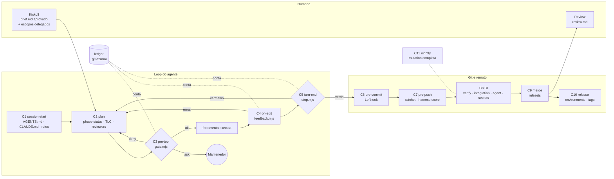

<!-- Gerado com a skill harness-analysis (HAF-1). Scorecard: docs/harness/harness-scorecard.json -->

# Análise do harness — d2rmatchmaking (HAF-1)

2026-11-03 · commit `a32aa62` (branch `phase/F0`) · ferramentas: Claude Code, Cursor, Codex (via AGENTS.md)

## 1. Veredito

O harness deste repositório é um **sistema de controle fechado**: o agente recebe contexto, cada chamada de
ferramenta passa por um gate em código, cada edição volta com feedback de sensores, o turno não termina com sensor
vermelho e toda falha tem orçamento (1 tentativa + 2 retries). O humano aparece só duas vezes por fase (kickoff e
review) e nas escalações. O ponto mais forte é **SEN (sensores e feedback) = 4.0**: tudo é código testado, com
fixtures que provam que o sensor falha quando deveria. O furo de indireção do gate (**GRD-4**: `bash -c`, `eval`, `python -c`…) foi fechado em 2026-11-03.
Os gaps que mais importam agora são **GOV-4** (não há orçamento de custo/tempo) e **CTX-4** (os guardrails só
existem para o Claude Code).

| Overall | Perfil        | Pontos  | Componentes | Hard-enforced |
| ------- | ------------- | ------- | ----------- | ------------- |
| 3.6 / 4 | Enforced (L3) | 142/160 | 37          | 73%           |

> O `harness-score` externo dá **L4 / 100%** (105/105). As duas notas medem coisas diferentes: o harness-score
> verifica se cada peça **existe**; o HAF verifica se ela **cobre todo o escopo** e se há furos. O perfil HAF fica em
> L3 porque a média geral (3.6) arredonda para baixo.

## 2. Como funciona

Uma unidade de trabalho, do começo ao merge:

1. **Kickoff (humano).** `/phase-kickoff F<n>` gera `brief.md`. O mantenedor aprova com as próprias palavras e marca
   os escopos delegados (`specs-and-tasks`, `sub-agents`, `harness-edits`, `local-merge-phase-branch`). Essa frase é
   a única aprovação humana da fase.
2. **Onde estamos?** Toda etapa começa com `phase-status --json`, que deriva o próximo passo de arquivos, linhas de
   aprovação, trailers de commit e do ledger. Nada vem da memória da sessão.
3. **Planejar (Opus).** O orquestrador escreve spec → design → tasks pelo método TLC. Cada artefato passa por
   validadores Python e por juízes Sonnet (spec/architecture/security reviewer). Passou? O orquestrador grava a
   aprovação delegada, que precisa citar o kickoff literalmente; o gate confere.
4. **Executar (Haiku).** `feature-worker`s rodam em worktrees paralelas, um por feature. Cada task roda seu gate via
   `attempt.mjs`, e o commit só é aceito se esse gate passou depois do último commit.
5. **Cada chamada de ferramenta** passa pelo gate: nega o destrutivo, pergunta o arriscado, protege segredos,
   arquivos críticos e o próprio harness. **Cada edição** volta com prettier/eslint/depcruise/testes relacionados.
   **Cada fim de turno** roda typecheck e testes afetados.
6. **Falhou três vezes?** A unidade fica bloqueada por código. O agente registra o bloqueio e segue para o que não
   depende dela.
7. **Verificar.** Um verifier Sonnet, com contexto limpo, roda as provas e mutações (só contra testes unitários).
8. **Integrar e revisar.** `pnpm check`, ratchet e harness-score passam; merge local em `phase/F<n>`; `/phase-review`
   gera `review.md` com números reais. Push e merge em `main` são do mantenedor.

## 3. Inventário de componentes

| Componente                   | Kind          | Trigger       | Responsabilidade                                                       | Ações               | Enforcement | Pilares                    | Evidência                                 |
| ---------------------------- | ------------- | ------------- | ---------------------------------------------------------------------- | ------------------- | ----------- | -------------------------- | ----------------------------------------- |
| AGENTS.md                    | guide         | session-start | Mapa, comandos e 12 regras invioláveis para qualquer agente            | inform              | soft        | CTX-1, CTX-4               | `AGENTS.md`                               |
| CLAUDE.md                    | guide         | session-start | Importa AGENTS.md e adiciona hooks, papéis e budget do Claude Code     | inform              | soft        | CTX-1                      | `CLAUDE.md`                               |
| Cursor scoped rules          | guide         | session-start | Regras por camada carregadas por glob                                  | inform              | soft        | CTX-2, CTX-4               | `.cursor/rules/*.mdc`                     |
| ADRs + docs de domínio       | guide         | plan          | 27 decisões, glossário, invariantes, eventos citados pelos gates       | inform              | soft        | CTX-3, MET-4               | `docs/adr/`, `docs/domain/`               |
| Skill tlc-spec-driven        | orchestration | plan          | O método: Specify → Design → Tasks → Execute                           | inform              | soft        | MET-1, VER-4               | `.claude/skills/tlc-spec-driven/`         |
| Validadores TLC              | sensor        | on-edit       | validate_spec/tasks, check_proofs, validate_verification, check_commit | block, report       | hard        | MET-1, MET-3, VER-4        | `tlc-spec-driven/scripts/`                |
| Skill d2rmm-phase-runner     | orchestration | plan          | Roda a fase inteira com gates automáticos e worktrees paralelas        | inform              | soft        | MET-1, ORQ-3, GOV-1, EST-2 | `.claude/skills/d2rmm-phase-runner/`      |
| Slash commands               | orchestration | on-demand     | /phase-kickoff, /phase-run, /phase-review, /check, /adr                | inform              | soft        | MET-1, GOV-1               | `.claude/commands/`                       |
| feature-worker (Haiku)       | orchestration | on-demand     | Implementa um lote de tasks na worktree, um commit por task            | record              | hard        | ORQ-1, ORQ-2, ORQ-3        | `.claude/agents/feature-worker.md`        |
| Juízes (Sonnet)              | orchestration | plan          | spec/architecture/security reviewer devolvem PASS/FAIL                 | block, report       | hard        | ORQ-1, ORQ-4, MET-4        | `.claude/agents/*-reviewer.md`            |
| verifier (Sonnet)            | orchestration | review        | Verificação independente, mutações, `verification.md`                  | block, report       | hard        | ORQ-4, VER-3, VER-4        | `.claude/agents/verifier.md`              |
| Model policy                 | governance    | pre-tool      | Subagente certo por step, modelos fixos, sem override                  | deny                | hard        | ORQ-2, ORQ-4               | `scripts/lib/model-policy.mjs`            |
| **PreToolUse gate**          | gate          | pre-tool      | Regras puras sobre Bash/Edit/Write/Read/Agent                          | deny, ask, record   | hard        | GRD-1..4, VER-2, GOV-2     | `.claude/hooks/lib/gate-rules.mjs`        |
| Permissões do Claude Code    | gate          | pre-tool      | Allow-list; deny .env/force push/reset; ask push/merge/secrets         | deny, ask           | hard        | GRD-1, GRD-2               | `.claude/settings.json`                   |
| Parser de delegação          | governance    | pre-tool      | Lê aprovação e escopos do brief ativo                                  | deny, ask           | hard        | GOV-1                      | `.claude/hooks/lib/delegation.mjs`        |
| **Retry budget**             | governance    | pre-tool      | 1+2 para gates, dispatches, stops, feedback, denials                   | deny, block, record | hard        | GOV-3, EST-4               | `scripts/lib/budget.mjs`                  |
| attempt.mjs                  | gate          | on-demand     | Roda o gate dentro do orçamento; a 4ª tentativa não executa            | block, record       | hard        | MET-3, GOV-3               | `scripts/attempt.mjs`                     |
| **PostToolUse feedback**     | sensor        | on-edit       | Formata, linta, checa arquitetura, roda testes relacionados            | fix, block, warn    | hard        | SEN-1                      | `.claude/hooks/feedback.mjs`              |
| **Stop / SubagentStop**      | sensor        | turn-end      | Typecheck, testes afetados, drift OpenAPI, cargo check                 | block               | hard        | SEN-2, GOV-3               | `.claude/hooks/stop.mjs`                  |
| depcruise + crate boundaries | sensor        | on-edit       | Camadas DDD (TS e Rust) com fixtures que falham                        | block               | hard        | SEN-4                      | `.dependency-cruiser.cjs`                 |
| Lefthook                     | sensor        | pre-commit    | pre-commit, commit-msg (Conventional + trailers), pre-push             | block               | hard        | SEN-3, MET-3, GRD-2        | `lefthook.yml`                            |
| Acceptance check             | sensor        | on-edit       | Todo requisito tem cenário Gherkin taggeado, sem skip                  | block               | hard        | MET-2, VER-2               | `scripts/acceptance-check.mjs`            |
| specs:check                  | sensor        | on-edit       | Cobertura do roadmap, aprovações delegadas, escopo de mutação          | block               | hard        | MET-2, GOV-1, VER-3        | `scripts/specs-check.mjs`                 |
| CI verify                    | sensor        | ci-pr         | Equivalente a `pnpm check` + mutação afetada + harness gate + ratchet  | block, report       | hard        | REM-1, EVO-2               | `.github/workflows/ci.yml`                |
| CI integration/agent/secrets | sensor        | ci-pr         | Testcontainers, e2e, BDD; clippy/nextest/cargo deny; gitleaks          | block               | hard        | VER-1, SEN-4, REM-4, GRD-2 | `.github/workflows/ci.yml`                |
| Rulesets                     | gate          | merge         | PR obrigatório, merge commit, checks requeridos, sem force push        | deny                | hard        | REM-2                      | `.github/rulesets/`                       |
| Deploy & release             | gate          | release       | Environments protegidos e tags `agent-v*` imutáveis                    | block               | hard        | REM-3                      | `.github/workflows/deploy-*.yml`          |
| Nightly                      | measurement   | scheduled     | Stryker e cargo-mutants completos, ratchet nightly, backup             | report, block       | hard        | VER-3, EVO-2               | `.github/workflows/nightly.yml`           |
| Dependabot                   | sensor        | scheduled     | Atualizações npm e Actions (falta cargo)                               | report              | hard        | REM-4                      | `.github/dependabot.yml`                  |
| phase-status                 | state         | plan          | Deriva o próximo passo da evidência                                    | report              | hard        | EST-1, EST-2               | `scripts/phase-status.mjs`                |
| Ledger de tentativas         | state         | pre-tool      | Registro inviolável de tentativas, falhas e resets                     | record, report      | hard        | EST-4                      | `.git/d2rmm/ledger.json`                  |
| STATE.md + decisions.md      | state         | plan          | Decisões AD-NNN e decisões assumidas para a review                     | record              | soft        | MET-4                      | `.specs/STATE.md`                         |
| Lessons                      | state         | review        | candidate → confirmed → quarantined (vazio até agora)                  | record              | soft        | EST-3                      | `.specs/LESSONS.md`                       |
| Quality ratchet              | measurement   | pre-push      | 15 métricas que só apertam                                             | block, deny         | hard        | EVO-2, VER-3               | `.quality-baseline.json`                  |
| harness-score                | measurement   | ci-pr         | Score externo de maturidade; CI exige L4                               | block, report       | hard        | EVO-2                      | `.harness-score.json`                     |
| Suíte de testes do harness   | measurement   | pre-commit    | 192 testes de gate, feedback, budget, ratchet, specs, workflows        | block               | hard        | EVO-1                      | `scripts/test/`, `.claude/hooks/test/`    |
| Phase review                 | governance    | review        | `review.md` com números reais; o mantenedor aprova ou devolve          | report              | soft        | GOV-1, EVO-3               | `d2rmm-phase-runner/references/templates` |

## 4. Cobertura por ponto de controle

| #   | Ponto de controle | Componentes que agem aqui                                           | Ação mais forte |
| --- | ----------------- | ------------------------------------------------------------------- | --------------- |
| C1  | session-start     | AGENTS.md, CLAUDE.md, Cursor rules                                  | inform          |
| C2  | plan              | ADRs, TLC, phase-runner, juízes, phase-status, STATE.md             | block           |
| C3  | pre-tool          | gate, permissões, model policy, delegação, retry budget, ledger     | deny            |
| C4  | on-edit           | feedback, validadores TLC, depcruise, acceptance check, specs:check | block           |
| C5  | turn-end          | Stop / SubagentStop                                                 | block           |
| C6  | pre-commit        | Lefthook, suíte do harness                                          | block           |
| C7  | pre-push          | Lefthook, ratchet                                                   | block           |
| C8  | ci-pr             | CI verify, integration/agent/secrets, harness-score                 | block           |
| C9  | merge             | Rulesets                                                            | deny            |
| C10 | release           | Deploy & release workflows                                          | block           |
| C11 | scheduled         | Nightly, Dependabot                                                 | block           |
| C12 | review            | verifier, phase review, lessons                                     | block           |

Nenhum ponto de controle está vazio. O único ponto só com `inform` é C1, o que é esperado: contexto não bloqueia.

## 5. Scorecard

### 5.1 Pilares

| Pilar                            | Score | Resumo                                                                                   |
| -------------------------------- | ----- | ---------------------------------------------------------------------------------------- |
| CTX · Contexto & Guias           | 3.2   | Contexto canônico e decisões excelentes; guardrails só para Claude Code                  |
| MET · Método & Rastreabilidade   | 3.8   | PRD → spec → cenário → prova → commit, tudo validado por script                          |
| ORQ · Orquestração & Papéis      | 3.8   | Opus planeja, Haiku implementa, Sonnet julga; tudo travado por código                    |
| GRD · Guardrails de ação         | 3.8   | Regras amplas e testadas, inclusive contra indireção de shell                            |
| SEN · Sensores & Feedback        | 4.0   | Feedback por edição, barreira de fim de turno, git hooks, sensores que provam que falham |
| VER · Integridade de testes      | 3.5   | Anti-enfraquecimento forte; carga e parte da mutação ainda não medidas                   |
| REM · Barreiras remotas          | 3.5   | CI espelha o local; rulesets importados à mão; dependabot sem cargo                      |
| EST · Estado, memória & retomada | 3.5   | Estado derivado de evidência; o loop de lições está vazio                                |
| GOV · Governança de autonomia    | 3.2   | Delegação, escalação e retry budget exemplares; sem orçamento de custo/tempo             |
| EVO · Medição & evolução         | 3.2   | Harness testado e ratchet; metade das métricas é `null`, sem tendência nem evals         |

### 5.2 Critérios

| ID    | Critério                        | Score | Evidência                                       | Nota                                                                                        |
| ----- | ------------------------------- | ----- | ----------------------------------------------- | ------------------------------------------------------------------------------------------- |
| CTX-1 | Arquivo canônico                | 4     | `AGENTS.md`, `CLAUDE.md`                        | Canônico, importado, checado pelo harness-score                                             |
| CTX-2 | Contexto escopado e progressivo | 3     | `.cursor/rules`, skills/references              | Existe e funciona; ninguém verifica que os globs batem nem que as regras estão em sincronia |
| CTX-3 | Domínio e decisões versionados  | 4     | `docs/adr/`, `docs/domain/`                     | ADRs citados nas mensagens do gate; ADR aceito protegido                                    |
| CTX-4 | Paridade entre ferramentas      | 2     | `.cursor/rules`, `.claude/settings.json`        | Cursor/Codex recebem guias, não recebem gate/feedback/stop/budget                           |
| MET-1 | Método definido                 | 4     | TLC + phase-runner                              | Validadores com self-test no CI                                                             |
| MET-2 | Requisito → teste               | 4     | `ROADMAP.md`, `specs-check`, `acceptance-check` | Cadeia completa e checada                                                                   |
| MET-3 | Unidade atômica com gate        | 4     | `attempt.mjs`, `commit-trailers.mjs`            | Commit recusado sem gate verde                                                              |
| MET-4 | Registro de decisões            | 3     | `STATE.md`, `decisions.md`                      | Checado por modelo, não por código                                                          |
| ORQ-1 | Papéis com menor privilégio     | 3     | `.claude/agents/*.md`                           | Juízes têm Bash; "só leitura" é instrução                                                   |
| ORQ-2 | Política de modelos             | 4     | `model-policy.mjs`                              | Override recusado pelo gate                                                                 |
| ORQ-3 | Isolamento do paralelo          | 4     | worktrees, `session#agent`                      | Orçamento por subagente                                                                     |
| ORQ-4 | Verificação independente        | 4     | `verifier.md`                                   | Autor ≠ verificador, modelos diferentes                                                     |
| GRD-1 | Destrutivo e remoto             | 4     | `checkBash()` + testes                          | push/reset/rm/deploy/release cobertos                                                       |
| GRD-2 | Segredos                        | 4     | gate, permissões, secretlint, gitleaks          | Duas camadas locais + CI obrigatório                                                        |
| GRD-3 | Artefatos protegidos            | 4     | `SELF_PROTECTED`, `HARNESS_FILES`               | Vendored, migrations, ADRs, baseline, o próprio gate                                        |
| GRD-4 | Robustez e fail-closed          | 3     | `shell-indirection.mjs`                         | Indireções avaliadas pelo que escondem; detecção ainda heurística                           |
| SEN-1 | Feedback por edição             | 4     | `feedback.mjs`                                  | Plano testado                                                                               |
| SEN-2 | Barreira de fim de turno        | 4     | `stop.mjs`                                      | Término garantido pelo contador                                                             |
| SEN-3 | Git hooks locais                | 4     | `lefthook.yml`                                  | `--no-verify` negado                                                                        |
| SEN-4 | Sensores de arquitetura         | 4     | depcruise, `expect-failure.mjs`                 | Fixtures provam que o sensor falha                                                          |
| VER-1 | Pirâmide                        | 3     | `testing.md`, ci.yml                            | Carga (k6) ainda não medida                                                                 |
| VER-2 | Anti-enfraquecimento            | 4     | `checkEdit()`, `agent-test-preservation`        | `.only` negado; skip/remoção escalados                                                      |
| VER-3 | Mutação                         | 3     | nightly, `mutation-scope.mjs`                   | api.domain 100; application e agent.core `null`                                             |
| VER-4 | Prova por critério              | 4     | `check_proofs.py`                               | Uma prova por critério                                                                      |
| REM-1 | CI espelha local                | 4     | `pnpm check`                                    | Mesmo comando                                                                               |
| REM-2 | Proteção como código            | 3     | `.github/rulesets/`                             | Importado à mão, sem checagem de drift                                                      |
| REM-3 | Release e deploy                | 4     | environments, tags, testes de workflow          | Workflows testados                                                                          |
| REM-4 | Supply chain                    | 3     | dependabot, cargo deny, gitleaks                | Falta o ecossistema cargo no dependabot                                                     |
| EST-1 | Estado por evidência            | 4     | `phase-status.mjs`                              | ADR 024                                                                                     |
| EST-2 | Resiliência a compactação       | 4     | "Read first", idempotência                      | Runner state commitado                                                                      |
| EST-3 | Aprendizado entre ciclos        | 2     | `LESSONS.md`                                    | 4 features prontas, 0 lições                                                                |
| EST-4 | Ledger auditável                | 4     | `ledger.json`, `attempt.mjs report`             | Fora do alcance do agente                                                                   |
| GOV-1 | Touchpoints e delegação         | 4     | `delegation.mjs`                                | Aprovação literal verificada                                                                |
| GOV-2 | Escalações                      | 4     | `escalation.md`, `ask()`                        | Chegam como prompt                                                                          |
| GOV-3 | Retry budget                    | 4     | `budget.mjs`, ADR 022                           | Bypasses listados e fechados                                                                |
| GOV-4 | Custo e tempo                   | 1     | model tiering                                   | Nada medido nem aplicado                                                                    |
| EVO-1 | Harness como código testado     | 4     | 192 testes                                      | Rodam em edit, commit e CI                                                                  |
| EVO-2 | Score e ratchet                 | 3     | harness-score L4, baseline                      | 8 de 15 métricas `null`                                                                     |
| EVO-3 | Telemetria de eficácia          | 2     | `attempt.mjs report`                            | Por fase, sem tendência nem eval                                                            |
| EVO-4 | Controle de mudança             | 4     | ADR 019, `SELF_PROTECTED`                       | Hooks sempre pedem o mantenedor                                                             |

## 6. Gaps e oportunidades

| #   | Critério | Score | Gap                                                                    | Próximo passo                                                                                                          | Esforço |
| --- | -------- | ----- | ---------------------------------------------------------------------- | ---------------------------------------------------------------------------------------------------------------------- | ------- |
| 1   | GOV-4    | 1     | Sem orçamento de tokens, custo ou tempo                                | Gravar tokens e duração por dispatch no ledger (input do SubagentStop); orçamento por fase no brief; `ask` ao estourar | M       |
| 3   | CTX-4    | 2     | Guardrails só existem no Claude Code                                   | Portar as regras puras para hooks do Cursor/Codex, ou restringir fases ao Claude Code no `phase-status`                | M       |
| 4   | EST-3    | 2     | Loop de lições vazio após 4 features                                   | Exigir `lessons.py add` (ou "sem lição" explícito) no gate de integração; contar na review                             | S       |
| 5   | EVO-3    | 2     | Sem tendência entre fases nem evals do harness                         | Persistir o report por fase; first-pass rate, retries/task, bloqueios; eval de replay do gate                          | M       |
| 6   | ORQ-1    | 3     | Juízes com Bash irrestrito                                             | Gate nega Bash não read-only quando `agent_type` é juiz                                                                | S       |
| 7   | EVO-2    | 3     | 8 de 15 métricas do ratchet `null`                                     | Medir `ci.duration_seconds` já; review falha com métrica `null` de fase fechada                                        | S       |
| 8   | REM-2    | 3     | Rulesets sem checagem de drift; checks `integration`/`agent` pendentes | Job agendado com `gh api` que compara com `.github/rulesets/`; adicionar os checks em `main.json`                      | S       |
| 9   | REM-4    | 3     | Dependabot sem cargo                                                   | Adicionar `cargo` para `apps/agent/src-tauri`                                                                          | S       |

GRD-4 (antigo item 2) foi fechado em 2026-11-03 e saiu da lista.
Ordem sugerida: **9 → 4 → 7** (baratos e fecham furos reais), depois **1 → 5** (custo e eficácia andam juntos:
os mesmos dados do ledger alimentam os dois) e por último **3**.

## 7. Pontos fortes para portar

- **Gate como funções puras + testes** (`gate-rules.mjs`, `gate-rules.test.mjs`): toda decisão é `f(tool_call,
repo_ctx)`, então o gate é testável sem rodar o Claude Code. Copiar o padrão, não as regras.
- **Retry budget com ledger fora do alcance do agente** (`budget.mjs`, `ledger-store.mjs`, ADR 022): fecha loops
  infinitos e a tabela "No open drains" lista cada bypass e o que o fecha.
- **Estado derivado de evidência** (`phase-status.mjs`, ADR 024): sessão nova ou compactada retoma sem memória.
- **Sensores que provam que falham** (`expect-failure.mjs`, fixtures de arquitetura): um sensor sem fixture vermelha
  pode estar mudo.
- **Aprovação delegada literal** (`delegation.mjs`): o humano aprova uma vez, e o agente só pode citar, nunca
  parafrasear.
- **Ratchet que só aperta** (`ratchet.mjs` + deny no gate): qualidade não regride sem decisão humana.

## 8. Para comparar

- Scorecard: [`docs/harness/harness-scorecard.json`](harness-scorecard.json)
- Validar: `python3 .claude/skills/harness-analysis/scripts/compare_scorecards.py validate docs/harness/harness-scorecard.json`
- Comparar com outro repo:
  `python3 .claude/skills/harness-analysis/scripts/compare_scorecards.py compare docs/harness/harness-scorecard.json <outro>/harness-scorecard.json`
